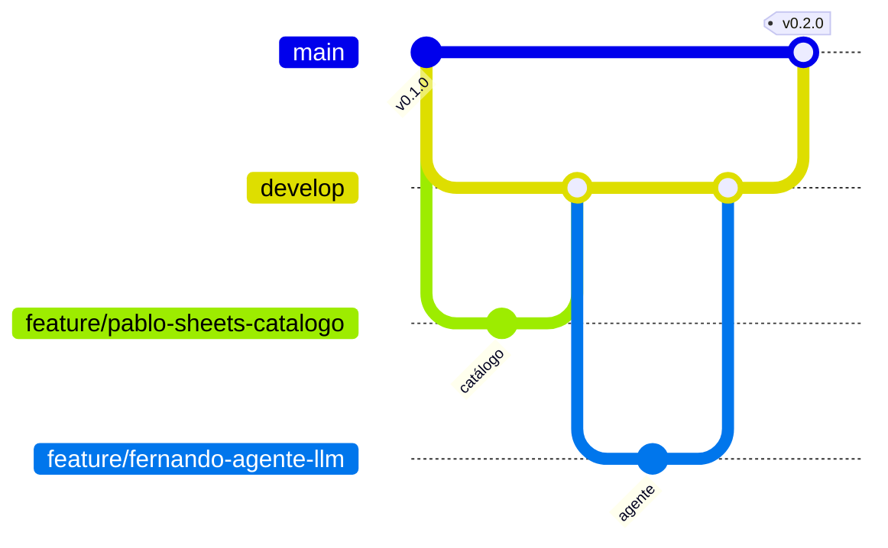

# 🤝 Cómo trabajamos con Git

Equipo: **Pablo, Fernando y Federico**.

## Ramas

| Rama | Para qué | Quién escribe |
|---|---|---|
| `main` | Versión estable, solo releases | Nadie directo: solo PR desde `develop` |
| `develop` | Integración del trabajo de todos | Nadie directo: solo PR desde ramas de tarea |
| `feature/<nombre>-<tarea>` | Una funcionalidad nueva | Una persona |
| `fix/<nombre>-<tarea>` | Corrección de un error | Una persona |

Ejemplos: `feature/pablo-sheets-catalogo`, `feature/fernando-agente-llm`, `fix/federico-webhook-duplicados`.



## Día a día

1. Partir siempre de `develop` actualizado:

   ```bash
   git switch develop
   git pull
   git switch -c feature/<nombre>-<tarea>
   ```

2. Commits chicos y descriptivos (`Agrega búsqueda de productos por SKU`).
3. Antes de abrir el PR, traer lo último de `develop` y correr los tests:

   ```bash
   git fetch origin
   git merge origin/develop
   pytest
   ```

4. Subir la rama y abrir un **Pull Request hacia `develop`**:

   ```bash
   git push -u origin feature/<nombre>-<tarea>
   gh pr create --base develop
   ```

5. **Otro integrante revisa y aprueba** el PR. Después se mergea y se borra la rama.

> Ramas cortas: una tarea = una rama = un PR. Si una tarea dura más de unos días,
> conviene partirla en PRs más chicos para no acumular conflictos.

## Releases (`develop` → `main`)

Cuando `develop` tiene un conjunto de cambios estable (por ejemplo, al cerrar una etapa del [roadmap](docs/roadmap.md)):

1. Abrir un PR de `develop` hacia `main` titulado `Release vX.Y.Z` con la lista de cambios.
2. Verificar que los tests pasen y que la app levante.
3. Mergear (con merge commit, no squash, para que `main` y `develop` no diverjan) y crear la versión:

   ```bash
   gh release create vX.Y.Z --target main --generate-notes
   ```

Versionado: `0.Y.0` por cada etapa del roadmap completada, `0.Y.Z` para correcciones.

## Reglas

- Nunca hacer push directo a `main` ni a `develop`.
- Nunca subir `.env` ni credenciales (ver `.gitignore`).
- Todo PR con código nuevo incluye o actualiza tests.
