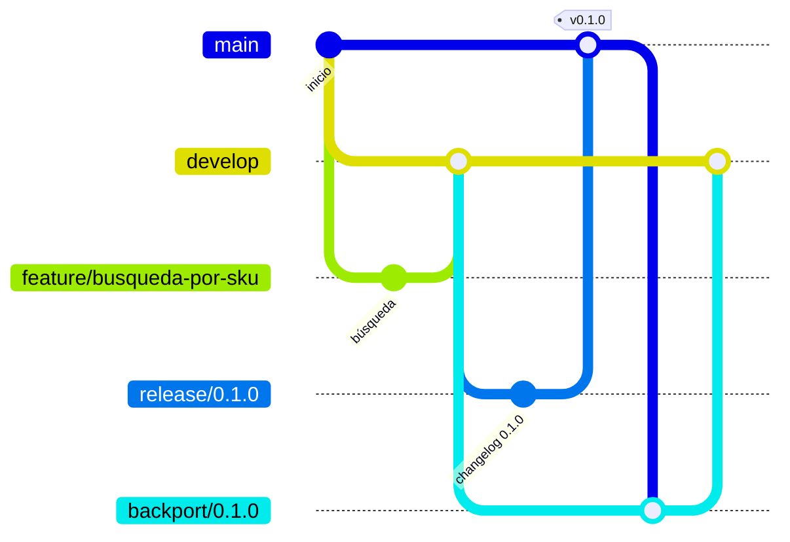

# 🤝 Cómo trabajamos

Equipo: **Pablo, Fernando y Federico**.

Todo lo que sigue lo controla el CI cuando puede (ver [Reglas que revisa el CI](#reglas-que-revisa-el-ci)).
Si una regla cambia, se cambia acá y en el script o workflow que la controla.

## Ramas

| Rama | Sale de | Se mergea a | Para qué |
|---|---|---|---|
| `main` | — | — | Producción. Solo recibe `release/*` y `hotfix/*`. |
| `develop` | — | — | Integración: lo terminado que espera la próxima release. |
| `feature/<nombre>` | `develop` | `develop` | Algo nuevo. |
| `fix/<nombre>` | `develop` | `develop` | Error **no urgente**. |
| `release/X.Y.Z` | `develop` | `main` | Cerrar el changelog y corregir errores de último momento. Sin funcionalidades nuevas. |
| `hotfix/X.Y.Z` | `main` | `main` | Error **urgente** en producción, con un test que lo reproduzca. |
| `backport/X.Y.Z` | `develop` | `develop` | Traer `main` a `develop` después de cada release o hotfix. |

- Nombres en minúsculas, con guiones y sin tildes: `feature/busqueda-por-sku`, `fix/webhook-duplicados`.
  Si querés que se vea de quién es, sumá tu nombre: `feature/federico-datos-ejemplo`.
- Nada se commitea directo a `main` ni a `develop`: todo entra por PR, y la rama se borra después del merge.
- Una tarea = una rama = una PR. Si una tarea dura más de unos días, conviene partirla en PRs más chicas.



## Spec primero (SDD)

Trabajamos con spec-driven development: el comportamiento se define en [`docs/spec/`](docs/spec/README.md) antes de
programarlo. Si una tarea agrega o cambia comportamiento:

- Primero se actualiza la spec (requisitos `RF`/`RNF` y criterios de aceptación `CA`). Para una etapa entera,
  una PR solo de spec a partir de la [plantilla](docs/spec/_plantilla.md); para algo chico, el primer commit de la PR.
- Después, los tests de cada `CA`, que lo citan en el docstring (`"""CA-15: …"""`).
- Recién después, el código. Si al implementar aparece algo que la spec no previó, se actualiza la spec en la misma PR.

El detalle está en la [spec del MVP](docs/spec/README.md#1-cómo-trabajamos-con-sdd).

## Día a día

1. Partir siempre de `develop` actualizado:

   ```bash
   git switch develop
   git pull
   git switch -c feature/<nombre>
   ```

2. Commits chicos. Títulos pensados para quien lee el historial, no para quien mira el código:
   `Búsqueda de productos por SKU en el catálogo`, no `agrega función`.
3. Antes de pushear, traer lo último de `develop`, correr lint y tests y sumar la [entrada al changelog](#changelog):

   ```bash
   git fetch origin
   git merge origin/develop
   ruff check .
   python -m pytest -q          # o: docker compose run --rm api pytest
   ```

4. Subir la rama y abrir la PR hacia `develop` (la plantilla trae el checklist):

   ```bash
   git push -u origin feature/<nombre>
   gh pr create --base develop
   ```

5. Con los checks en verde y la revisión de otro integrante, se mergea con **Squash and merge**:
   un commit por cambio en `develop`, con el título de la PR. Después se borra la rama.

## Cómo se mergea cada PR

| PR | Botón | Por qué |
|---|---|---|
| `feature/*`, `fix/*` → `develop` | **Squash and merge** | Un commit por cambio, con el título de la PR. |
| `release/*`, `hotfix/*` → `main` | **Create a merge commit** | Si se squashea, `main` deja de ser ancestro de `develop` y el siguiente backport da conflicto en `CHANGELOG.md`. |
| `backport/*` → `develop` | **Create a merge commit** | Mismo motivo: el merge commit es lo que reconcilia las dos ramas. |

## Reglas que revisa el CI

Cada PR a `main` o `develop` corre estos checks; los cinco son obligatorios para mergear:

| Check | Workflow | Qué revisa |
|---|---|---|
| `Lint (ruff)` | [`tests.yml`](.github/workflows/tests.yml) | `ruff check .` con la versión fijada en `requirements-dev.txt` y la config de `pyproject.toml`. |
| `Tests (pytest)` | [`tests.yml`](.github/workflows/tests.yml) | Los tests, con la misma versión de Python que el `Dockerfile` (y falla si no coinciden). |
| `Build de la imagen Docker` | [`tests.yml`](.github/workflows/tests.yml) | Que la imagen de producción se construya y que la API arranque y responda `/health`. |
| `Escaneo de secretos` | [`secretos.yml`](.github/workflows/secretos.yml) | gitleaks sobre **todo el historial**, no solo sobre el último commit. |
| `Nombre de rama y changelog` | [`reglas-pr.yml`](.github/workflows/reglas-pr.yml) | El script [`verificar_reglas_pr.sh`](.github/scripts/verificar_reglas_pr.sh). |

`Nombre de rama y changelog` rechaza la PR si:

- va a `develop` y la rama no es `feature/<nombre>`, `fix/<nombre>` (minúsculas, números y guiones) ni `backport/X.Y.Z`;
- va a `main` y la rama no es `release/X.Y.Z` ni `hotfix/X.Y.Z`, o si `CHANGELOG.md` no tiene la sección `## [X.Y.Z]`;
- no modifica `CHANGELOG.md` (salvo los backports).

Se puede correr en local antes de abrir la PR (compara tus commits contra `origin/<base>`):

```bash
HEAD_REF=feature/x BASE_REF=develop bash .github/scripts/verificar_reglas_pr.sh
```

## Changelog

[`CHANGELOG.md`](CHANGELOG.md) sigue [Keep a Changelog](https://keepachangelog.com/es-ES/1.1.0/), en español,
con una sección `## [Sin publicar]` arriba de todo.

- Cada PR a `develop` agrega **una línea** dentro de `[Sin publicar]`. Sin entrada no se mergea.
  Los backports no llevan entrada propia: lo que traen ya está anotado.
- Categorías: `Agregado`, `Cambiado`, `Obsoleto`, `Eliminado`, `Corregido`, `Seguridad`.
- Se escribe para quien usa el proyecto: `Búsqueda de productos por nombre aproximado.`, no `fix matching`.
- Si el cambio altera el comportamiento en producción, se dice explícitamente, junto con lo que haya que
  migrar al desplegar (una variable nueva en `.env`, un archivo que mover en `data/`, etc.).

## Versiones

[SemVer](https://semver.org/lang/es/) con tags `vX.Y.Z` en `main`:

- **MAJOR**: cambio incompatible que obliga a migrar (formato de la base o de la config).
- **MINOR**: funcionalidad nueva compatible.
- **PATCH**: solo correcciones.

Mientras estemos en `0.x`, un MINOR puede cambiar comportamiento (avisándolo en el changelog).
Como guía, cerrar una etapa del [roadmap](docs/roadmap.md) es un MINOR.

## Release

1. Desde `develop` actualizado: `git switch -c release/X.Y.Z`.
2. En `CHANGELOG.md`: `## [Sin publicar]` pasa a `## [X.Y.Z] - AAAA-MM-DD`, con un párrafo de resumen arriba
   de las categorías, y se deja una `## [Sin publicar]` vacía encima. Actualizar los links del final.
3. En la rama solo entran correcciones de último momento, nunca funcionalidades nuevas.
4. PR `release/X.Y.Z` → `main`, titulada `Versión X.Y.Z`. Con los checks en verde: **Create a merge commit**.
5. Tag anotado sobre `main` y push del tag:

   ```bash
   git switch main && git pull
   git tag -a vX.Y.Z -m "Versión X.Y.Z"
   git push origin vX.Y.Z
   ```

   El tag dispara [`imagen-release.yml`](.github/workflows/imagen-release.yml): verifica que el tag esté en
   `main`, corre los tests y publica `ghcr.io/fernandomrestelli/norma-agentic-ai:X.Y.Z` (y `latest`)
   para amd64 y arm64.
6. [Backport](#backport).

## Hotfix

Solo para un error **urgente** en producción; si puede esperar a la próxima release, es un `fix/*` a `develop`.

1. Desde `main`: `git switch main && git pull && git switch -c hotfix/X.Y.Z` (PATCH siguiente).
2. Primero un test que reproduzca el error (tiene que fallar), después el arreglo.
3. En `CHANGELOG.md`, la sección `## [X.Y.Z] - AAAA-MM-DD` con la entrada en `Corregido`.
4. PR `hotfix/X.Y.Z` → `main`, **Create a merge commit**, tag y push del tag como en la release.
5. [Backport](#backport).

## Backport

Después de cada release o hotfix, `main` vuelve a `develop`:

```bash
git switch develop && git pull
git switch -c backport/X.Y.Z
git merge --no-ff origin/main
git push -u origin backport/X.Y.Z
gh pr create --base develop --title "Backport de la versión X.Y.Z"
```

Si hay conflicto en `CHANGELOG.md`, queda la versión de `main` para `[X.Y.Z]` y lo de `develop` en `[Sin publicar]`.
Se mergea con **Create a merge commit**.

## Producción

Producción corre la **imagen de una release**, nunca la carpeta de trabajo. Vive en una carpeta propia del servidor:

```text
~/norma-prod/
├── docker-compose.prod.yml   # el del tag que corre
├── .env                      # secretos de producción (a partir de .env.example)
├── credentials/              # cuenta de servicio de Google
└── data/                     # base SQLite; el contenedor escribe con el UID 1000
```

Primera vez: `mkdir -p ~/norma-prod/data ~/norma-prod/credentials` y, si tu usuario no es el UID 1000,
`sudo chown 1000 ~/norma-prod/data`. Si el paquete de GHCR es privado, `docker login ghcr.io` con un token
que tenga `read:packages`.

Desplegar la versión X.Y.Z:

```bash
cd ~/norma-prod
git -C ~/Proyectos/norma-agentic-ai fetch --tags
git -C ~/Proyectos/norma-agentic-ai show vX.Y.Z:docker-compose.prod.yml > docker-compose.prod.yml
VERSION=X.Y.Z docker compose -f docker-compose.prod.yml pull
VERSION=X.Y.Z docker compose -f docker-compose.prod.yml up -d
curl -s http://localhost:8000/openapi.json | grep -o '"version":"[^"]*"'   # confirma la versión que corre
```

Volver atrás es lo mismo con la versión anterior. Antes de desplegar, leer en el changelog si la versión pide migrar algo.

Como el código y la configuración van dentro de la imagen, **cambiar un parámetro es una release**.
Solo los secretos (`.env`) y los datos (`data/`) quedan fuera.

### Lo que no puede correr en desarrollo y en producción al mismo tiempo

- **El mismo puerto**: los dos compose publican el `8000`. En la misma máquina, frenar uno antes de levantar el otro.
- **El mismo Google Sheet de pedidos** (`ORDERS_SHEET_ID`): desarrollo registraría órdenes de prueba en la planilla
  que usa el equipo. Desarrollo usa una copia propia.
- **El mismo número y webhook de WhatsApp** (`WHATSAPP_PHONE_NUMBER_ID`, URL registrada en Meta): Meta manda cada
  mensaje a un solo webhook y desarrollo podría responderle a clientes reales. Desarrollo usa un número de prueba.
- **La misma carpeta `data/`**: SQLite no está pensado para dos procesos escribiendo a la vez.

## Protección de ramas

Se configura en GitHub (*Settings → Rules → Rulesets*), igual para `main` y `develop`:

- Pull request obligatoria antes de mergear (con 1 aprobación, que es como trabajamos).
- Checks obligatorios: `Lint (ruff)`, `Tests (pytest)`, `Build de la imagen Docker`, `Escaneo de secretos`
  y `Nombre de rama y changelog`.
- Sin bypass, ni siquiera para administradores.
- Sin force push ni borrado de la rama.
- En *Settings → General*: habilitar **Squash merging** y **Merge commits**, y **Automatically delete head branches**.

## Reglas generales

- Nunca subir `.env`, credenciales ni datos de clientes (ver `.gitignore`); el escaneo de secretos lo revisa igual.
- Todo `fix/*` o `hotfix/*` entra con un test que reproduce el error.
- Los tests no usan red ni Docker (ver [`tests/conftest.py`](tests/conftest.py)).
