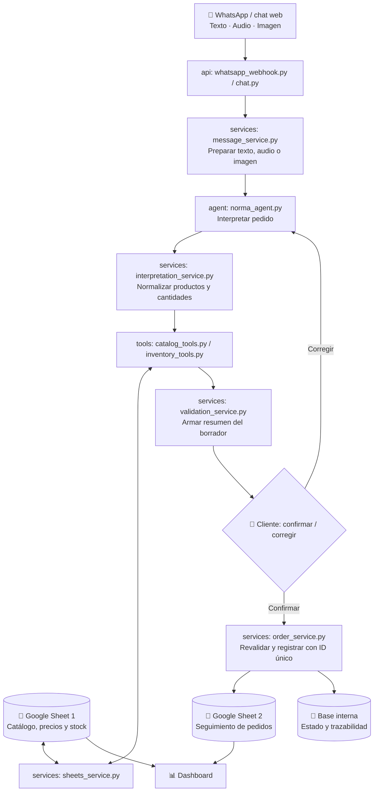

# 🏗️ Norma Agentic AI | Arquitectura v1

> **Una app, un agente y dos Google Sheets.**  
> Documento simple para entender cómo se conectan las partes del MVP y dónde vive cada archivo.  
> El detalle del comportamiento está en la [spec del MVP](spec/README.md); si este resumen la contradice, manda la spec.

## 🎯 Qué estamos construyendo

Un cliente envía un pedido por **texto, audio o imagen** mediante WhatsApp o chat web. Un agente interpreta el contenido, consulta catálogo, precio y disponibilidad, y prepara un **borrador**. El cliente recibe la propuesta en el chat y responde escribiendo si la acepta o qué quiere cambiar. Solo si la acepta, la aplicación registra la orden y la incorpora al seguimiento. Norma ve el estado de pedidos y stock en un dashboard.

## 🔄 El circuito completo



**El punto de control principal:** `Interpretado` **no equivale** a `Confirmado`. No se registra nada operativo antes del OK del cliente.

## 🧩 Las piezas y para qué sirven

| Parte | Archivos principales | Responsabilidad |
|---|---|---|
| **Entradas** | `internal/api/chat.py`, `whatsapp_webhook.py`, `telegram_webhook.py`; `internal/telegram_polling.py` | Recibir mensajes del chat, WhatsApp o Telegram (canal de prueba de la beta) |
| **Gestión de órdenes** | `internal/api/orders.py` | Consultar y cancelar órdenes con token de operador |
| **Orquestador** | `internal/services/conversation_service.py` | Abrir y cerrar la conversación y pasar cada turno al agente, de a uno por cliente |
| **Preprocesamiento** | `internal/services/message_service.py` | Preparar texto, transcribir audio y analizar imágenes |
| **Agente** | `internal/agent/norma_agent.py`, `graph.py`, `system_prompt.md`, `llm.py` | Entender la intención y elegir herramientas |
| **Skills y BR** | `internal/skills/`, `internal/services/skill_service.py` | Recetas y reglas de negocio que el agente lee, con sus permisos |
| **Tools** | `internal/tools/catalog_tools.py`, `inventory_tools.py`, `order_tools.py`, `reply_tools.py`, `skill_tools.py` | Acciones controladas disponibles para el agente |
| **Interpretación** | `internal/services/interpretation_service.py` | Convertir entradas diversas a un borrador común |
| **Contrato de datos** | `internal/schemas/order_schema.py`, `catalog_schema.py` | Definir campos y validaciones del pedido, productos y stock |
| **Confirmación** | `internal/services/validation_service.py` | Presentar resumen y manejar confirmación/corrección |
| **Negocio** | `internal/services/order_service.py`, `inventory_service.py` | Registrar el pedido confirmado una sola vez y descontar del stock las órdenes activas |
| **Google Sheets** | `internal/services/sheets_service.py` | Consultar la planilla de catálogo y escribir en la de seguimiento |
| **Persistencia** | `internal/database/connection.py`, `models.py` | Guardar borradores, IDs, estados e historial necesario |
| **Interfaz** | `frontend/src/Chat/`, `frontend/src/Dashboard/` | Confirmación visual del cliente y panel operativo |
| **Pruebas** | `tests/` | Comprobar interpretación, confirmación y registro |
| **Documentación** | `docs/` | Decisiones, diagramas y plan de trabajo |

## 📗 Dos planillas, dos responsabilidades

| Google Sheet 1: entrada | Google Sheet 2: salida |
|---|---|
| **Catálogo y stock**, solo fuente de consulta durante el MVP | **Órdenes confirmadas**, para seguimiento por el equipo |
| SKU, producto, marca, presentación, precio, stock | ID, fecha/hora, cliente, productos y cantidades, observaciones, estado |
| Se reemplazará por la API del sistema de gestión real | Puede seguir como tablero o reemplazarse al integrar el sistema real |

> Recomendación: una fila por **pedido** en la planilla operativa; el detalle por ítem se almacena estructurado en la base interna para permitir análisis por producto.

## ✅ Regla de confirmación

1. El agente crea un **borrador**, no una orden final.
2. Valida los productos contra el catálogo: **nunca inventa un SKU**.
3. Si el producto, cantidad o presentación no está claro, pregunta.
4. Le propone el pedido al cliente, y el backend guarda esa propuesta validada.
5. Si el cliente cambia algo, propone de nuevo.
6. Si el cliente acepta («dale»), el backend **vuelve a consultar el stock**, registra una única orden con ID y la sincroniza con Google Sheets. Solo puede registrar lo propuesto.

**Confirmación:** en todos los canales el cliente responde escribiendo, sin botones. Si responde exactamente `OK` o `CONFIRMAR` y hay una propuesta vigente, el backend la registra sin llamar al LLM. Cualquier otra respuesta la interpreta el agente.

## 📊 De dónde se alimenta el dashboard

El dashboard consume **APIs del backend**, no claves privadas de Google Sheets ni consultas directas desde el navegador. Para el MVP puede mostrar:

- Pedidos totales y pedidos por estado (`Recibido`, `Preparado`, `Retirado`, `Cancelado`).
- Últimos pedidos y hora de creación.
- Stock disponible y productos con poco stock (según Sheet 1).

Los indicadores de venta o margen solo se mostrarán cuando los datos requeridos estén disponibles y sean confiables.

## 🗃️ Estructura de código (MVP)

```text
norma-agentic-ai/
├── internal/
│   ├── main.py
│   ├── config.py
│   ├── telegram_polling.py   # bot de Telegram por polling (beta)
│   ├── verificar_claves.py
│   ├── evaluar_agente.py     # corre los casos de mensajes.json con el LLM real
│   ├── api/
│   │   ├── chat.py
│   │   ├── orders.py
│   │   ├── telegram_webhook.py
│   │   └── whatsapp_webhook.py
│   ├── agent/
│   │   ├── norma_agent.py
│   │   ├── graph.py
│   │   ├── state.py
│   │   ├── context.py
│   │   ├── tool_registry.py
│   │   ├── llm.py
│   │   ├── observabilidad.py
│   │   └── system_prompt.md
│   ├── skills/               # una carpeta por skill: skill.md y sus BR
│   ├── tools/
│   │   ├── catalog_tools.py
│   │   ├── inventory_tools.py
│   │   ├── order_tools.py
│   │   ├── reply_tools.py
│   │   └── skill_tools.py
│   ├── services/
│   │   ├── conversation_service.py
│   │   ├── message_service.py
│   │   ├── interpretation_service.py
│   │   ├── validation_service.py
│   │   ├── order_service.py
│   │   ├── inventory_service.py
│   │   ├── palabras_clave.py
│   │   ├── skill_service.py
│   │   ├── sheets_service.py
│   │   └── telegram_service.py
│   ├── schemas/
│   │   ├── agent_schema.py
│   │   ├── catalog_schema.py
│   │   ├── conversation_schema.py
│   │   └── order_schema.py
│   └── database/
│       ├── connection.py
│       └── models.py
├── frontend/
│   └── src/
│       ├── Chat/
│       └── Dashboard/
├── tests/                    # conftest.py, datos_sinteticos.py y un test_*.py por área, sin red ni Docker
├── data/                     # base SQLite local, ignorada por git
├── data_example/            # catálogo, pedidos y mensajes inventados
├── docs/
│   ├── spec/                 # spec del MVP, del agente y del canal Telegram (fuente de verdad)
│   ├── architecture.md
│   └── roadmap.md
├── .github/
│   ├── workflows/            # tests, secretos, reglas-pr, imagen-release
│   ├── scripts/verificar_reglas_pr.sh
│   └── pull_request_template.md
├── .dockerignore
├── .env.example
├── .gitignore
├── CHANGELOG.md
├── CONTRIBUTING.md
├── MEJORAS.md
├── Dockerfile
├── docker-compose.yml
├── docker-compose.prod.yml
├── README.md
├── pyproject.toml
├── pytest.ini
├── requirements.txt
└── requirements-dev.txt
```

## 🔐 Reglas que protegen el sistema

- Las credenciales se configuran en `.env` o mediante secretos del servidor: **nunca en GitHub**.
- El LLM interpreta si el cliente aceptó, pero solo puede registrar lo que el backend validó y guardó como propuesta.
- Cada confirmación usa un identificador único para evitar órdenes duplicadas en reintentos.
- El stock de una planilla puede quedar desactualizado: durante el MVP se revalida al confirmar, pero Google Sheets **no garantiza reserva transaccional**; para mitigarlo, la base interna descuenta las órdenes activas del stock disponible (`inventory_service`).
- Acceso al dashboard y modificaciones de pedidos sujetos a autenticación/permisos.
- Mensajes y archivos de clientes se guardan solo cuando haga falta y con acceso restringido.

## ⏭️ La siguiente versión (v2)

**Fuera del MVP:** handoff a Cristian y notificaciones al equipo, integración con la API del software real, creación de pedidos en ese software y sugerencias de reposición a proveedores. Diseñamos los servicios para poder cambiar la fuente de datos sin cambiar el agente ni el frontend por completo.

---

### 💡 Principio rector
**El LLM interpreta; el backend valida y registra; el cliente confirma; el equipo controla la operación.**
