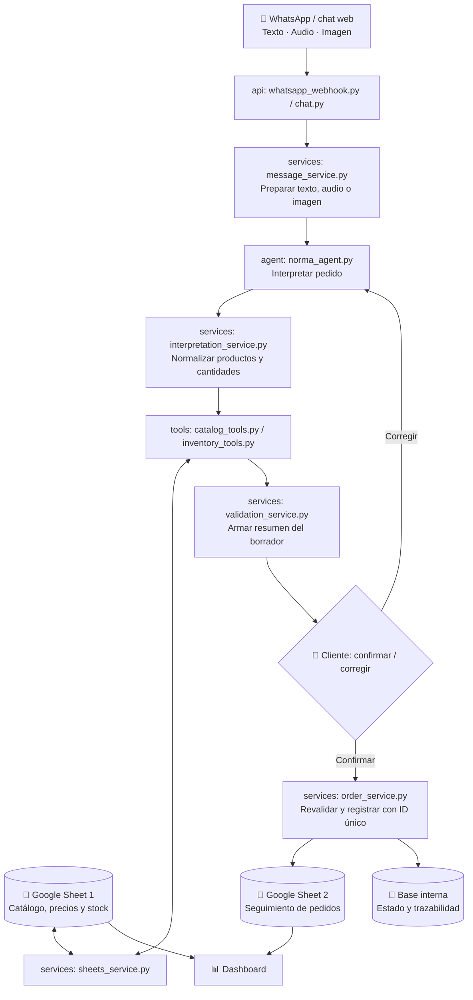

# 🏗️ Norma Agentic AI | Arquitectura v1

> **Una app, un agente y dos Google Sheets.**  
> Documento simple para entender cómo se conectan las partes del MVP y dónde vive cada archivo.

## 🎯 Qué estamos construyendo

Un cliente envía un pedido por **texto, audio o imagen** mediante WhatsApp o chat web. Un agente interpreta el contenido, consulta catálogo, precio y disponibilidad, y prepara un **borrador**. El cliente recibe una tarjeta con **✅ Confirmar** y **✏️ Corregir**. Solo tras confirmar, la aplicación registra la orden y la incorpora al seguimiento. Norma ve el estado de pedidos y stock en un dashboard.

## 🔄 El circuito completo



**El punto de control principal:** `Interpretado` **no equivale** a `Confirmado`. No se registra nada operativo antes del OK del cliente.

## 🧩 Las piezas y para qué sirven

| Parte | Archivos principales | Responsabilidad |
|---|---|---|
| **Entradas** | `backend/api/chat.py`, `whatsapp_webhook.py` | Recibir mensajes del chat o WhatsApp |
| **Preprocesamiento** | `backend/services/message_service.py` | Preparar texto, transcribir audio y analizar imágenes |
| **Agente** | `backend/agent/norma_agent.py`, `instructions.md`, `llm_client.py` | Entender la intención y elegir herramientas |
| **Tools** | `backend/tools/catalog_tools.py`, `inventory_tools.py`, `order_tools.py` | Acciones controladas disponibles para el agente |
| **Interpretación** | `backend/services/interpretation_service.py` | Convertir entradas diversas a un borrador común |
| **Contrato de datos** | `backend/schemas/order_schema.py` | Definir campos y validaciones del pedido |
| **Confirmación** | `backend/services/validation_service.py` | Presentar resumen y manejar confirmación/corrección |
| **Negocio** | `backend/services/order_service.py` | Registrar el pedido confirmado una sola vez |
| **Google Sheets** | `backend/services/sheets_service.py` | Consultar la planilla de catálogo y escribir en la de seguimiento |
| **Persistencia** | `backend/database/connection.py`, `models.py` | Guardar borradores, IDs, estados e historial necesario |
| **Interfaz** | `frontend/src/Chat/`, `frontend/src/Dashboard/` | Confirmación visual del cliente y panel operativo |
| **Pruebas** | `tests/` | Comprobar interpretación, confirmación y registro |
| **Documentación** | `docs/` | Decisiones, diagramas y plan de trabajo |

## 📗 Dos planillas, dos responsabilidades

| Google Sheet 1: entrada | Google Sheet 2: salida |
|---|---|
| **Catálogo y stock**, solo fuente de consulta durante el MVP | **Órdenes confirmadas**, para seguimiento por el equipo |
| SKU, producto, marca, presentación, precio, stock | ID, fecha/hora, cliente, productos y cantidades, observaciones, estado |
| Se reemplazará por la API del sistema de gestión real | Puede seguir como tablero o reemplazarse al integrar el sistema real |

> Recomendación: una fila por **pedido** en la planilla operativa; el detalle por ítem se almacena estructurado en la base interna para permitir análisis por producto.

## ✅ Regla de confirmación

1. El agente crea un **borrador**, no una orden final.
2. Valida los productos contra el catálogo: **nunca inventa un SKU**.
3. Si el producto, cantidad o presentación no está claro, pregunta.
4. Muestra el resumen con **Confirmar** y **Corregir**.
5. Si se corrige, vuelve a mostrar un nuevo resumen.
6. Si se confirma, el backend **vuelve a consultar el stock**, registra una única orden con ID y la sincroniza con Google Sheets.

**WhatsApp:** el equivalente a la tarjeta puede ser un mensaje interactivo con botones cuando el canal y tipo de mensaje lo permitan; si no, se usa la respuesta `OK` / `CORREGIR`. El backend debe vincular la acción al borrador correcto.

## 📊 De dónde se alimenta el dashboard

El dashboard consume **APIs del backend**, no claves privadas de Google Sheets ni consultas directas desde el navegador. Para el MVP puede mostrar:

- Pedidos totales y pedidos por estado (`Recibido`, `Preparado`, `Retirado`, `Cancelado`).
- Últimos pedidos y hora de creación.
- Stock disponible y productos con poco stock (según Sheet 1).

Los indicadores de venta o margen solo se mostrarán cuando los datos requeridos estén disponibles y sean confiables.

## 🗃️ Estructura de código (MVP)

```text
norma-agentic-ai/
├── backend/
│   ├── main.py
│   ├── config.py
│   ├── api/
│   │   ├── chat.py
│   │   └── whatsapp_webhook.py
│   ├── agent/
│   │   ├── norma_agent.py
│   │   ├── llm_client.py
│   │   └── instructions.md
│   ├── tools/
│   │   ├── catalog_tools.py
│   │   ├── inventory_tools.py
│   │   └── order_tools.py
│   ├── services/
│   │   ├── message_service.py
│   │   ├── interpretation_service.py
│   │   ├── validation_service.py
│   │   ├── order_service.py
│   │   └── sheets_service.py
│   ├── schemas/
│   │   └── order_schema.py
│   └── database/
│       ├── connection.py
│       └── models.py
├── frontend/
│   └── src/
│       ├── Chat/
│       └── Dashboard/
├── tests/
│   ├── test_agent.py
│   ├── test_interpretation.py
│   ├── test_api.py
│   └── test_orders.py
├── docs/
│   ├── architecture.md
│   └── roadmap.md
├── .github/
│   ├── workflows/tests.yml
│   └── pull_request_template.md
├── .env.example
├── .gitignore
├── CONTRIBUTING.md
├── README.md
├── pytest.ini
└── requirements.txt
```

## 🔐 Reglas que protegen el sistema

- Las credenciales se configuran en `.env` o mediante secretos del servidor: **nunca en GitHub**.
- El backend verifica la confirmación; el LLM **no** decide por sí solo cuándo guardar una orden definitiva.
- Cada confirmación usa un identificador único para evitar órdenes duplicadas en reintentos.
- El stock de una planilla puede quedar desactualizado: durante el MVP se revalida al confirmar, pero Google Sheets **no garantiza reserva transaccional**.
- Acceso al dashboard y modificaciones de pedidos sujetos a autenticación/permisos.
- Mensajes y archivos de clientes se guardan solo cuando haga falta y con acceso restringido.

## ⏭️ La siguiente versión (v2)

**Fuera del MVP:** handoff a Cristian y notificaciones al equipo, integración con la API del software real, creación de pedidos en ese software y sugerencias de reposición a proveedores. Diseñamos los servicios para poder cambiar la fuente de datos sin cambiar el agente ni el frontend por completo.

---

### 💡 Principio rector
**El LLM interpreta; el backend valida y registra; el cliente confirma; el equipo controla la operación.**
