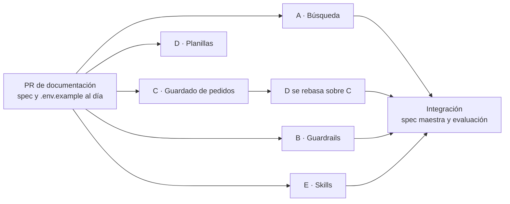

# 🛠️ Plan de mejora del asistente

> **Qué está flojo hoy en el asistente, en qué frentes se arregla y cómo se reparte el trabajo.**
> Diagnóstico hecho sobre el código de la 0.1.1 (2026-11-10). Cada frente es una rama, una spec propia y una PR a
> `develop`. Cuando un frente se mergea, se tacha acá y su estado pasa a [`MEJORAS.md`](../MEJORAS.md).

## 1. Diagnóstico

Lo que sigue se verificó leyendo el código y probando la búsqueda contra el catálogo real (1.090 productos).

### 1.1 Búsqueda: un error de tipeo o una abreviatura deja al cliente sin producto

| Lo que escribe el cliente | Qué pasa hoy | Por qué |
|---|---|---|
| «sh keratina x900» | No encuentra el shampoo de keratina de 900 ml: trae bidones y otras medidas | `sh` no se expande a `shampoo`, y `x900` queda como una sola palabra con número, que exige coincidencia exacta |
| «champu fidelite» | No trae nada | No hay sinónimos ni equivalencia por sonido (`champú` = `shampoo`) |
| «mascara argan 1k» | Trae 4 máscaras con el mismo puntaje, sin distinguir medida | El catálogo escribe `1 KG`, `1K` y `1000ml` según el producto; las unidades no se normalizan |
| «tintura koleston 7.1» | No trae nada, sin ninguna pista | Cuando nada supera el umbral, la tool devuelve una lista vacía: el agente no sabe si es un error de tipeo o si no existe |

- La búsqueda está en [`internal/tools/catalog_tools.py`](../internal/tools/catalog_tools.py): compara palabra por
  palabra con `difflib` y un umbral fijo. No conoce abreviaturas, sinónimos, unidades ni tonos de coloración.
- En el catálogo real la columna `presentacion` está vacía: la medida viene dentro del nombre (`X 900 ML`, `X 1K`,
  `370CC`). La búsqueda no la separa.
- No existe el «¿quisiste decir…?»: el agente pasa directo a «no está en el catálogo» (BR-04).
- Cada búsqueda relee el CSV entero y consulta todas las órdenes: no hay caché (RNF-13 no está implementado).

### 1.2 Guardrails: los límites están solo en el prompt

- Los límites del asistente son texto en [`system_prompt.md`](../internal/agent/system_prompt.md). El código no
  verifica nada de lo que el LLM le escribe al cliente: `respond_to_customer` solo controla que el mensaje no esté
  vacío y no pase de 600 caracteres.
- Si el LLM responde con texto suelto, sin tool terminal, ese texto **se le manda tal cual al cliente**
  ([`graph.py`](../internal/agent/graph.py), `llamar_modelo`). Es la vía más directa para saltear todas las reglas.
- Nada impide que el mensaje revele cantidades de stock, mencione SKU, diga «pedido hecho» sin orden, invente un
  precio o prometa descuentos, envíos o plazos.
- No hay controles de entrada: un mensaje de cualquier largo llega al LLM, no hay tope de mensajes por cliente y el
  nombre del perfil de Telegram entra al system prompt sin limpiar (vía de inyección de instrucciones).
- Hay un solo caso adversarial en `mensajes.json` (`intenta-cambiar-las-reglas`).

### 1.3 Pedidos: se guarda lo mínimo y se pierde información

- La orden vive en una sola tabla (`orders`) con las líneas en una columna JSON. Falta la tabla `order_items`
  (RF-21) y no se guarda el total.
- La orden no guarda **quién** pidió: solo `customer_id` (por ejemplo `telegram:123`). El nombre del perfil se
  descarta, así que el equipo no puede saber de quién es el pedido.
- Las **observaciones** del cliente se pierden: `OrderDraft.notes` nunca se completa, y la línea que propone el
  agente lleva solo `sku` y `quantity`. El **tono** de una coloración tampoco se guarda (V-01).
- Las propuestas no están en la base: viven en el checkpoint del grafo. No queda registro de qué se propuso, qué
  versión se aceptó ni a qué conversación pertenece una orden.
- No hay historial de cambios de estado ni forma de pasar una orden a `Preparado` o `Retirado` por la API.
- No hay migraciones: `create_all` crea tablas nuevas pero no cambia las existentes. Cada `~/norma-prod` tiene su
  propia base, y hoy cambiar el modelo las rompe.
- La deduplicación de Telegram es en memoria: un reinicio la pierde.

### 1.4 Planillas: `sheets_service` todavía no habla con Google Sheets

- [`sheets_service.py`](../internal/services/sheets_service.py) lee el catálogo de un CSV y escribe los pedidos en
  otro CSV. `gspread` está en `requirements.txt` pero no se usa, y `CATALOG_SHEET_ID`, `ORDERS_SHEET_ID` y
  `GOOGLE_CREDENTIALS_FILE` se leen de la configuración sin efecto.
- El equipo no ve los pedidos salvo abriendo el CSV en la máquina donde corre el bot.
- `sync_pending_orders()` existe para reintentar los pedidos que no llegaron a la planilla, pero **nadie la llama**.
- En producción, la API y el bot son dos procesos que escriben el mismo CSV sin bloqueo.

### 1.5 Skills: instrucciones parchadas, respuestas robóticas

- El prompt y las skills crecieron por parches. La regla de no revelar stock está repetida en cinco lugares y la de
  «pedidos confirmados son definitivos» en cuatro. Hay listas de frases prohibidas («tené», «mostro», «mirarte»)
  que le muestran al modelo justo lo que no tiene que decir.
- No hay ejemplos de respuestas buenas por situación. Todas las propuestas cierran con la misma frase.
- `informar` responde «no tengo ese dato» a horarios, envíos y pagos: no hay una fuente con los datos del negocio.
- Nunca se pudo medir la calidad: las tres corridas de evaluación fallaron por cuota del free tier
  ([`MEJORAS.md`](../MEJORAS.md)). `mensajes.json` tiene 24 casos de un solo turno y evalúa el resultado, no cómo
  suena la respuesta.

## 2. Frentes de trabajo

Cinco frentes, uno por objetivo. Cada uno lo implementa una sesión de Claude con el modelo Opus 5.5, en su propio
worktree; el plan y la revisión de los PR los hace la sesión coordinadora con Fable 5.2.

| # | Frente | Rama | Spec propia | IDs reservados |
|---|---|---|---|---|
| A | Búsqueda tolerante a errores | `feature/busqueda-tolerante-a-errores` | `docs/spec/busqueda-tolerante.md` | RF-36 a RF-39, CA-59 a CA-68 |
| B | Guardrails en código | `feature/guardrails-del-agente` | `docs/spec/guardrails.md` | RF-40 a RF-44, CA-69 a CA-80 |
| C | Guardado de pedidos en la base | `feature/guardado-de-pedidos` | `docs/spec/guardado-de-pedidos.md` | RF-45 a RF-49, CA-81 a CA-92 |
| D | Google Sheets y Excel | `feature/planillas-google-sheets` | `docs/spec/planillas.md` | RF-50 a RF-54, CA-93 a CA-102 |
| E | Skills y respuestas más reales | `feature/skills-respuestas-reales` | `docs/spec/skills-y-respuestas.md` | RF-55 a RF-58, CA-103 a CA-112, BR-07 a BR-10 |

### A · Búsqueda tolerante a errores

**Objetivo:** que un pedido con errores de ortografía, abreviaturas o medidas escritas de otra forma encuentre el
producto, y que cuando la coincidencia no es segura el agente pregunte «¿quisiste decir…?» en vez de decir que no
existe.

- **Normalización** de la búsqueda y del catálogo con las mismas reglas: abreviaturas y sinónimos del rubro
  (`sh`, `champú`, `acond`, `enjuague`, `masc`, `mascarilla`, `oxi`, `vol`, `tinte`, `tintura`), unidades
  (`1k` = `1 kg` = `1000 g`; `1 l` = `1000 ml` = `1000 cc`; `x900` = `900`) y tonos de coloración (`821` = `8.21`,
  según V-01).
- **Coincidencia aproximada mejor**: tolerar letras cambiadas, faltantes o transpuestas y errores por sonido
  (`b/v`, `s/c/z`, `ll/y`, `h` muda, `k/qu`), sin aproximar números.
- **Medida fuera del nombre**: separar la medida del nombre del producto al indexar, para comparar medida con
  medida.
- **Sugerencias**: cuando nada supera el umbral, devolver los candidatos más cercanos marcados como aproximados y
  las palabras que se corrigieron.
- **Índice en memoria** del catálogo normalizado, para no recalcularlo en cada búsqueda.

**Contrato que deja para los otros frentes** (resultado de `search_products`):

```json
{
  "matches": [{"sku": "…", "name": "…", "score": 0.93, "aproximado": false, "hay_stock": true}],
  "sugerencias": [{"sku": "…", "name": "…", "score": 0.55, "aproximado": true, "hay_stock": true}],
  "corregido": {"champu": "shampoo"}
}
```

`matches` son coincidencias confiables. `sugerencias` solo viene cuando `matches` está vacío. `corregido` dice qué
palabras de la búsqueda se interpretaron como otra.

**Archivos:** `internal/tools/catalog_tools.py`, módulo nuevo `internal/services/busqueda_service.py`,
`internal/schemas/catalog_schema.py`, la función `_search_products` y la descripción de la tool en
`tool_registry.py` y `agent_schema.py`, tests nuevos en `tests/test_busqueda.py`. **No toca** skills ni prompt.

**Hecho cuando:** las cuatro búsquedas de §1.1 traen primero el producto correcto con datos sintéticos del mismo
estilo que el catálogo real, siguen pasando CA-29 y CA-45, y la búsqueda sobre 1.000 productos tarda menos de 50 ms.

### B · Guardrails en código

**Objetivo:** que lo que el asistente no puede decir ni hacer lo impida el backend, no solo el prompt.

- **Salida:** antes de mandar un mensaje al cliente, un validador revisa que no revele cantidades de stock (salvo
  el caso de BR-01), no mencione SKU, tools, skills ni BR, no afirme que el pedido está hecho ni dé un número de
  orden, no traiga precios que no salen del catálogo, no prometa descuentos, envíos, plazos ni formas de pago, y
  respete el formato del canal. Si falla, vuelve al LLM como error de tool para que reescriba; si se agotan los
  intentos, sale un mensaje fijo seguro.
- **Texto suelto:** la respuesta sin tool terminal pasa por el mismo validador en vez de ir directo al cliente.
- **Entrada:** tope de largo del mensaje, tope de mensajes por cliente por minuto, limpieza del nombre del perfil
  antes de que entre al prompt, y detección de intentos de cambiar las reglas, que se registran en el log y en la
  traza sin el texto.
- **Fuera de tema:** una respuesta fija para lo que no es un pedido cuando el validador rechaza el intento.
- **Casos adversariales** en `mensajes.json` y tests con el modelo falso.

**Archivos:** módulo nuevo `internal/agent/guardrails.py`, los puntos de enganche en `tool_registry.py`
(`_respond_to_customer`) y `graph.py` (texto suelto y entrada), `conversation_service.py` (topes de entrada),
`agent/context.py` (nombre del cliente), tests nuevos en `tests/test_guardrails.py`. **No toca** skills ni
`system_prompt.md`.

**Hecho cuando:** cada regla tiene un test que muestra el mensaje rechazado y el reintento, ningún texto llega al
cliente sin pasar por el validador, y los falsos positivos se miden contra las respuestas válidas de los tests
existentes (no puede rechazar ninguna).

### C · Guardado de pedidos en la base

**Objetivo:** que un pedido guardado diga quién pidió, qué pidió exactamente, con qué observaciones, cuánto suma y
qué le pasó después.

- **Modelo:** tabla `order_items` (RF-21), total de la orden, nombre del cliente, observaciones y, por línea, el
  tono o la variante cuando aplica.
- **Propuestas en la base:** tabla `drafts` con cada versión propuesta, su conversación y si terminó en orden.
- **Trazabilidad:** `orders.conversation_id` e historial de cambios de estado (`order_events`).
- **Estados por la API:** endpoint de operador para pasar una orden a `Preparado` o `Retirado`, con las
  transiciones de `can_transition`.
- **Observaciones:** que el agente pueda mandar una nota general y una por línea al proponer, y que lleguen a la
  orden.
- **Migraciones:** mecanismo simple e idempotente que actualiza una base existente al arrancar, con las líneas de
  las órdenes viejas copiadas a `order_items`.
- **Deduplicación persistida:** tabla `processed_messages` en lugar de la memoria (RF-31).

**Contrato que deja para D:** `Order.customer_name`, `Order.total` y `OrderItem.note`, y las columnas nuevas de
la fila de pedido en `sheets_service.format_order_row` y `ORDER_COLUMNS`.

**Archivos:** `internal/database/`, `internal/services/order_service.py`, `inventory_service.py`,
`internal/schemas/order_schema.py`, `agent_schema.py` (`ProposedItem`), `reply_tools.py`,
`interpretation_service.py`, `validation_service.py`, `api/orders.py`, `telegram_service.py` (deduplicación),
`format_order_row` y `ORDER_COLUMNS` de `sheets_service.py`, tests nuevos en `tests/test_guardado_pedidos.py`.

**Hecho cuando:** una base de la 0.1.1 con órdenes arranca con la versión nueva sin perder nada, una orden nueva
se puede reconstruir entera desde la base sin el checkpoint, y el changelog dice qué migrar al desplegar.

**Fuera:** el descuento de stock al despachar (issue #61) depende de definiciones del negocio que siguen abiertas.

### D · Google Sheets y Excel

**Objetivo:** que el catálogo se lea de la planilla del negocio y que el equipo vea los pedidos en una planilla,
sin perder ninguno cuando Google falla.

- **Catálogo desde Sheet 1** con `gspread` cuando hay `CATALOG_SHEET_ID` y credenciales; si no, el CSV de hoy.
- **Caché** del catálogo de 5 minutos, con la última copia buena por hasta 1 hora si Google no responde (RNF-13).
  La confirmación sigue leyendo fresco.
- **Pedidos en Sheet 2** con `ORDERS_SHEET_ID`: una fila por orden, sin duplicar en reintentos.
- **Reintento automático:** una tarea en segundo plano llama a `sync_pending_orders()` cada pocos minutos.
- **Excel:** exportación de las órdenes a `.xlsx` para el operador (`GET /orders/export`), con una hoja de órdenes
  y otra de líneas.
- **CSV local seguro:** bloqueo de archivo para que la API y el bot no escriban a la vez.
- **Verificación:** `python -m internal.verificar_claves` prueba el acceso a las dos planillas sin mostrar datos.

**Archivos:** `internal/services/sheets_service.py` (lectura del catálogo y `append_order`; **no** el formato de
la fila, que es de C), módulo nuevo `internal/services/google_sheets_client.py`, `internal/main.py` (tarea en
segundo plano), `internal/config.py`, `.env.example`, `verificar_claves.py`, `api/orders.py` (solo el endpoint de
exportación), tests nuevos en `tests/test_planillas.py` con un cliente falso de Google.

**Hecho cuando:** con un cliente falso, el catálogo sale de la planilla, una orden aparece una sola vez aunque el
primer intento falle, y sin planillas configuradas todo sigue funcionando con los CSV. La prueba contra las
planillas reales la hace una persona del equipo con sus credenciales.

### E · Skills y respuestas más reales

**Objetivo:** que el asistente suene como alguien del mostrador de la distribuidora y que cada skill tenga
instrucciones claras, sin repeticiones ni parches.

- **Reescritura** del system prompt y de las tres skills: cada regla en un solo lugar, en positivo y con su motivo.
- **Ejemplos** de respuestas buenas por situación (saludo, propuesta, aclaración, falta de stock, fuera de
  catálogo, corrección, rechazo, pedido largo), con variedad en los cierres.
- **BR nuevas:** BR-07 para coincidencias aproximadas («¿quisiste decir…?», usa el contrato del frente A), BR-08
  para observaciones del pedido (usa el contrato del frente C) y las que surjan al separar reglas hoy mezcladas.
- **Datos del negocio:** un archivo que `informar` pueda leer con horarios, zona de entrega, medios de pago y
  mínimo de compra. Lo que el negocio no confirmó queda como pendiente en
  [`validaciones_pendientes.md`](validaciones_pendientes.md), no inventado.
- **Evaluación de cómo suena:** casos de varios turnos en `mensajes.json`, chequeos automáticos de estilo sobre
  cada respuesta y una salida con las conversaciones completas para revisarlas a mano.

**Archivos:** `internal/skills/**`, `internal/agent/system_prompt.md`, `data_example/mensajes.json`,
`internal/evaluar_agente.py`, `internal/services/skill_service.py` si hace falta, tests en `tests/test_tools.py`
(CA-46) y nuevos en `tests/test_skills.py`.

**Hecho cuando:** ninguna regla está repetida, cada skill tiene ejemplos, los chequeos de estilo pasan con el
modelo falso y hay una corrida de evaluación documentada con el LLM real, aunque sea parcial por cuota.

## 3. Reglas comunes a todos los frentes

1. **Spec primero (SDD):** cada frente escribe su spec con la [plantilla](spec/_plantilla.md) y usa solo los IDs
   que tiene reservados. En la [spec maestra](spec/README.md) cambia únicamente el estado de requisitos que ya
   existen; las filas nuevas se suman al integrar.
2. **Archivos con dueño:** cada frente toca los archivos de su lista. Si necesita otro, lo anota en la PR.
3. **Tests sin red ni Docker**, con el modelo falso y datos sintéticos. Ningún dato real de `data/` entra al repo.
4. **Compatibilidad:** sin las variables nuevas configuradas, todo funciona como en la 0.1.1.
5. **PR a `develop`** con su línea en el changelog, `ruff check .` y `pytest` en verde.

## 4. Orden de integración



Los cinco frentes salen de la rama de documentación y avanzan en paralelo. Orden sugerido de merge: documentación,
A, C, D, B y E al final, porque E ajusta los textos contra el comportamiento ya integrado. Al integrar se suman las
filas nuevas a la spec maestra y se corre la evaluación completa.

## 5. Fuera de este plan

- **Stock al despachar** (issue #61): espera definiciones del negocio sobre Sheet 1 y Sheet 2.
- **Derivación a una persona, descarte y vencimiento** (RF-26 a RF-28): son de la etapa 04.
- **Audio e imagen** (RF-04, RF-05): esperan el modelo de visión (D-01).
- **Chat web y dashboard**: etapas 03 y 06.
