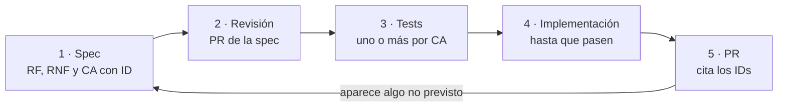
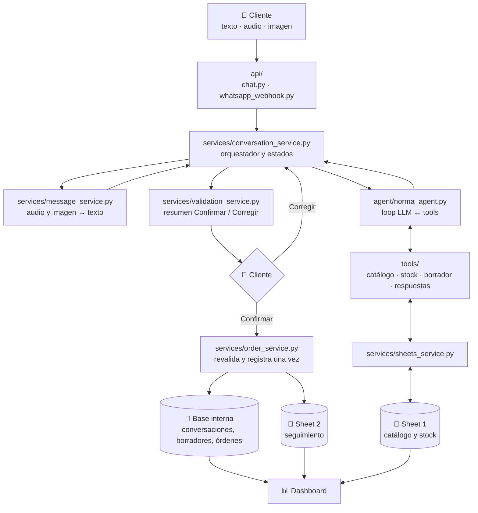

# 📐 Norma Agentic AI | Spec del MVP

> **Qué tiene que hacer el sistema y cómo sabemos que lo hace.**
> Esta spec es la fuente de verdad del comportamiento del MVP. El código y los tests la siguen; si no coinciden,
> uno de los dos tiene un error y se corrige en una PR.

## 0. Estado del documento

| | |
|---|---|
| Versión | 0.1, borrador para revisión |
| Fecha | 2026-10-29 |
| Base | Plan de Fernando ([`docs/Flujo completo de Norma Agentic AI.png`](../Flujo%20completo%20de%20Norma%20Agentic%20AI.png)), [`architecture.md`](../architecture.md), [`roadmap.md`](../roadmap.md) y el código de `develop` |
| Partes | Esta spec maestra y la [spec del agente](agente.md) (loop, estados, tools, errores, memoria y código) |
| Cómo se cambia | Por PR, como cualquier cambio (ver [§1](#1-cómo-trabajamos-con-sdd)) |

**Índice**

1. [Cómo trabajamos con SDD](#1-cómo-trabajamos-con-sdd)
2. [Visión y alcance del MVP](#2-visión-y-alcance-del-mvp)
3. [Arquitectura y componentes](#3-arquitectura-y-componentes)
4. [Flujos principales](#4-flujos-principales)
5. [Contratos de datos](#5-contratos-de-datos)
6. [Requisitos funcionales](#6-requisitos-funcionales)
7. [Requisitos no funcionales](#7-requisitos-no-funcionales)
8. [Roadmap por fases](#8-roadmap-por-fases)
9. [Criterios de aceptación](#9-criterios-de-aceptación)
10. [Decisiones abiertas y riesgos](#10-decisiones-abiertas-y-riesgos)
11. [Referencias](#11-referencias)

---

## 1. Cómo trabajamos con SDD

Trabajamos con **SDD (spec-driven development)**: primero se escribe y se revisa **qué** tiene que pasar,
después los tests que lo comprueban y recién después el código.

### 1.1 El ciclo

1. **Spec.** Toda funcionalidad nueva o cambio de comportamiento empieza en la spec:
   - Cambios chicos (un requisito, un criterio): se editan en esta spec o en la del agente.
   - Una etapa del roadmap o una funcionalidad grande: se escribe una spec propia en `docs/spec/`, a partir de la
     [plantilla](_plantilla.md) (por ejemplo `docs/spec/etapa-02-datos-del-negocio.md`), que detalla y referencia
     los IDs de esta spec.
2. **Revisión.** La spec se revisa en una PR como el código (otro integrante aprueba). Para una etapa entera,
   conviene una PR **solo de spec** (`feature/spec-<tema>`) antes de empezar a implementar; para un cambio chico,
   el primer commit de la PR es el de la spec.
3. **Tests.** Cada criterio de aceptación (`CA-xx`) tiene al menos un test que lo cita. Se escriben **antes** de
   implementar. Si el test entra en `develop` antes que el código, se marca
   `@pytest.mark.xfail(strict=True, reason="CA-xx pendiente")`: el CI sigue verde y, cuando el código lo hace pasar,
   el `strict` obliga a sacar la marca.
4. **Implementación.** Hasta que pasen los tests del CA, sin agregar comportamiento que la spec no pida.
5. **PR.** La descripción dice qué IDs cubre (sección *Spec* de la plantilla de PR). Si al implementar aparece algo
   que la spec no previó, se vuelve al paso 1 en la misma PR: no se decide en silencio en el código.

### 1.2 IDs y trazabilidad

| Prefijo | Qué es | Dónde vive |
|---|---|---|
| `RF-xx` | Requisito funcional: qué hace el sistema | [§6](#6-requisitos-funcionales) |
| `RNF-xx` | Requisito no funcional: con qué calidad | [§7](#7-requisitos-no-funcionales) |
| `CA-xx` | Criterio de aceptación verificable (Dado / Cuando / Entonces) | [§9](#9-criterios-de-aceptación) |
| `C-xx` | Cambio respecto del plan original de la imagen | [§3.3](#33-cambios-respecto-de-la-imagen) |
| `D-xx` | Decisión abierta o tomada que conviene revisar | [§10](#10-decisiones-abiertas-y-riesgos) |

- Los IDs **no se reutilizan**: si un requisito se elimina, queda tachado con el motivo.
- Los tests citan el CA en su docstring: `"""CA-15: confirmar dos veces devuelve la misma orden."""`.
  Así `grep -rn "CA-15" tests/` muestra qué lo prueba.
- Cada requisito tiene un **estado**: `Propuesto` → `Aprobado` (spec mergeada) → `Implementado` (test en verde en
  `develop`). La PR que implementa actualiza el estado.

### 1.3 Relación con el resto de la documentación

| Documento | Rol |
|---|---|
| `docs/spec/` | **Qué** tiene que hacer el sistema (fuente de verdad) |
| [`docs/architecture.md`](../architecture.md) | Vista resumida de las piezas; si contradice a la spec, manda la spec |
| [`docs/roadmap.md`](../roadmap.md) | Orden de las etapas; el detalle de cada una está en [§8](#8-roadmap-por-fases) |
| [`MEJORAS.md`](../../MEJORAS.md) | Estado real, evidencia y próximos pasos |
| [`CHANGELOG.md`](../../CHANGELOG.md) | Qué cambió en cada versión, para quien usa el sistema |
| [`CONTRIBUTING.md`](../../CONTRIBUTING.md) | Cómo trabajamos: ramas, PR, CI, releases |

---

## 2. Visión y alcance del MVP

### 2.1 Problema y propuesta

Los clientes de Norma hacen pedidos informales («mandame 2 pantene», un audio, la foto de una lista) por WhatsApp.
Pasarlos a mano a una orden es lento y propenso a errores de producto, presentación y cantidad.

**Norma Agentic AI** es un **asistente que toma pedidos**: recibe el mensaje por texto, audio o imagen, lo
interpreta contra el catálogo, muestra **qué entendió** y, solo cuando el cliente **confirma**, registra una
orden clara para que el equipo la prepare.

> **Principio rector:** el LLM interpreta; el backend valida y registra; el cliente confirma; el equipo controla la operación.

### 2.2 Actores

| Actor | Qué hace |
|---|---|
| **Cliente** | Pide por WhatsApp o chat web; confirma o corrige el borrador |
| **Equipo de Norma** | Prepara los pedidos, actualiza su estado y mira el dashboard; atiende las conversaciones derivadas |
| **Sistema** (backend) | Orquesta la conversación, valida, confirma y registra |
| **Agente** (LLM + tools) | Interpreta el pedido y arma el borrador o pregunta |
| **Servicios externos** | WhatsApp Cloud API, Google Sheets, proveedor de LLM (D-01) |

### 2.3 Alcance

| ✅ Dentro del MVP | ⏭️ Fuera del MVP (v2) |
|---|---|
| Pedidos por texto, audio e imagen, por chat web y WhatsApp | Atención humana completa y avisos al equipo |
| Catálogo, precios y stock desde Google Sheet 1 | API del sistema de gestión real |
| Interpretación con aclaraciones; nunca inventa productos | Órdenes en el sistema real |
| Borrador con **Confirmar / Corregir** | Reposición sugerida a proveedores |
| Una orden por confirmación, en la base interna y en Google Sheet 2 | Memoria de largo plazo («lo mismo que la otra vez») |
| Dashboard operativo con autenticación | Analítica de ventas y margen |
| Derivación **mínima** a una persona (C-09) | Usuarios y permisos por persona en el dashboard |

### 2.4 Supuestos y restricciones

- Un solo negocio, un solo catálogo, precios en pesos con centavos.
- El cliente **retira** el pedido (los estados son `Recibido → Preparado → Retirado`); no hay envíos ni cobros.
- Una sola instancia del backend con SQLite (alcanza para el volumen del MVP).
- El repositorio es público: ningún dato real de clientes, precios o stock entra en él.
- Los tests no usan red ni Docker.

### 2.5 Glosario

| Término | Definición |
|---|---|
| **Conversación** | El intento de armar un pedido de un cliente por un canal, de principio a fin ([agente §2](agente.md#2-estados-de-la-conversación)) |
| **Turno** | Un mensaje del cliente y la única respuesta del sistema |
| **Borrador** (`OrderDraft`) | Lo que el agente entendió; se puede corregir; **no** es una orden |
| **Orden** (`Order`) | Lo que existe después de que el cliente confirma; tiene `order_id` |
| **Interpretado ≠ confirmado** | Nada operativo se registra antes del OK del cliente |
| **Tool** | Acción controlada que el agente puede pedir al backend |
| **Tool terminal** | Tool que cierra el turno del agente y define el resultado |
| **SKU** | Código único de producto del catálogo |
| **Stock bajo** | `stock < stock_minimo` según Sheet 1 |
| **Derivar** | Pasar la conversación a una persona del equipo |

---

## 3. Arquitectura y componentes

### 3.1 Vista general

La base es el plan de Fernando, con sus 8 pasos. Lo que cambia respecto de la imagen está en [§3.3](#33-cambios-respecto-de-la-imagen).

| Paso | Qué pasa | Componente |
|---|---|---|
| 1 · Cliente | Envía texto, audio o imagen | WhatsApp / chat web |
| 2 · Recepción | Recibe y autentica el mensaje | `api/whatsapp_webhook.py`, `api/chat.py` |
| 2½ · Orquestación | Carga la conversación y decide qué hacer con el evento (**nuevo**, C-05) | `services/conversation_service.py` |
| 3 · Procesamiento de entrada | Audio → texto, imagen → texto, normalización | `services/message_service.py` |
| 4 · Agente Norma | Interpreta y arma el borrador o pregunta, con tools | `agent/`, `tools/`, `services/interpretation_service.py` |
| 5 · Consulta de información | Catálogo, precios y stock | `services/sheets_service.py` ↔ Google Sheet 1 |
| 6 · Validación del pedido | Resumen con **Confirmar / Corregir**; corregir vuelve al paso 4 | `services/validation_service.py` |
| 7 · Registro | Revalida stock y crea **una** orden | `services/order_service.py` → base interna y Google Sheet 2 |
| 8 · Visualización | Pedidos, stock, métricas y conversaciones derivadas | `api/dashboard.py` → `frontend/src/Dashboard/` |

El diseño detallado del agente, el orquestador y la organización del código está en la
[spec del agente](agente.md).

### 3.2 Componentes

| Componente | Archivos | Responsabilidad | No hace |
|---|---|---|---|
| Entradas | `api/chat.py`, `api/whatsapp_webhook.py` | HTTP, firma de Meta, deduplicación, respuesta rápida | Lógica de negocio |
| Orquestador | `services/conversation_service.py` | Estados de la conversación, lock, persistencia del turno | Interpretar lenguaje |
| Preprocesamiento | `services/message_service.py` | Normalizar texto, transcribir audio, leer imágenes | Decidir productos |
| Agente | `agent/` | Loop LLM ↔ tools de un turno | Confirmar ni registrar órdenes |
| Tools | `tools/` | Acciones controladas con contratos ([agente §4](agente.md#4-tools)) | Llamar al LLM |
| Interpretación | `services/interpretation_service.py` | Completar y validar líneas contra el catálogo | Elegir productos |
| Confirmación | `services/validation_service.py` | Resumen del borrador | Crear órdenes |
| Negocio | `services/order_service.py` | Confirmar: revalidar stock y crear la orden una sola vez | — |
| Google Sheets | `services/sheets_service.py` | Leer Sheet 1 (con caché), escribir Sheet 2 | — |
| WhatsApp | `services/whatsapp_service.py` (nuevo) | Enviar mensajes y botones, descargar multimedia | — |
| Dashboard | `api/dashboard.py`, `services/dashboard_service.py` (nuevos) | Indicadores y listados con autenticación | Escribir datos |
| Contratos | `schemas/` | Modelos compartidos ([§5](#5-contratos-de-datos)) | — |
| Persistencia | `database/` | Base interna SQLite | — |
| Interfaz | `frontend/src/Chat/`, `frontend/src/Dashboard/` | Tarjeta de confirmación y panel | Hablar con Google Sheets |

### 3.3 Cambios respecto de la imagen

La imagen de Fernando es la base. Estos son los puntos en los que la spec la cambia o la completa, con el motivo:

| ID | En la imagen | En la spec | Motivo |
|---|---|---|---|
| C-01 | Base de datos local **opcional** | **Obligatoria** (SQLite en `data/`) | Sin base no hay forma de garantizar una sola orden por confirmación (`draft_id` único), ni de guardar el estado de la conversación entre mensajes |
| C-02 | Estados del dashboard: Confirmado / En proceso / Pendiente | `Recibido` / `Preparado` / `Retirado` / `Cancelado` (`OrderStatus`) | Ya están en el código, el roadmap y `pedidos.csv`; «Pendiente» y «Confirmado» se confunden con los estados del borrador |
| C-03 | Sheet 2: Cliente, Fecha/Hora, Productos, Cantidades, Descripción, Estado | Columnas de [`pedidos.csv`](../../datos_ejemplo/pedidos.csv): `id_orden`, `fecha_hora`, `cliente`, `canal`, `productos`, `notas`, `estado` | Hace falta el ID para seguir y deduplicar, y el canal para responder; cantidades van dentro de `productos` (una fila por pedido) |
| C-04 | Logo de OpenAI en «LLM» | Proveedor **sin definir** (D-01), detrás de `llm_client` | El repo todavía no eligió proveedor; la spec fija qué tiene que soportar, no cuál es |
| C-05 | El mensaje va de la recepción directo al procesamiento y al agente | Un **orquestador** (`conversation_service.py`) con máquina de estados entre la API y el agente | El loop «si el cliente corrige, vuelve a interpretación» necesita estado: qué borrador está pendiente, qué se preguntó, cuándo vence |
| C-06 | «OK / Confirmar» dentro del flujo del agente | La confirmación **no pasa por el LLM**: botón o palabra clave exacta | El LLM no debe decidir cuándo se registra una orden |
| C-07 | Tools: catálogo, inventario, órdenes | Se suman `reply_tools.py` (`respond_to_customer`, `escalate_to_human`) y `discard_order_draft` | Cada turno termina en una tool que define el resultado; así los casos de `mensajes.json` son verificables |
| C-08 | — | Las tools reciben `customer_id`, `channel` y `draft_id` **inyectados** por el backend | Que el LLM no pueda actuar a nombre de otro cliente ni sobre otro borrador |
| C-09 | Sin derivación | Derivación **mínima** a una persona (estado `derivada`, visible en el dashboard) | Un asistente que no puede resolver algo necesita una salida; los avisos al equipo siguen en v2 |
| C-10 | Dashboard sin acceso controlado | Dashboard detrás de **autenticación** | Muestra datos de clientes; `architecture.md` ya lo pedía |
| C-11 | — | `whatsapp_service.py` para enviar mensajes y descargar multimedia | La imagen recibe por WhatsApp pero no muestra cómo se responde |
| C-12 | Frontend: solo `Dashboard/` | También `Chat/` (tarjeta Confirmar / Corregir del chat web) | Ya existe en el repo y el chat web es un canal del MVP |
| C-13 | `OrderDraft` sin versión | `OrderDraft.version`, que sube con cada corrección | Evita confirmar un resumen viejo que el cliente ya corrigió |

---

## 4. Flujos principales

Los flujos de la conversación (estados y eventos) están en detalle en la [spec del agente](agente.md#2-estados-de-la-conversación).

### F1 · Pedido por texto hasta el borrador

1. El cliente escribe «Quiero 5 shampoo pantene 400ml y 3 tinturas koleston 6.1».
2. La API valida el `IncomingMessage` y lo pasa al orquestador, que abre una conversación (`esperando_pedido`).
3. `message_service` normaliza el texto.
4. El agente busca cada producto (`search_products`), verifica stock (`check_stock`) y llama a
   `create_order_draft` con `[{SH-PAN-400, 5}, {TIN-KOL-61, 3}]`.
5. El backend completa nombres y precios, guarda el borrador (versión 1) y la conversación pasa a `borrador_pendiente`.
6. El cliente ve el resumen con **Confirmar / Corregir** (RF-11).

### F2 · Audio y F3 · imagen

Igual que F1, pero en el paso 3 `message_service` transcribe el audio o lee la imagen. El texto resultante entra al
agente marcado con su origen (`audio transcripto`, `imagen leída`). Si no se obtiene texto útil, se le pide al
cliente que lo escriba, sin llamar al agente (RF-04, RF-05).

### F4 · Aclaración

Si hay varias opciones («mandame 2 pantene»), el agente responde con `respond_to_customer(kind="aclaracion")`
ofreciendo los SKU posibles; la conversación pasa a `aclarando` y el siguiente mensaje del cliente se interpreta
con esa pregunta en contexto. Lo mismo para falta de stock (`sin_stock`) o producto inexistente
(`fuera_de_catalogo`), sin inventar un SKU (RF-08 a RF-10).

### F5 · Corrección

El cliente toca **Corregir** (respuesta fija «¿Qué querés cambiar?») o escribe directamente la corrección
(«mejor que sean 3»). El agente llama a `update_order_draft`, la versión sube y se muestra un resumen nuevo (RF-12).

### F6 · Confirmación y registro

El cliente toca **Confirmar** (o responde `OK` en WhatsApp). Sin pasar por el LLM, `order_service` revalida stock,
crea la orden en una transacción, responde con el número de orden y agrega la fila en Sheet 2
([agente §5](agente.md#5-confirmación-sin-llm), RF-13 a RF-19).

### F7 · WhatsApp de punta a punta

1. Meta envía el POST; el webhook valida la firma, guarda el id del mensaje y responde **200 enseguida**.
2. En segundo plano: si el id ya se procesó, se descarta; si es multimedia, `whatsapp_service` descarga el archivo.
3. Sigue el mismo flujo que el chat web (F1 a F6).
4. El borrador se envía como **mensaje interactivo con botones** cuando se puede; si no, como texto con la
   instrucción «Respondé OK para confirmar o CORREGIR para cambiar algo».

### F8 · Seguimiento y dashboard

1. La orden nace en estado `Recibido`.
2. El equipo actualiza el estado en Sheet 2 (`Preparado`, `Retirado` o `Cancelado`) (D-06).
3. El dashboard pide los datos al backend (`/dashboard/*`), que lee la base, Sheet 1 y Sheet 2; nunca el navegador
   directo a Google.

---

## 5. Contratos de datos

Los modelos viven en `backend/schemas/`. Los cambios marcados **(nuevo)** o **(cambia)** son parte del MVP y entran
con la etapa que los usa ([§8](#8-roadmap-por-fases)).

### 5.1 Mensaje entrante: `IncomingMessage`

| Campo | Tipo | Reglas |
|---|---|---|
| `customer_id` | `str` | En WhatsApp, el número del cliente; en web, ver D-05 |
| `channel` | `web \| whatsapp` | |
| `type` | `text \| audio \| image` | Por defecto `text` |
| `text` | `str \| None` | Obligatorio y no vacío si `type = text` |
| `media_url` | `str \| None` | Obligatorio si `type` es `audio` o `image` |
| `external_id` | `str \| None` **(nuevo)** | Id del mensaje en Meta, para deduplicar |

### 5.2 Catálogo: `Product`, `StockCheck` ↔ Google Sheet 1

| Columna de Sheet 1 (`catalogo.csv`) | Campo | Reglas |
|---|---|---|
| `sku` | `sku` | Único |
| `nombre` | `name` | |
| `marca` | `brand` | Opcional |
| `presentacion` | `presentation` | Opcional. Ej.: `400 ml`, `90 g`, `kit` |
| `precio` | `price` | `Decimal ≥ 0`, punto decimal |
| `stock` | `stock` | Entero |
| `stock_minimo` | `min_stock` | Entero `≥ 0`, por defecto 0 |
| — | `is_low_stock` | Calculado: `stock < min_stock` |

`StockCheck`: `sku`, `requested`, `available` y el calculado `is_enough = available ≥ requested`.

### 5.3 Borrador: `OrderDraft`, `OrderItem`

| Campo | Tipo | Reglas |
|---|---|---|
| `draft_id` | `str` | Único |
| `conversation_id` | `str` **(nuevo)** | Conversación a la que pertenece |
| `customer_id`, `channel` | | Los pone el backend, nunca el LLM |
| `items` | `list[OrderItem]` | Al menos uno |
| `notes` | `str \| None` | |
| `status` | `pendiente_confirmacion \| confirmado \| descartado` | Nace `pendiente_confirmacion` |
| `version` | `int` **(nuevo)** | Empieza en 1, sube con cada corrección (C-13) |

`OrderItem`: `sku` (existente en el catálogo), `product_name`, `presentation`, `quantity > 0`,
`unit_price: Decimal ≥ 0` (precio del catálogo al armar el borrador).

### 5.4 Orden: `Order` ↔ Google Sheet 2

| Columna de Sheet 2 (`pedidos.csv`) | Campo | Formato |
|---|---|---|
| `id_orden` | `order_id` | `ORD-0001`, correlativo, único |
| — | `draft_id` | Único: un borrador produce como máximo una orden |
| `fecha_hora` | `created_at` | ISO 8601 con zona horaria (`-03:00`) |
| `cliente` | `customer_id` | |
| `canal` | `channel` | `web` o `whatsapp` |
| `productos` | `items` | `cantidad x nombre presentación (SKU)`, separados por `; ` |
| `notas` | `notes` | |
| `estado` | `status` | `Recibido`, `Preparado`, `Retirado` o `Cancelado` |

Una fila por pedido en Sheet 2; el detalle por ítem se guarda estructurado en la base (RF-21).

### 5.5 Resultado del agente: `AgentOutcome` (cambia: reemplaza a `AgentReply`)

Definido en la [spec del agente](agente.md#92-agentoutcome). Sus valores de `kind` coinciden con
`esperado.resultado` de [`mensajes.json`](../../datos_ejemplo/mensajes.json): `borrador`, `aclaracion`,
`sin_stock`, `fuera_de_catalogo`, más `informacion`, `descartado`, `derivado` y `error`.

### 5.6 Conversación (nuevo)

`ConversationState`: `esperando_pedido`, `aclarando`, `borrador_pendiente`, `confirmada`, `descartada`, `vencida`,
`derivada` ([agente §2](agente.md#2-estados-de-la-conversación)).

### 5.7 Base interna

| Tabla | Campos principales | Para qué |
|---|---|---|
| `conversations` | `id`, `customer_id`, `channel`, `state`, `draft_id`, `failures`, `consecutive_clarifications`, `created_at`, `updated_at`, `expires_at` | Estado y vencimiento |
| `messages` | `id`, `conversation_id`, `role`, `origin` (texto/audio/imagen), `content`, `tool_calls` (JSON), `created_at` | Historial y contexto del agente |
| `drafts` | `draft_id`, `conversation_id`, `customer_id`, `channel`, `items` (JSON), `notes`, `status`, `version`, fechas | Borradores |
| `orders` | `order_id`, `draft_id` (**único**), `customer_id`, `channel`, `notes`, `status`, `sheets_synced`, `created_at` | Órdenes e idempotencia |
| `order_items` | `order_id`, `sku`, `product_name`, `presentation`, `quantity`, `unit_price` | Análisis por producto |
| `processed_messages` | `channel`, `external_id` (**único**), `received_at` | Deduplicar reintentos de Meta |

### 5.8 API HTTP

| Método y ruta | Entrada | Salida | Estado hoy |
|---|---|---|---|
| `GET /health` | — | `{"status": "ok"}` | Hecho |
| `GET /webhook/whatsapp` | `hub.mode`, `hub.verify_token`, `hub.challenge` | `challenge` o `403` | Hecho |
| `POST /webhook/whatsapp` | Payload de Meta + `X-Hub-Signature-256` | `200` o `403` | Firma hecha; procesamiento pendiente |
| `POST /chat/messages` | `IncomingMessage` | `{state, outcome: AgentOutcome}` | `501` |
| `POST /chat/drafts/{draft_id}/confirmar?version=N` | — | `200 {order}`; `409` versión vieja, estado inválido o stock insuficiente; `404` | `501` |
| `POST /chat/drafts/{draft_id}/corregir?version=N` | — | `200 {message}`; `409`; `404` | `501` |
| `GET /dashboard/summary` | — | Indicadores de RF-22 | Nuevo |
| `GET /dashboard/orders?status=&limit=` | — | Últimos pedidos | Nuevo |
| `GET /dashboard/stock?low=true` | — | Productos y stock | Nuevo |
| `GET /dashboard/conversations?state=derivada` | — | Conversaciones que requieren atención | Nuevo |

Todos los `/dashboard/*` requieren autenticación (RNF-01).

---

## 6. Requisitos funcionales

Estado: **P** propuesto, **A** aprobado, **I** implementado (ver [§1.2](#12-ids-y-trazabilidad)).
Esta versión de la spec está en revisión: todo lo que no está implementado figura como **P**.

### Entrada

| ID | Requisito | Etapa | Estado |
|---|---|---|---|
| RF-01 | El sistema recibe mensajes de texto del chat web y rechaza los que no tienen contenido para su tipo | 03 | P (validación: I) |
| RF-02 | El sistema recibe mensajes de texto, audio e imagen por WhatsApp; verifica el webhook y la firma de Meta | 07 | P (verificación y firma: I) |
| RF-03 | El webhook responde 200 antes de procesar, y un mensaje de Meta repetido se procesa una sola vez | 07 | P |
| RF-04 | Los audios se transcriben a texto antes de llegar al agente; si no hay texto útil, se pide escribirlo | 03 | P |
| RF-05 | De las imágenes se extrae el texto o la lista de productos; si no hay texto útil, se pide escribirlo | 03 | P |
| RF-06 | El texto se normaliza (espacios) antes de llegar al agente | 03 | I |

### Interpretación

| ID | Requisito | Etapa | Estado |
|---|---|---|---|
| RF-07 | Se buscan productos por nombre, marca o presentación de forma aproximada (mayúsculas, tildes, plurales, errores de tipeo) | 02 | P |
| RF-08 | Toda línea de un borrador referencia un SKU existente; el sistema nunca inventa SKU, precio ni presentación | 03 | P |
| RF-09 | Si producto, presentación, tono o cantidad son ambiguos, el agente pregunta (una pregunta por vez) ofreciendo las opciones del catálogo | 03 | P |
| RF-10 | Si no alcanza el stock, el agente lo avisa y ofrece lo disponible o una alternativa; si el producto no está en el catálogo, lo dice | 03 | P |

### Borrador y confirmación

| ID | Requisito | Etapa | Estado |
|---|---|---|---|
| RF-11 | Con el pedido claro se muestra un resumen generado por el backend (producto, presentación y cantidad de cada línea) con **Confirmar / Corregir** | 04 | P (resumen: I) |
| RF-12 | Una corrección actualiza el mismo borrador, sube su versión y muestra un resumen nuevo | 04 | P |
| RF-13 | Solo se confirma con una acción explícita (botón o palabra clave exacta); el agente no puede confirmar y, ante un texto como «dale», recuerda cómo hacerlo | 04 | P |
| RF-14 | Al confirmar se revalida el stock de cada línea con una lectura fresca; si no alcanza, no se crea la orden | 04 | P |
| RF-15 | Un borrador produce como máximo una orden, aunque la confirmación llegue repetida | 05 | P |
| RF-16 | No se puede confirmar una versión del borrador que no sea la última | 04 | P |
| RF-17 | Cada orden tiene un `order_id` único y correlativo (`ORD-0001`) | 05 | P |
| RF-18 | Al confirmar, el cliente recibe el número de orden | 05 | P |

### Registro y seguimiento

| ID | Requisito | Etapa | Estado |
|---|---|---|---|
| RF-19 | Cada orden se agrega como una fila en Sheet 2 con el formato de [§5.4](#54-orden-order--google-sheet-2) | 05 | P |
| RF-20 | Las órdenes siguen `Recibido → Preparado → Retirado`, con `Cancelado` desde cualquier estado previo a `Retirado` | 05 | P |
| RF-21 | El detalle por ítem de cada orden se guarda en la base interna | 05 | P |

### Dashboard

| ID | Requisito | Etapa | Estado |
|---|---|---|---|
| RF-22 | Indicadores: pedidos de hoy, pedidos por estado, productos distintos pedidos hoy y cantidad de productos con stock bajo | 06 | P |
| RF-23 | Listados: últimos pedidos con estado y hora; stock disponible con marca de stock bajo | 06 | P |
| RF-24 | Listado de conversaciones derivadas que requieren atención | 06 | P |
| RF-25 | El dashboard obtiene todo de la API del backend y requiere autenticación | 06 | P |

### Conversación

| ID | Requisito | Etapa | Estado |
|---|---|---|---|
| RF-26 | El cliente puede cancelar un pedido antes de confirmarlo; el borrador queda descartado | 04 | P |
| RF-27 | La conversación se deriva a una persona si el cliente lo pide, tras 2 fallas o tras 3 aclaraciones seguidas sin borrador | 04 | P |
| RF-28 | Una conversación abierta vence tras 24 h sin actividad; su borrador queda descartado | 04 | P |

---

## 7. Requisitos no funcionales

| ID | Tema | Requisito |
|---|---|---|
| RNF-01 | Seguridad | Secretos solo en `.env` o secretos del servidor; firma de Meta y token comparados en tiempo constante; dashboard con autenticación (en el MVP, un token compartido por variable de entorno); escaneo de secretos en todo el historial |
| RNF-02 | Control del LLM | El LLM no registra órdenes ni conoce identificadores del cliente o del borrador (se inyectan); toda salida del LLM que llega a una tool se valida con pydantic |
| RNF-03 | Privacidad | Audios e imágenes no se guardan, solo el texto extraído; los logs llevan IDs, no el texto de los mensajes; ningún dato real en el repositorio; plazo de retención de conversaciones según D-08 |
| RNF-04 | Confiabilidad | La orden se crea en una transacción de la base; si falla la escritura en Sheet 2, se reintenta en segundo plano sin duplicar la fila (se busca el `order_id` antes de agregar) |
| RNF-05 | Concurrencia | Los turnos de una conversación se procesan de a uno; el MVP corre en una sola instancia (SQLite) |
| RNF-06 | Latencia | Webhook: 200 en menos de 2 s. Respuesta a texto: p95 < 10 s. Audio o imagen: p95 < 20 s. Dashboard: < 2 s. Timeout del LLM: 30 s |
| RNF-07 | Observabilidad | Logs estructurados con `conversation_id`, `draft_id`, `order_id`, tools llamadas, iteraciones, latencia y tokens; la versión que corre se ve en `/openapi.json` |
| RNF-08 | Testabilidad | Tests sin red ni Docker; el LLM se reemplaza por un `FakeLLM`; datos sintéticos deterministas; cada CA tiene al menos un test |
| RNF-09 | Portabilidad | Cambiar de proveedor de LLM es agregar una clase en `llm_client`; cambiar Google Sheets por el sistema real es reemplazar `sheets_service` |
| RNF-10 | Despliegue | Producción corre la imagen de una release; la configuración va en la imagen y cambiar un parámetro es una release ([CONTRIBUTING](../../CONTRIBUTING.md#producción)) |
| RNF-11 | Experiencia | Español rioplatense, breve y amable; una pregunta por vez; mensajes de WhatsApp dentro de los límites del canal |
| RNF-12 | Costo | Máximo 6 iteraciones por turno, historial acotado a 20 mensajes y catálogo fuera del contexto (D-07) |
| RNF-13 | Caché | El catálogo se cachea 5 min para buscar (hasta 1 h si Google no responde); la confirmación siempre lee fresco |

---

## 8. Roadmap por fases

Mismas 7 etapas que [`roadmap.md`](../roadmap.md). Cerrar una etapa es una versión MINOR
([CONTRIBUTING](../../CONTRIBUTING.md#versiones)). Antes de empezar cada etapa se escribe su spec con la
[plantilla](_plantilla.md).

| Etapa | Meta | Requisitos | Se cierra cuando | Versión | Estado |
|---|---|---|---|---|---|
| 01 · Base compartida | Todos pueden ejecutar el proyecto | — | La API levanta en los tres equipos y el CI está en verde | 0.1.0 | ✅ Completa (falta publicar la release) |
| 02 · Datos del negocio | Consultar catálogo, precios y stock | RF-07, RNF-13 | Pasan CA-27 y CA-29 con el catálogo de ejemplo, y se consulta Sheet 1 real sin tocar código | 0.2.0 | Pendiente |
| 03 · Agente y pedidos multimodales | Del mensaje al borrador o la pregunta | RF-01, RF-04 a RF-06, RF-08 a RF-10 | Pasan CA-06 a CA-12 y CA-20 con `FakeLLM`, y los casos de `mensajes.json` con el LLM elegido | 0.3.0 | Pendiente (bloqueada por D-01) |
| 04 · Confirmación del cliente | Ningún pedido sin confirmación | RF-11 a RF-14, RF-16, RF-26 a RF-28 | Pasan CA-13, CA-14, CA-16, CA-17 y CA-21 a CA-23, CA-28 | 0.4.0 | Pendiente |
| 05 · Registro y seguimiento | Pedido confirmado = trabajo operativo | RF-15, RF-17 a RF-21 | Pasan CA-15 y CA-19 | 0.5.0 | Pendiente |
| 06 · Dashboard | Ver qué pasa en el negocio | RF-22 a RF-25 | Pasan CA-24 y CA-25 | 0.6.0 | Pendiente (bloqueada por D-02) |
| 07 · WhatsApp de punta a punta | Operar desde el canal del cliente | RF-02, RF-03 | Pasan CA-05 y CA-18, y un pedido real de prueba por WhatsApp llega al dashboard | 0.7.0 | Pendiente |

Orden sugerido dentro de la etapa 03: primero el loop con texto (orquestador, tools y `FakeLLM`), después audio e
imagen. El MVP está listo cuando se cumplen los criterios de [`roadmap.md`](../roadmap.md#-cuándo-está-listo-el-mvp)
y todos los CA de esta spec están en verde.

---

## 9. Criterios de aceptación

Formato: **Dado** (contexto) · **Cuando** (acción) · **Entonces** (resultado). La columna *Test* indica qué lo
prueba hoy; «pendiente» significa que el test se escribe con la etapa.

### Entrada y contratos

| ID | Dado | Cuando | Entonces | RF | Test |
|---|---|---|---|---|---|
| CA-01 | La API levantada | Se pide `GET /health` | Responde `200 {"status": "ok"}` | — | `test_api.py::test_health` |
| CA-02 | `WHATSAPP_VERIFY_TOKEN` configurado | Meta verifica con el token correcto / incorrecto | Devuelve `challenge` / `403` | RF-02 | `test_api.py::test_whatsapp_verify` |
| CA-03 | `WHATSAPP_APP_SECRET` configurado | Llega un POST con firma válida / inválida | `200` / `403` | RF-02 | `test_api.py::test_whatsapp_post_*` |
| CA-04 | Cualquier canal | Llega un mensaje de texto sin texto, o un audio o imagen sin `media_url` | Se rechaza (`422` en la API) | RF-01 | `test_orders.py::test_incoming_message_requires_content_for_its_type`, `test_api.py::test_chat_rejects_text_message_without_text` |
| CA-05 | Un mensaje de WhatsApp ya procesado | Meta lo reenvía con el mismo id | Se responde `200` y no se procesa de nuevo | RF-03 | pendiente |
| CA-06 | Un audio con un pedido | Llega por cualquier canal | El agente recibe la transcripción marcada como `audio transcripto`; si está vacía, se pide escribirlo sin llamar al LLM | RF-04 | pendiente |
| CA-07 | Una imagen con un pedido | Llega por cualquier canal | Igual que CA-06, con `imagen leída` | RF-05 | pendiente |
| CA-26 | — | Se construyen borradores y órdenes | Un borrador sin ítems o con cantidad ≤ 0 es inválido; nace `pendiente_confirmacion`; los precios son `Decimal` | RF-08 | `test_orders.py`, `test_invariantes.py::test_un_borrador_nace_sin_confirmar` |

### Interpretación (casos de `datos_ejemplo/mensajes.json`)

| ID | Dado | Cuando | Entonces | RF | Test |
|---|---|---|---|---|---|
| CA-08 | El catálogo de ejemplo | Llega un caso con `resultado: borrador` (`texto-simple`, `texto-varios-productos`, `cantidad-en-palabras`, `articulo-indefinido`) | El turno termina en `borrador` con exactamente los SKU y cantidades esperados | RF-08 | pendiente |
| CA-09 | El catálogo de ejemplo | Llega un caso con `resultado: aclaracion` (`ambiguo-*`) | El turno termina en `aclaracion`, sin borrador, ofreciendo exactamente las `opciones` esperadas | RF-09 | pendiente |
| CA-10 | El catálogo de ejemplo | Llega un caso con `resultado: sin_stock` | El turno termina en `sin_stock` y no se crea borrador con cantidades sin stock | RF-10 | pendiente |
| CA-11 | El catálogo de ejemplo | Llega `fuera-de-catalogo` | El turno termina en `fuera_de_catalogo` y no aparece ningún SKU inventado | RF-08, RF-10 | pendiente |
| CA-12 | Una tool de borrador | El LLM pide un SKU que no existe o una cantidad sin stock | La tool devuelve `sku_inexistente` / `stock_insuficiente` y no se guarda nada | RF-08, RF-10 | pendiente |
| CA-20 | Un `FakeLLM` que nunca llama a una tool terminal | Corre un turno | Se corta a las 6 iteraciones con mensaje fijo y la conversación suma una falla | RNF-12 | pendiente |
| CA-27 | Los archivos de `datos_ejemplo/` | Se validan contra los esquemas | Columnas correctas, SKU únicos, casos coherentes con el catálogo | RF-07 | `test_datos_ejemplo.py` |
| CA-29 | El catálogo de ejemplo | Se busca «shampoo pantene 400», «Shampoo Pantene 400ML» y «shampo pantne 400» | `SH-PAN-400` aparece primero en los tres casos | RF-07 | pendiente |

### Borrador, confirmación y registro

| ID | Dado | Cuando | Entonces | RF | Test |
|---|---|---|---|---|---|
| CA-13 | Un borrador pendiente versión 1 | El cliente corrige una cantidad | El mismo `draft_id` pasa a versión 2, el resumen nuevo muestra cada ítem, sigue pendiente | RF-11, RF-12 | `test_invariantes.py::test_el_resumen_muestra_cada_item_del_borrador` (resumen); resto pendiente |
| CA-14 | Un borrador en versión 2 | Llega Confirmar con versión 1 | `409` y no se crea orden | RF-16 | pendiente |
| CA-15 | Un borrador pendiente | Llega Confirmar dos veces (doble click o reintento) | Se crea una sola orden, las dos respuestas tienen el mismo `order_id` y hay una sola fila en Sheet 2 | RF-15 | pendiente |
| CA-16 | Un borrador cuyo stock se agotó después de armarlo | El cliente confirma | No se crea orden, se informa qué línea no alcanza y la conversación sigue en `borrador_pendiente` | RF-14 | pendiente |
| CA-17 | Un borrador pendiente | El cliente escribe «dale, mandalo» | No se crea orden; el agente recuerda cómo confirmar | RF-13 | pendiente |
| CA-18 | Un borrador pendiente en WhatsApp sin botones | El cliente responde `ok` / `Corregir` | Se confirma / se pide la corrección, igual que con los botones; en otro estado, `OK` va al agente | RF-13 | pendiente |
| CA-19 | Una orden confirmada | Sheet 2 falla al escribir y después vuelve | La orden existe en la base con `sheets_synced = false` y el reintento agrega una sola fila con las columnas de `pedidos.csv` | RF-19, RNF-04 | pendiente |
| CA-21 | Una conversación con una falla previa | Ocurre una segunda falla | La conversación pasa a `derivada` y el bot no responde a ese cliente por 24 h | RF-27 | pendiente |
| CA-22 | Cualquier conversación abierta | El cliente pide hablar con una persona | El turno termina en `derivado` | RF-27 | pendiente |
| CA-23 | Un borrador pendiente | El cliente dice que ya no lo quiere | El borrador queda `descartado`, la conversación `descartada` y no hay orden | RF-26 | pendiente |
| CA-28 | Una conversación abierta sin actividad | Pasan 24 h | Queda `vencida` y el siguiente mensaje abre una conversación nueva | RF-28 | pendiente |

### Dashboard

| ID | Dado | Cuando | Entonces | RF | Test |
|---|---|---|---|---|---|
| CA-24 | — | Se pide `/dashboard/*` sin token o con uno inválido | `401` | RF-25 | pendiente |
| CA-25 | El catálogo y los pedidos de ejemplo | Se pide `/dashboard/summary` | Productos con stock bajo = 3 (`CE-SED-340`, `ALG-EST-140`, `TIN-KOL-71`) y pedidos por estado = 2 `Recibido`, 2 `Preparado`, 2 `Retirado`, 1 `Cancelado` | RF-22, RF-23 | pendiente |

---

## 10. Decisiones abiertas y riesgos

### 10.1 Decisiones

| ID | Tema | Estado | Detalle |
|---|---|---|---|
| D-01 | Proveedor de LLM | **Abierta**, bloquea la etapa 03 | Tiene que soportar tool calling con JSON Schema, buen español, y transcripción de audio y lectura de imágenes (o usar otro servicio para eso). Criterios: aciertos en `mensajes.json`, latencia (RNF-06) y costo por pedido |
| D-02 | Tecnología del frontend | **Abierta**, bloquea la etapa 06 | Chat web y dashboard en `frontend/src/` |
| D-03 | Servidor de producción | **Abierta** | Ver `MEJORAS.md`, próximos pasos |
| D-04 | ¿El resumen muestra precios y total? | **Abierta** | Hoy no los muestra; el precio se guarda en cada línea igual |
| D-05 | Identidad del cliente en el chat web | **Abierta** | Propuesta: un id anónimo que genera el backend y el navegador guarda; sin cuentas de usuario |
| D-06 | Dónde se cambia el estado de una orden | Tomada en esta spec, a revisar | En el MVP el equipo lo cambia en Sheet 2 y el dashboard lo lee de ahí; la base guarda la orden y su estado inicial |
| D-07 | Parámetros del agente | Tomada en esta spec, a revisar | 6 iteraciones por turno, 20 mensajes de historial, 24 h de vencimiento y de silencio tras derivar, 2 fallas o 3 aclaraciones para derivar, 30 s de timeout, caché de 5 min; se ajustan con uso real |
| D-08 | Retención de conversaciones | **Abierta** | Propuesta: 90 días |

### 10.2 Riesgos

| Riesgo | Mitigación |
|---|---|
| El stock de la planilla no se puede reservar (dos clientes confirman el último) | Revalidación al confirmar (RF-14); se acepta el riesgo residual en el MVP |
| El LLM interpreta mal un pedido | El cliente siempre ve el resumen antes de confirmar; `mensajes.json` como evaluación |
| Conversaciones derivadas sin atender (no hay avisos en el MVP) | Listado en el dashboard (RF-24); avisos en v2 |
| Costo del LLM por pedido | Límites de RNF-12 y medición de tokens (RNF-07) |
| SQLite con más de una instancia | Una sola instancia en el MVP; migrar de base sería MAJOR |
| Cambios de la API de Meta o de Google | Encapsulados en `whatsapp_service` y `sheets_service` |

---

## 11. Referencias

- [Spec del agente](agente.md) · [Plantilla de spec](_plantilla.md)
- [Plan de Fernando (imagen)](../Flujo%20completo%20de%20Norma%20Agentic%20AI.png) · [Arquitectura](../architecture.md) · [Roadmap](../roadmap.md)
- [Datos de ejemplo](../../datos_ejemplo/README.md) · [`backend/schemas/`](../../backend/schemas/)
- [Cómo trabajamos](../../CONTRIBUTING.md) · [Mejoras](../../MEJORAS.md) · [Changelog](../../CHANGELOG.md)
