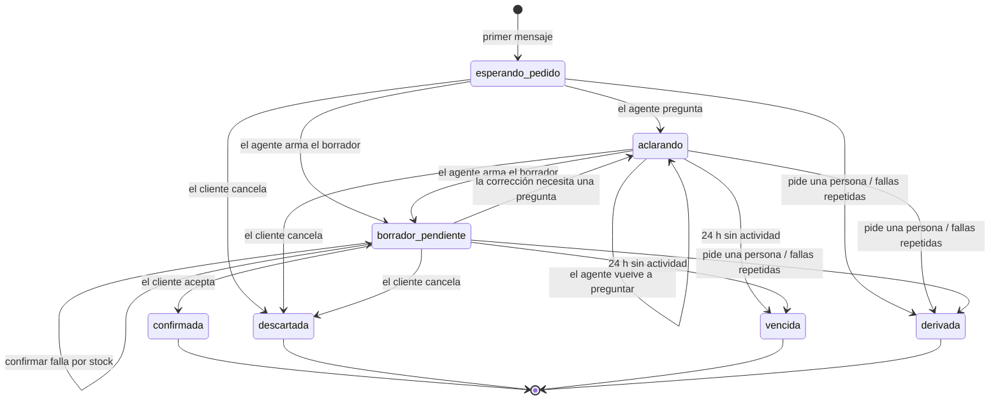
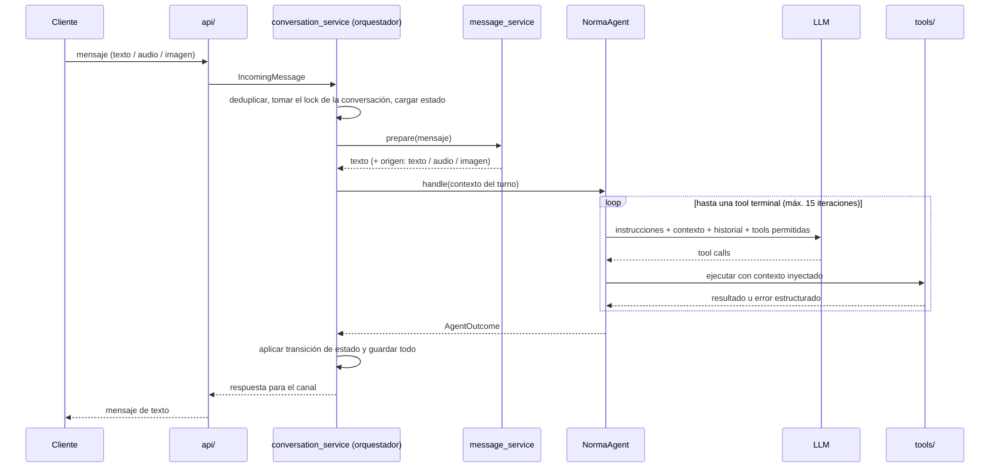
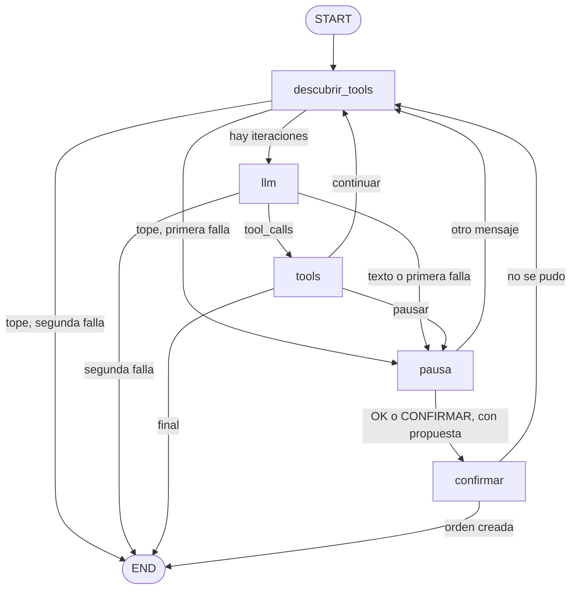
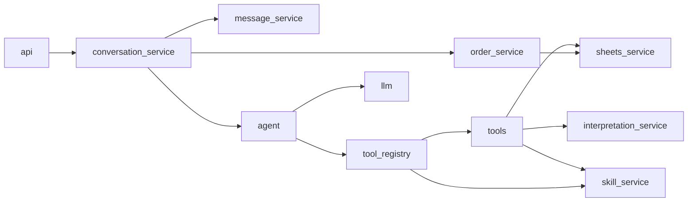

# 🤖 Spec del agente Norma

> Parte de la [spec del MVP](README.md). Define **cómo conversa el asistente**: el loop de cada turno,
> los estados de la conversación, las tools con sus contratos, el manejo de errores, la derivación a una
> persona, la memoria y cómo se organiza todo eso en el código.
>
> Los IDs `RF-xx`, `RNF-xx`, `CA-xx` y `D-xx` son los de la [spec del MVP](README.md).

## 1. Idea central

El agente **no maneja la conversación solo**. La conversación la conduce el backend con una máquina de estados
(el **orquestador**), y el LLM entra únicamente en los momentos en que hay que **interpretar lenguaje**:

| Lo decide el backend (determinístico) | Lo decide el LLM (dentro de un turno) |
|---|---|
| En qué estado está la conversación y qué eventos acepta | Qué quiso decir el cliente |
| Crear la orden exactamente con lo propuesto | Qué productos buscar y cuáles coinciden |
| Revalidar el stock al crear la orden | Si hace falta preguntar algo y qué |
| Qué se le puede registrar al cliente: solo la propuesta vigente | Si el cliente aceptó la propuesta, salvo `OK` o `CONFIRMAR` exactos |
| Completar nombre, presentación y precio desde el catálogo | Las cantidades y el SKU de cada línea |
| El mensaje final con el pedido registrado | Si el cliente quiere cancelar o hablar con una persona |
| Límites, reintentos, vencimientos y derivación por fallas | El texto de las preguntas y avisos al cliente |
| Qué tools y BR permite cada skill | Qué skill y qué BR leer en cada turno |

Así se cumple el principio rector: **el LLM interpreta; el backend valida y registra; el cliente confirma.**
El cliente confirma conversando: el LLM interpreta su respuesta, pero solo puede registrar lo que el backend ya
validó y guardó como propuesta (§5). El riesgo es que interprete mal una respuesta, y se mide con los casos de
evaluación de `data_example/mensajes.json`.

## 2. Estados de la conversación

> **Primer corte:** por ahora la conversación solo se guarda como `abierta`, `cerrada` o `fallida`. Los estados
> de esta sección, el vencimiento y la derivación se suman en etapas siguientes.

Una **conversación** es el intento de armar **un** pedido de un cliente por un canal. Hay como máximo una
conversación abierta por `(customer_id, channel)`. Cuando termina (confirmada, descartada, vencida o derivada),
el siguiente mensaje del cliente abre una nueva.

| Estado | Significado | ¿Abierta? |
|---|---|---|
| `esperando_pedido` | Recién abierta, todavía no hay nada interpretado | Sí |
| `aclarando` | El agente hizo una pregunta y espera la respuesta | Sí |
| `borrador_pendiente` | Hay una propuesta vigente, esperando la respuesta del cliente | Sí |
| `confirmada` | El cliente confirmó y se creó la orden | No |
| `descartada` | El cliente canceló el pedido antes de confirmar | No |
| `vencida` | Pasaron 24 h sin actividad (D-07) | No |
| `derivada` | Se pasó a una persona del equipo | No |



### 2.1 Eventos que recibe el orquestador

| Evento | Origen | ¿Pasa por el LLM? |
|---|---|---|
| Mensaje de texto, audio o imagen | Cualquier canal | Sí, después del preprocesamiento |
| `OK` o `CONFIRMAR` exactos, con una propuesta vigente | Texto del cliente | **No**: el backend registra la propuesta |
| Vencimiento | Tarea del backend | No |

Ningún canal usa botones: el cliente confirma escribiendo. Cualquier otra respuesta («dale», «sí») va al agente, que
decide si acepta la propuesta vigente (RF-13, §5). Sin propuesta vigente, `OK` también va al agente.

### 2.2 Qué pasa en cada estado al recibir un mensaje

| Estado | Mensaje del cliente |
|---|---|
| `esperando_pedido` | Turno del agente |
| `aclarando` | Turno del agente (con la pregunta pendiente en contexto) |
| `borrador_pendiente` | `OK` o `CONFIRMAR` exactos: se registra la propuesta (§5). Otro mensaje: turno del agente, con la propuesta en contexto |
| Cerrada | Abre una conversación nueva (salvo `derivada`, ver §7) |

## 3. El loop de un turno

Un **turno** empieza con un mensaje del cliente y termina con **una sola respuesta** del sistema.



Reglas del loop:

1. **Cada turno termina con exactamente una tool terminal** (§4.2). Ese resultado decide la transición de estado.
2. **Máximo 15 iteraciones** LLM ↔ tools por turno (D-07). Si se alcanza sin tool terminal, el turno termina con
   un mensaje fijo de disculpa y suma una falla a la conversación (§6).
3. Si el LLM responde **solo texto** sin llamar a una tool terminal, se trata como
   `respond_to_customer(kind="informacion")`, descarta la propuesta y queda registrado como advertencia.
4. Las tools de lectura se pueden llamar varias veces en un turno. Las terminales, una sola vez: la primera
   que tenga éxito cierra el turno.
5. El **mensaje final** con el pedido registrado no lo escribe el LLM: lo arma `validation_service` a partir
   de la orden creada (RF-11).
6. Los turnos de una misma conversación se procesan **de a uno** (lock por `(customer_id, channel)`). Un mensaje
   que llega durante un turno espera a que termine (RNF-05).
7. Cada turno empieza **sin skills activas**. Las tools que no son de base se habilitan al leer la skill que las
   permite (§4.5).

### 3.1 Fases del turno: L1 y L2

L1 y L2 son fases de **un mismo loop**, no dos agentes ni dos prompts. Comparten el tope de iteraciones y el
historial del turno.

| Fase | Qué hace | Tools típicas | Termina cuando |
|---|---|---|---|
| **L1 · Entender** | Junta los datos que necesita, sin decidir todavía | `search_products`, `get_product`, `check_stock` | Sabe qué pidió el cliente y qué hay en el catálogo |
| **L2 · Decidir** | Elige la skill, lee las BR que necesite y cierra el turno | `leer_skill`, `leer_br` y una tool terminal | Una tool terminal tiene éxito |

Ejemplo: el cliente pide 5 unidades y hay 3.

| Iteración | Fase | Tool | Resultado |
|---|---|---|---|
| 1 | L1 | `search_products` | Encuentra el producto con stock 3 |
| 2 | L2 | `leer_skill("tomar_pedido")` | Se habilitan sus tools y sus BR |
| 3 | L2 | `leer_br("BR-01")` | Lee cómo ofrecer lo disponible |
| 4 | L2 | `respond_to_customer(kind="sin_stock", propuesta=[{sku, 3}])` | «Me quedaron 3, ¿te armo el pedido con 3?». El backend guarda la propuesta y el grafo pausa |

Si el cliente acepta, el turno siguiente lee `confirmar_pedido` y termina en la tool `armar_pedido`, que crea la orden
con esas 3 unidades (§5).

> **Riesgo:** cada lectura suma una llamada al LLM, con todo el contexto. Hay que medir que el camino normal cumpla
> el p95 de 10 s (RNF-06). Un turno que agota el tope puede tardar varios minutos con la conversación bloqueada
> (15 llamadas de hasta 30 s), y en el free tier de Gemini consume 15 requests (D-07).

### 3.2 El grafo

El loop se implementa con LangGraph en `agent/graph.py`, y el modelo se llama con LangChain:



| Nodo | Qué hace |
|---|---|
| `descubrir_tools` | Calcula las tools permitidas: las de base más las de las skills leídas en el turno. Corta al llegar a 15 iteraciones |
| `llm` | Arma el contexto (§8) y llama al modelo solo con esas tools. Guarda el `AIMessage` completo para conservar las firmas de Gemini |
| `tools` | Rechaza lo no permitido, inyecta los datos del backend, ejecuta y guarda los resultados en el sobre común |
| `pausa` | Devuelve el mensaje con `interrupt()` y espera. Al retomar, agrega el mensaje del cliente y reinicia iteraciones y skills |
| `confirmar` | Registra la propuesta sin llamar al LLM, si el cliente respondió exactamente `OK` o `CONFIRMAR`. Si no se puede, por ejemplo porque ya no alcanza el stock, sigue el agente |

- **Persistencia:** el estado del grafo se guarda con `SqliteSaver` en `CHECKPOINT_DB`, un archivo propio dentro de
  `data/`, con `LANGGRAPH_STRICT_MSGPACK=true`. El `thread_id` es el ID de la conversación, y una conversación
  sigue aunque el proceso se reinicie entre dos mensajes.
- **Un solo worker:** el lock por conversación vive en el proceso, así que la API corre con un solo worker mientras
  los checkpoints estén en SQLite. La conexión espera hasta 15 s si otro proceso, como el bot, está escribiendo.
- **Salidas por `END`:** un pedido registrado cierra la conversación. Una segunda falla la marca `fallida`, y el
  mensaje siguiente abre otra.
- **`recursion_limit`:** es solo una red de seguridad. El tope real es el contador de 15 iteraciones.

## 4. Tools

### 4.1 Contexto inyectado

Las tools reciben dos tipos de parámetros:

- **Del LLM**: solo lo que tiene que interpretar (texto de búsqueda, SKU, cantidades, notas, mensajes).
- **Del backend**, inyectados por `tool_registry` y **nunca visibles para el LLM**: `customer_id`, `channel`,
  `conversation_id`, `draft_id`. Así el LLM no puede registrar un pedido a nombre de otro cliente ni tocar
  otro borrador.

> La `propuesta` de `respond_to_customer` solo lleva `sku` y `quantity`. El resto lo completa el backend desde el
> catálogo, y `armar_pedido` no recibe productos.

### 4.2 Catálogo de tools

| Tool | Tipo | Archivo | Para qué |
|---|---|---|---|
| `search_products` | Lectura | `tools/catalog_tools.py` | Buscar candidatos por nombre, marca o presentación |
| `get_product` | Lectura | `tools/catalog_tools.py` | Ver un producto por SKU |
| `explorar_catalogo` | Lectura | `tools/catalog_tools.py` | Explorar marcas o categorías del catálogo de forma agregada sin recorrer todo el catálogo |
| `check_stock` | Lectura | `tools/inventory_tools.py` | Saber si alcanza el stock para una cantidad |
| `leer_skill` | Lectura | `tools/skill_tools.py` | Leer una skill y habilitar sus tools y BR (§4.5) |
| `leer_br` | Lectura | `tools/skill_tools.py` | Leer una regla de negocio permitida (§4.6) |
| `armar_pedido` | **Terminal** | `tools/order_tools.py` | Registrar la propuesta vigente cuando el cliente la acepta |
| `discard_order_draft` | **Terminal** | `tools/order_tools.py` | El cliente cancela el pedido |
| `respond_to_customer` | **Terminal** | `tools/reply_tools.py` | Preguntar, proponer un pedido, avisar falta de stock o de producto, informar |
| `escalate_to_human` | **Terminal** | `tools/reply_tools.py` | Pasar la conversación a una persona |

`discard_order_draft` y `escalate_to_human` todavía no se implementan: quedan para cuando se sumen la cancelación
explícita y la derivación.

### 4.3 Contratos

Todas las tools devuelven un sobre común, para que el LLM pueda recuperarse de un error en la misma iteración:

```json
{"ok": true, "data": { ... }}
{"ok": false, "error": {"code": "sku_inexistente", "message": "No existe el SKU XX-000", "details": {"sku": "XX-000"}}}
```

#### `leer_skill`

Entrada `nombre: str`. Busca en el índice de skills cargado al arrancar. Salida `data`: `{nombre, instrucciones,
tools, br}`. Desde la iteración siguiente, las tools de esa skill quedan disponibles y sus BR se pueden leer.
Errores: `skill_inexistente`.

#### `leer_br`

Entrada `id: str`. Inyectado: `skills_activas`. Busca en el índice de BR cargado al arrancar. Salida `data`:
`{id, texto}`. Errores: `br_inexistente`, `br_no_permitida` (ninguna skill leída en este turno la permite).

Ninguna de las dos arma una ruta de archivo con lo que manda el LLM: el nombre o el ID solo se comparan contra el
índice. Así, un mensaje malicioso no puede hacer que el agente lea otro archivo del sistema, como `.env`.

#### `search_products`

| Entrada | Tipo | Reglas |
|---|---|---|
| `query` | `str` | No vacío. Texto libre del cliente o del LLM («pantene 400») |
| `limit` | `int` | 1 a 10, por defecto 5 |

Salida `data.matches`: lista de `{sku, name, brand, presentation, price, stock, score}`, ordenada por `score`
descendente (0 a 1). La búsqueda es aproximada: tolera mayúsculas, tildes, plurales y errores de tipeo (RF-07).
Los números no se aproximan: `340` no trae un producto de 400 ml, y `6.1` no trae el tono 7.1 (RF-08).
Lista vacía si no hay coincidencias razonables. Errores: `catalogo_no_disponible`.

#### `get_product`

Entrada `sku: str`. Salida `data.product`: `{sku, name, brand, presentation, price, stock}` o `null`. Errores: `catalogo_no_disponible`.

#### `explorar_catalogo`

| Entrada | Tipo | Reglas |
|---|---|---|
| `brand` | `str | None` | Opcional. Marca a filtrar (insensible a mayúsculas/minúsculas). |
| `category` | `str | None` | Opcional. Categoría a filtrar (insensible a mayúsculas/minúsculas). |
| `limit` | `int` | 1 a 10, por defecto 5. Límite de productos de muestra cuando se filtran ambos. |

Permite responder preguntas abiertas exploratorias (ej.: «¿Qué marcas de shampoo tenés?» o «¿Qué productos tenés de Fidelité?») en una sola llamada sin requerir iteraciones múltiples ni saturar los tokens de contexto (RF-35, CA-55).

Devuelve un diccionario estructurado según los parámetros provistos:
- Si solo se indica `category`: lista de `marcas` que tienen productos en dicha categoría (`tipo_consulta: marcas_por_categoria`).
- Si solo se indica `brand`: diccionario de `categorias` con conteo de productos de la marca (`tipo_consulta: categorias_por_marca`).
- Si se indican ambos (`brand` y `category`): muestra acotada de nombres y presentaciones de productos (`tipo_consulta: productos_por_marca_y_categoria`).
- Si no se indican parámetros: listado general de categorías con su total de productos (`tipo_consulta: categorias_generales`).


#### `check_stock`

Entrada `sku: str`, `quantity: int > 0`. Salida `data`: un `StockCheck` (`sku`, `requested`, `available`,
`is_enough`). Errores: `sku_inexistente`, `catalogo_no_disponible`.

#### `armar_pedido` (terminal)

No recibe nada del LLM. Inyectados: `customer_id`, `channel` y la propuesta vigente.

Validaciones del backend, en este orden:

1. Hay una propuesta vigente → si no, `sin_propuesta`.
2. Si ya existe una orden con ese `draft_id`, la devuelve sin crear otra.
3. Alcanza el stock de cada línea, con una lectura fresca → si no, `stock_insuficiente` y no se crea nada.

Si todo pasa, crea la orden (§5) y cierra la conversación. Resultado del turno: `pedido`.

#### `discard_order_draft` (terminal)

Entrada `reason: str`. Marca el borrador (si hay) como `descartado` y la conversación como `descartada`.
Solo se usa cuando el cliente lo pide de forma explícita. Resultado del turno: `descartado`.

#### `respond_to_customer` (terminal)

| Entrada | Tipo | Reglas |
|---|---|---|
| `kind` | `propuesta \| aclaracion \| sin_stock \| fuera_de_catalogo \| informacion` | Ver tabla de abajo |
| `message` | `str` | El texto para el cliente. No vacío, máx. 600 caracteres |
| `options` | `list[str]` | SKU que se le ofrecen al cliente. Cada uno tiene que existir (`sku_inexistente` si no) |
| `propuesta` | `list[{sku: str, quantity: int}] \| None` | Solo con `kind` `propuesta` o `sin_stock`. El backend valida cada SKU y el stock (`sku_inexistente`, `stock_insuficiente`) |

Con `propuesta`, el backend completa los datos desde el catálogo y guarda un `OrderDraft`. Si ya había una, conserva
el `draft_id` y sube la versión, y las líneas nuevas reemplazan a las anteriores. Sin `propuesta`, descarta la que
hubiera: una propuesta solo sigue vigente si es lo último que el bot le ofreció al cliente. Por eso, si el cliente
pregunta algo sobre ella, el agente responde y la vuelve a enviar con las mismas líneas (BR-06).

| `kind` | Cuándo | Nuevo estado |
|---|---|---|
| `propuesta` | El pedido está claro y alcanza el stock: se le pregunta si lo arma | `borrador_pendiente` |
| `aclaracion` | Producto, presentación, tono o cantidad no claros; varias opciones posibles | `aclarando` |
| `sin_stock` | No alcanza el stock; se ofrece lo disponible o una alternativa | `aclarando` |
| `fuera_de_catalogo` | El producto no está en el catálogo (sin inventar un SKU parecido) | `aclarando` |
| `informacion` | Saludo o consulta general | Sin cambio |

Los `kind` coinciden con los resultados esperados de [`data_example/mensajes.json`](../../data_example/mensajes.json),
así cada caso de ejemplo se puede verificar contra el resultado del turno (CA-08 a CA-11).

#### `escalate_to_human` (terminal)

Entrada `reason: str`. Solo cuando el cliente pide hablar con una persona o plantea algo que no es un pedido y
el agente no puede resolver (reclamos, devoluciones). La conversación pasa a `derivada` (§7).

### 4.4 Cómo se exponen al LLM

`agent/tool_registry.py` es el único lugar que conoce la lista de tools. Para cada una guarda: nombre,
descripción para el LLM, modelo pydantic de entrada (de él sale el JSON Schema que recibe el LLM), función, si es
terminal y qué parámetros se inyectan. Agregar una tool es agregar una entrada al registro, su modelo y sus tests.
LangChain traduce esos esquemas al formato del proveedor elegido (D-01).

Antes de cada iteración, el registro calcula las tools disponibles: las **tools de base** más las que permiten las
skills activas. Al LLM solo se le ofrecen esas, y si pide otra recibe el error `tool_no_permitida` sin ejecutarla.

### 4.5 Skills

Una **skill** es una receta para una situación: cuándo aplica, qué tools y BR puede usar el agente y cómo proceder.
Cada skill tiene su carpeta en `internal/skills/<nombre>/`. `skill.md` lleva los permisos en un encabezado YAML
y las instrucciones debajo, y `BR/` guarda un `.md` por cada regla que la skill puede leer:

```text
internal/skills/tomar_pedido/
├── skill.md
└── BR/
    ├── BR-01.md
    ├── BR-03.md
    ├── BR-04.md
    └── BR-05.md
```

```markdown
---
nombre: tomar_pedido
cuando: El cliente pide o consulta productos, o quiere cambiar una cantidad o un producto de la propuesta vigente, sumar o sacar algo
tools: [search_products, get_product, check_stock, respond_to_customer]
---
1. Buscá cada producto y elegí el que coincide.
2. Compará su stock con la cantidad pedida.
3. Si identificaste todo y alcanza, respondé con `kind = propuesta`.

Si no, seguí el caso que corresponda: por ejemplo, si no alcanza el stock, leé BR-01.
```

**Cuándo crear una skill:** cuando habilita una tool distinta o aplica en un momento donde el resto no hace falta.
Si solo cambia cómo se responde, va como BR dentro de una skill existente. Por eso no hay una skill por cada
resultado de la búsqueda: el agente no lo conoce hasta buscar, y un mismo mensaje puede caer en varios.

Reglas:

- **Tools de base:** `leer_skill`, `leer_br`, `search_products`, `get_product` y `check_stock` están disponibles
  desde el inicio del turno, porque el agente necesita consultar el catálogo para saber qué skill elegir.
  `leer_br` igual respeta las BR permitidas.
- **Tools terminales:** solo se habilitan a través de una skill.
- **Varias skills:** los permisos se suman dentro del turno. Por ejemplo, si la tool `armar_pedido` recibe
  `stock_insuficiente`, el agente lee `tomar_pedido` para responder.
- **Duración:** los permisos valen solo para el turno. Leer una skill en un turno anterior no habilita nada.
- **Lectura opcional:** el agente decide si lee una BR. Las BR que hace cumplir el backend se aplican igual (§4.6).
- **BR permitidas:** son las que están en la carpeta `BR/` de la skill. No se listan en el encabezado.
- **Elegir la skill:** no hay una skill selectora, porque habría que leerla en todos los turnos. El agente elige del
  índice del system prompt (§8). El índice no muestra las skills con `requiere_propuesta: true` si no hay una propuesta
  vigente (CA-54). Es solo una ayuda para elegir: lo que protege la orden sigue siendo `sin_propuesta` (CA-42).
- **Validación al arrancar:** `skill_service` carga los archivos y `tool_registry` verifica que toda tool
  nombrada exista. Si algo no coincide, la aplicación no arranca.

| Skill | Cuándo aplica | Tools que habilita, además de las de catálogo | BR |
|---|---|---|---|
| `tomar_pedido` | El cliente pide o consulta productos, o cambia la propuesta vigente | `respond_to_customer` | BR-01, BR-03, BR-04, BR-05 |
| `confirmar_pedido` | Hay una propuesta vigente y el cliente la acepta, la rechaza o duda | `armar_pedido`, `respond_to_customer` | BR-06 |
| `informar` | Saludo, consulta general, «dale» sin propuesta o algo que no es un pedido | `respond_to_customer` | — |
| `derivar_o_cancelar` | Pide una persona o cancela el pedido | `escalate_to_human`, `discard_order_draft` | BR-08 |

`derivar_o_cancelar` todavía no existe: depende de las tools de §4.2. Mientras tanto, `informar` no promete
derivar a nadie, y un rechazo descarta la propuesta con `confirmar_pedido`.

### 4.6 Reglas de negocio (BR)

Una **BR** es una regla atómica con un ID fijo. Vive en la carpeta `BR/` de su skill
(`internal/skills/tomar_pedido/BR/BR-01.md`) y cambia
por PR, como el código. Que el agente lea una BR **no reemplaza** su control: lo que protege datos u órdenes lo
hace cumplir el backend, aunque el agente no la haya leído.

| ID | Regla | Quién la hace cumplir | Origen |
|---|---|---|---|
| BR-01 | Si no alcanza el stock, proponer lo disponible; si no queda nada, ofrecer una alternativa sin proponerla | LLM ofrece, backend bloquea con `stock_insuficiente` | RF-10 |
| BR-02 | Nunca inventar SKU, precio ni presentación | Backend y system prompt. No la permite ninguna skill | RF-08 |
| BR-03 | Ante una ambigüedad, hacer una sola pregunta con opciones del catálogo | LLM | RF-09 |
| BR-04 | Si el producto no está en el catálogo, decirlo sin ofrecer un SKU inventado; lo demás del pedido se propone igual | LLM y backend | RF-08, RF-10 |
| BR-05 | Una corrección vuelve a enviar la propuesta completa, en el mismo borrador y con otra versión | LLM arma las líneas, backend versiona | RF-12 |
| BR-06 | Armar el pedido solo si el cliente acepta la propuesta vigente sin cambios ni condiciones; si cambia algo, proponer de nuevo; si pone una condición, duda o pregunta, responder y volver a ofrecerla | LLM interpreta, backend registra solo la propuesta | RF-13 |
| BR-07 | Revalidar el stock al crear la orden | Backend. No la permite ninguna skill | RF-14 |
| BR-08 | Derivar si el cliente lo pide, tras 2 fallas o tras 3 aclaraciones seguidas | LLM y backend | RF-27 |

Las reglas que dependen solo del LLM, como BR-03, se controlan con la evaluación de `mensajes.json`, que registra
qué BR leyó el agente en cada caso (§10).

## 5. Confirmación

El cliente confirma conversando (RF-13). El LLM interpreta si aceptó, pero **no decide qué se registra**:

1. El bot propone un pedido con `respond_to_customer(propuesta=...)`. El backend valida SKU y stock, y guarda la
   propuesta como `OrderDraft`.
2. El cliente responde. Si escribe exactamente `OK` o `CONFIRMAR`, el backend sigue en el paso 3 sin llamar al LLM.
   Con otra respuesta decide el agente: si acepta sin cambios («dale», «sí»), lee la skill `confirmar_pedido` y llama a
   la tool. Si cambia algo, pone una condición o duda, propone de nuevo o pregunta (BR-06).
3. `armar_pedido` solo puede crear lo que está en la propuesta vigente.
4. Si ya hay una orden con ese `draft_id`, devuelve la existente (idempotencia, CA-15).
5. **Revalida el stock disponible** de cada línea con una lectura fresca descontando las órdenes activas previas
   (`stock_disponible = max(0, stock_base - unidades_comprometidas)`). Si alguna no alcanza, no crea nada, y el agente
   tiene que proponer de nuevo (CA-16).
6. En **una transacción** de la base crea la `Order`, con `order_id` correlativo `ORD-0001` y `draft_id` único,
   comprometiendo atómicamente el stock para consultas y órdenes posteriores.
7. Responde con un mensaje fijo armado por el backend: el detalle registrado y el número de orden.

> **Primer corte:** la orden solo queda en la base local. Escribir en Google Sheet 2 y reintentar si falla
> (`sheets_synced`, RNF-04) entra con la etapa 05.

> **Riesgo:** el LLM puede tomar como aceptación algo que no lo es. El mensaje final muestra qué se registró, y los
> casos de aceptación ambigua de `data_example/mensajes.json` miden cuánto pasa.

## 6. Errores

| Situación | Qué hace el sistema | Estado |
|---|---|---|
| Una tool devuelve `ok: false` | El error vuelve al LLM en la misma iteración para que corrija (p. ej. buscar de nuevo) | Sin cambio |
| Argumentos que no cumplen el esquema | Error `argumentos_invalidos` al LLM, con el detalle de pydantic | Sin cambio |
| El LLM falla o tarda más de 30 s | 1 reintento. Si vuelve a fallar: mensaje fijo «Tuve un problema, probá de nuevo en unos minutos» y +1 falla | Sin cambio |
| Se alcanzan 15 iteraciones sin tool terminal | Mensaje fijo de disculpa y +1 falla | Sin cambio |
| El LLM pide una tool que su skill no permite | Error `tool_no_permitida` al LLM, sin ejecutarla | Sin cambio |
| Audio o imagen sin texto útil (transcripción u OCR vacíos o fallidos) | Sin llamar al LLM: «No pude entender el audio / la imagen, ¿me lo escribís?» | Sin cambio |
| Catálogo no disponible al buscar | Se usa la última copia en caché si tiene menos de 1 h; si no, `catalogo_no_disponible` | Sin cambio |
| Catálogo no disponible al confirmar | No se confirma; «No pude verificar el stock, probá en unos minutos» | `borrador_pendiente` |
| Falla al escribir en Google Sheet 2 | La orden ya existe en la base; reintento en segundo plano | `confirmada` |
| Mensaje de WhatsApp repetido (mismo id de Meta) | Se ignora y se responde 200 | Sin cambio |
| **2 fallas** en la misma conversación, o **3 aclaraciones seguidas** sin llegar a un borrador | Derivación automática (§7) | `derivada` |

Todas las situaciones quedan registradas con `conversation_id` para poder reconstruir el turno (RNF-07).

## 7. Derivación a una persona

En el MVP la derivación es **mínima** (la atención humana completa y los avisos al equipo siguen en v2):

- La conversación pasa a `derivada` y se guarda el motivo.
- El cliente recibe un mensaje fijo: «Te va a responder una persona del equipo».
- La conversación aparece en el dashboard como **requiere atención** (RF-24).
- Durante 24 h el bot **no responde** automáticamente a ese cliente en ese canal; los mensajes se guardan para
  que los vea el equipo. Pasado ese plazo, un mensaje nuevo abre una conversación nueva.

> **Riesgo:** sin avisos al equipo (v2), una conversación derivada depende de que alguien mire el dashboard.

## 8. Memoria y contexto

**Memoria de corto plazo (en el MVP):** todo lo de la conversación abierta se guarda en la base interna:
mensajes del cliente (ya preprocesados), respuestas, tool calls con sus resultados, estado y borrador.

**Contexto que recibe el LLM en cada iteración**, armado por `agent/context.py`:

1. El system prompt de [`agent/system_prompt.md`](../../internal/agent/system_prompt.md), más un **índice de
   skills** con el `nombre` y el `cuando` de cada una, generado desde los archivos. Sin propuesta vigente, no incluye
   las skills con `requiere_propuesta: true` (§4.5).
2. Un bloque de **estado actual**, generado por el backend: estado de la conversación, borrador pendiente
   (líneas y versión), última pregunta hecha y opciones ofrecidas.
3. Los **últimos 20 mensajes** de la conversación abierta (D-07), con el origen de cada uno
   (`texto`, `audio transcripto`, `imagen leída`) para que el agente sea más prudente con audio e imagen.
4. Las tools disponibles en esa iteración (§4.4).

**No van al contexto:** el catálogo completo (se consulta con las tools, porque el real puede tener miles de
productos), conversaciones anteriores del cliente ni datos de otros clientes. Tampoco el texto de las skills
y las BR hasta que el agente las lee. Esas lecturas valen para su turno: quedan guardadas para reconstruirlo
(RNF-07), pero no se reenvían en los turnos siguientes ni ocupan lugar en el historial de 20 mensajes.

**Memoria de largo plazo:** no hay en el MVP. «Lo mismo que la otra vez» o un perfil del cliente quedan para v2.

**Estado del grafo:** el `SqliteSaver` guarda los mensajes y el estado de cada conversación en `CHECKPOINT_DB`. Es
texto de clientes: aplica la misma retención que al resto de la conversación (D-08).

**Retención:** los archivos de audio e imagen se procesan y **no se guardan**; se guarda solo el texto extraído
(RNF-03).

## 9. Organización del código

```text
internal/
├── api/
│   ├── chat.py                  # chat web: mensajes
│   ├── whatsapp_webhook.py      # webhook de Meta: firma, deduplicación, respuesta 200 rápida
│   ├── telegram_webhook.py      # NUEVO: webhook del bot de Telegram (canal de prueba de la beta)
│   └── dashboard.py             # NUEVO: endpoints del dashboard, con autenticación
├── agent/
│   ├── norma_agent.py           # inicia o retoma el grafo y devuelve un AgentOutcome
│   ├── graph.py                 # NUEVO: nodos y edges del loop con LangGraph
│   ├── state.py                 # NUEVO: EstadoNorma, el estado del grafo
│   ├── tool_registry.py         # NUEVO: tools disponibles, esquemas y parámetros inyectados
│   ├── context.py               # NUEVO: arma instrucciones + estado + historial para el LLM
│   ├── llm.py                   # NUEVO: crea el modelo de LangChain según LLM_PROVIDER
│   └── system_prompt.md         # comportamiento del agente en lenguaje natural
├── skills/                      # una carpeta por skill
│   └── tomar_pedido/
│       ├── skill.md             # permisos e instrucciones
│       └── BR/                  # un .md por BR (BR-01.md)
├── tools/
│   ├── catalog_tools.py         # search_products, get_product
│   ├── inventory_tools.py       # check_stock
│   ├── order_tools.py           # armar_pedido
│   ├── skill_tools.py           # NUEVO: leer_skill, leer_br
│   └── reply_tools.py           # NUEVO: respond_to_customer, escalate_to_human
├── services/
│   ├── conversation_service.py  # NUEVO: orquestador y máquina de estados de la conversación
│   ├── message_service.py       # preprocesamiento: texto, audio → texto, imagen → texto
│   ├── interpretation_service.py# {sku, quantity} del LLM → OrderItem completos y validados
│   ├── validation_service.py    # resumen del borrador y mensaje final del pedido
│   ├── order_service.py         # el único lugar donde nace una Order
│   ├── sheets_service.py        # única capa que conoce Google Sheets (con caché del catálogo)
│   ├── skill_service.py         # NUEVO: carga skills y BR al arrancar y las sirve desde un índice
│   ├── whatsapp_service.py      # NUEVO: enviar mensajes, descargar multimedia
│   ├── telegram_service.py      # NUEVO: Bot API de Telegram, lista blanca y traducción de updates
│   └── dashboard_service.py     # NUEVO: indicadores, pedidos, stock y conversaciones derivadas
├── schemas/
│   ├── order_schema.py          # mensajes, borrador, orden
│   ├── catalog_schema.py        # producto y stock
│   ├── conversation_schema.py   # NUEVO: ConversationState, Conversation, Turn
│   └── agent_schema.py          # NUEVO: AgentOutcome, ToolResult y entradas de cada tool
└── database/
    ├── connection.py
    └── models.py                # tablas de la §5.7 de la spec del MVP
```

### 9.1 Reglas de dependencia



- `api/` solo traduce HTTP ↔ esquemas y llama al orquestador; no tiene lógica de negocio.
- El agente no conoce el canal ni HTTP: recibe un contexto y devuelve un `AgentOutcome`.
- Las tools no llaman al LLM y no conocen al agente.
- Solo `skill_service` lee los archivos de skills y BR. Los lee al arrancar: `PyYAML` pasa a ser dependencia de
  producción para leer el encabezado.
- Solo `order_service` crea una `Order`; solo `sheets_service` conoce gspread; solo `agent/llm.py` crea el modelo
  del proveedor; solo `whatsapp_service` conoce la API de Meta.
- Solo `telegram_service` conoce la Bot API de Telegram (`internal/telegram_polling.py` es el proceso que la
  consulta en desarrollo).
- Cambiar Google Sheets por el sistema de gestión real (v2) es reemplazar `sheets_service` sin tocar agente ni tools.

### 9.2 `AgentOutcome`

Reemplaza al `AgentReply` actual. Es lo que devuelve `NormaAgent.handle` al orquestador:

| Campo | Tipo | Notas |
|---|---|---|
| `kind` | `propuesta \| pedido \| aclaracion \| sin_stock \| fuera_de_catalogo \| informacion \| descartado \| derivado \| error` | Sale de la tool terminal |
| `message` | `str` | Lo que ve el cliente (en `pedido`, el mensaje de `validation_service`) |
| `draft` | `OrderDraft \| None` | La propuesta vigente |
| `order_id` | `str \| None` | Solo en `pedido` |
| `cerrada` | `bool` | Si el grafo terminó en `END` y la conversación se cierra |
| `options` | `list[str]` | SKU ofrecidos, en `aclaracion` y `sin_stock` |
| `iterations` | `int` | Para observabilidad |

## 10. Cómo se prueba el agente

- **Sin red y sin LLM real** (regla de `CONTRIBUTING.md`): un modelo falso con respuestas guionadas (tool calls)
  prueba el loop, los límites, los errores y las transiciones.
- **Tools y orquestador**: con `tests/datos_sinteticos.py` y `data_example/catalogo.csv`, sin LLM.
- **Skills y BR**: un test carga los archivos reales y falla si una skill nombra una tool que no existe
  (CA-40). Los permisos se prueban con el modelo falso (CA-37 a CA-39).
- **Casos de `data_example/mensajes.json`**: cada caso es un criterio de aceptación de interpretación
  (CA-08 a CA-11). Con el modelo falso se prueba que el orquestador produce el resultado esperado; con el LLM real se
  corren como **evaluación manual** fuera del CI (D-01), y el porcentaje de aciertos se anota en `MEJORAS.md`,
  junto con las skills y BR que leyó el agente en cada caso.
