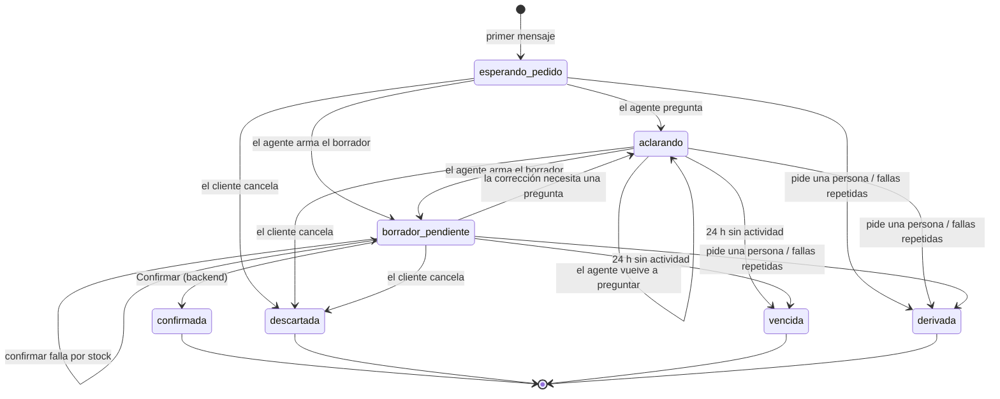
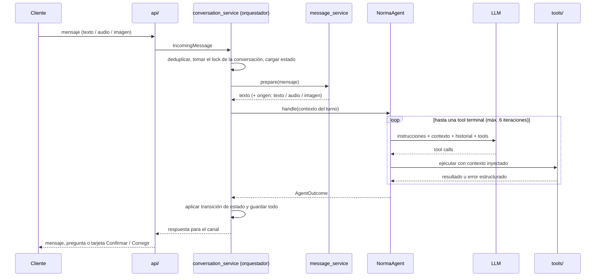
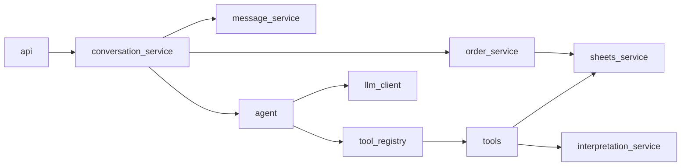

# 🤖 Spec del agente Norma

> Parte de la [spec del MVP](README.md). Define **cómo conversa el asistente**: el loop de cada turno,
> los estados de la conversación, las tools con sus contratos, el manejo de errores, la derivación a una
> persona, la memoria y cómo se organiza todo eso en el código.
>
> Los IDs `RF-xx`, `RNF-xx`, `CA-xx` y `D-xx` son los de la [spec del MVP](README.md).

## 1. Idea central

El agente **no maneja la conversación solo**. La conversación la conduce el backend con una máquina de estados
(el **orquestador**), y el LLM entra únicamente en los momentos en que hay que **interpretar lenguaje**:

| Lo decide el backend (determinístico) | Lo decide el LLM (dentro de un turno) |
|---|---|
| En qué estado está la conversación y qué eventos acepta | Qué quiso decir el cliente |
| Confirmar un borrador y crear la orden | Qué productos buscar y cuáles coinciden |
| Revalidar el stock al confirmar | Si hace falta preguntar algo y qué |
| Completar nombre, presentación y precio desde el catálogo | Las cantidades y el SKU de cada línea |
| El texto del resumen con **Confirmar / Corregir** | Si el cliente quiere cancelar o hablar con una persona |
| Límites, reintentos, vencimientos y derivación por fallas | El texto de las preguntas y avisos al cliente |

Así se cumple el principio rector: **el LLM interpreta; el backend valida y registra; el cliente confirma.**

## 2. Estados de la conversación

Una **conversación** es el intento de armar **un** pedido de un cliente por un canal. Hay como máximo una
conversación abierta por `(customer_id, channel)`. Cuando termina (confirmada, descartada, vencida o derivada),
el siguiente mensaje del cliente abre una nueva.

| Estado | Significado | ¿Abierta? |
|---|---|---|
| `esperando_pedido` | Recién abierta, todavía no hay nada interpretado | Sí |
| `aclarando` | El agente hizo una pregunta y espera la respuesta | Sí |
| `borrador_pendiente` | Hay un borrador mostrado con **Confirmar / Corregir** | Sí |
| `confirmada` | El cliente confirmó y se creó la orden | No |
| `descartada` | El cliente canceló el pedido antes de confirmar | No |
| `vencida` | Pasaron 24 h sin actividad (D-07) | No |
| `derivada` | Se pasó a una persona del equipo | No |



### 2.1 Eventos que recibe el orquestador

| Evento | Origen | ¿Pasa por el LLM? |
|---|---|---|
| Mensaje de texto, audio o imagen | Chat web o WhatsApp | Sí, después del preprocesamiento |
| Acción **Confirmar** (`draft_id`, `version`) | Botón de la tarjeta o del mensaje interactivo de WhatsApp | **No** |
| Acción **Corregir** (`draft_id`, `version`) | Botón | **No**: responde un texto fijo («¿Qué querés cambiar?») |
| Palabra clave `OK` / `CONFIRMAR` / `CORREGIR` | Texto en WhatsApp, cuando no hay botones | **No**: se trata igual que el botón |
| Vencimiento | Tarea del backend | No |

Las palabras clave se comparan sin mayúsculas, tildes ni espacios sobrantes, y **solo** se aceptan si el
mensaje es exactamente esa palabra y la conversación está en `borrador_pendiente`. Cualquier otro texto
(«dale, mandalo», «sí») va al agente, que **no puede confirmar**: le recuerda al cliente cómo hacerlo (RF-13).

### 2.2 Qué pasa en cada estado al recibir un mensaje

| Estado | Mensaje del cliente | Confirmar | Corregir |
|---|---|---|---|
| `esperando_pedido` | Turno del agente | Error: no hay borrador | Error: no hay borrador |
| `aclarando` | Turno del agente (con la pregunta pendiente en contexto) | Error: no hay borrador | Error: no hay borrador |
| `borrador_pendiente` | Turno del agente (con el borrador en contexto) | Confirmación (§5) | Texto fijo, sigue en `borrador_pendiente` |
| Cerrada | Abre una conversación nueva (salvo `derivada`, ver §7) | Idempotente si es la misma orden; si no, error | Error: el pedido ya no se puede corregir |

## 3. El loop de un turno

Un **turno** empieza con un mensaje del cliente y termina con **una sola respuesta** del sistema.



Reglas del loop:

1. **Cada turno termina con exactamente una tool terminal** (§4.2). Ese resultado decide la transición de estado.
2. **Máximo 6 iteraciones** LLM ↔ tools por turno (D-07). Si se alcanza sin tool terminal, el turno termina con
   un mensaje fijo de disculpa y suma una falla a la conversación (§6).
3. Si el LLM responde **solo texto** sin llamar a una tool terminal, se trata como
   `respond_to_customer(kind="informacion")` y queda registrado como advertencia.
4. Las tools de lectura se pueden llamar varias veces en un turno. Las terminales, una sola vez: la primera
   que tenga éxito cierra el turno.
5. El texto del **resumen del borrador** no lo escribe el LLM: lo arma `validation_service.build_summary`
   a partir del borrador validado (RF-11).
6. Los turnos de una misma conversación se procesan **de a uno** (lock por `(customer_id, channel)`). Un mensaje
   que llega durante un turno espera a que termine (RNF-05).

## 4. Tools

### 4.1 Contexto inyectado

Las tools reciben dos tipos de parámetros:

- **Del LLM**: solo lo que tiene que interpretar (texto de búsqueda, SKU, cantidades, notas, mensajes).
- **Del backend**, inyectados por `tool_registry` y **nunca visibles para el LLM**: `customer_id`, `channel`,
  `conversation_id`, `draft_id`. Así el LLM no puede registrar un pedido a nombre de otro cliente ni tocar
  otro borrador.

> **Cambio respecto del esqueleto actual:** hoy `create_order_draft` recibe `customer_id`, `channel` y
> `OrderItem` completos (con nombre y precio). Pasa a recibir solo `sku` y `quantity`; el resto lo inyecta o lo
> completa el backend desde el catálogo.

### 4.2 Catálogo de tools

| Tool | Tipo | Archivo | Para qué |
|---|---|---|---|
| `search_products` | Lectura | `tools/catalog_tools.py` | Buscar candidatos por nombre, marca o presentación |
| `get_product` | Lectura | `tools/catalog_tools.py` | Ver un producto por SKU |
| `check_stock` | Lectura | `tools/inventory_tools.py` | Saber si alcanza el stock para una cantidad |
| `create_order_draft` | **Terminal** | `tools/order_tools.py` | Armar el borrador cuando el pedido está claro |
| `update_order_draft` | **Terminal** | `tools/order_tools.py` | Reemplazar las líneas del borrador tras una corrección |
| `discard_order_draft` | **Terminal** | `tools/order_tools.py` | El cliente cancela el pedido |
| `respond_to_customer` | **Terminal** | `tools/reply_tools.py` | Preguntar, avisar falta de stock o de producto, informar |
| `escalate_to_human` | **Terminal** | `tools/reply_tools.py` | Pasar la conversación a una persona |

**No existe ninguna tool para confirmar.** Confirmar es un evento del cliente que procesa el backend (§5).

### 4.3 Contratos

Todas las tools devuelven un sobre común, para que el LLM pueda recuperarse de un error en la misma iteración:

```json
{"ok": true, "data": { ... }}
{"ok": false, "error": {"code": "sku_inexistente", "message": "No existe el SKU XX-000", "details": {"sku": "XX-000"}}}
```

#### `search_products`

| Entrada | Tipo | Reglas |
|---|---|---|
| `query` | `str` | No vacío. Texto libre del cliente o del LLM («pantene 400») |
| `limit` | `int` | 1 a 10, por defecto 5 |

Salida `data.matches`: lista de `{sku, name, brand, presentation, price, stock, score}`, ordenada por `score`
descendente (0 a 1). La búsqueda es aproximada: tolera mayúsculas, tildes, plurales y errores de tipeo (RF-07).
Lista vacía si no hay coincidencias razonables. Errores: `catalogo_no_disponible`.

#### `get_product`

Entrada `sku: str`. Salida `data.product`: un `Product` completo o `null`. Errores: `catalogo_no_disponible`.

#### `check_stock`

Entrada `sku: str`, `quantity: int > 0`. Salida `data`: un `StockCheck` (`sku`, `requested`, `available`,
`is_enough`). Errores: `sku_inexistente`, `catalogo_no_disponible`.

#### `create_order_draft` (terminal)

| Entrada | Tipo | Reglas |
|---|---|---|
| `items` | `list[{sku: str, quantity: int}]` | Al menos uno. `quantity > 0`. Un SKU repetido se suma en una sola línea |
| `notes` | `str \| None` | Opcional: aclaraciones del cliente («retira a la tarde») |

Inyectados: `customer_id`, `channel`, `conversation_id`.

Validaciones del backend, en este orden:

1. La conversación no tiene un borrador pendiente → si no, `borrador_existente` (usar `update_order_draft`).
2. Cada SKU existe en el catálogo → si no, `sku_inexistente` con la lista de SKU inválidos.
3. Alcanza el stock de cada línea → si no, `stock_insuficiente` con `{sku, requested, available}` por línea.

Si todo pasa: completa `product_name`, `presentation` y `unit_price` desde el catálogo, guarda un `OrderDraft`
con `version = 1` y estado `pendiente_confirmacion`, y devuelve `data = {draft, summary}`.
La conversación pasa a `borrador_pendiente`. Resultado del turno: `borrador`.

#### `update_order_draft` (terminal)

Igual que `create_order_draft`, pero reemplaza **todas** las líneas del borrador pendiente (inyectado `draft_id`)
y hace `version + 1`. Errores adicionales: `sin_borrador`. Resultado del turno: `borrador`.

#### `discard_order_draft` (terminal)

Entrada `reason: str`. Marca el borrador (si hay) como `descartado` y la conversación como `descartada`.
Solo se usa cuando el cliente lo pide de forma explícita. Resultado del turno: `descartado`.

#### `respond_to_customer` (terminal)

| Entrada | Tipo | Reglas |
|---|---|---|
| `kind` | `aclaracion \| sin_stock \| fuera_de_catalogo \| informacion` | Ver tabla de abajo |
| `message` | `str` | El texto para el cliente. No vacío, máx. 600 caracteres |
| `options` | `list[str]` | SKU que se le ofrecen al cliente. Cada uno tiene que existir (`sku_inexistente` si no) |

| `kind` | Cuándo | Nuevo estado |
|---|---|---|
| `aclaracion` | Producto, presentación, tono o cantidad no claros; varias opciones posibles | `aclarando` |
| `sin_stock` | No alcanza el stock; se ofrece lo disponible o una alternativa | `aclarando` |
| `fuera_de_catalogo` | El producto no está en el catálogo (sin inventar un SKU parecido) | `aclarando` |
| `informacion` | Saludo, consulta general o recordatorio de cómo confirmar | Sin cambio |

Los `kind` coinciden con los resultados esperados de [`datos_ejemplo/mensajes.json`](../../datos_ejemplo/mensajes.json),
así cada caso de ejemplo se puede verificar contra el resultado del turno (CA-08 a CA-11).

#### `escalate_to_human` (terminal)

Entrada `reason: str`. Solo cuando el cliente pide hablar con una persona o plantea algo que no es un pedido y
el agente no puede resolver (reclamos, devoluciones). La conversación pasa a `derivada` (§7).

### 4.4 Cómo se exponen al LLM

`agent/tool_registry.py` es el único lugar que conoce la lista de tools. Para cada una guarda: nombre,
descripción para el LLM, modelo pydantic de entrada (de él sale el JSON Schema que recibe el LLM), función, si es
terminal y qué parámetros se inyectan. Agregar una tool es agregar una entrada al registro, su modelo y sus tests.
`llm_client` traduce ese formato neutral al del proveedor elegido (D-01).

## 5. Confirmación (sin LLM)

La confirmación es **determinística** y vive en `services/order_service.py` (RF-14 a RF-18):

1. Llega `Confirmar` con `draft_id` y `version` (botón o palabra clave; con la palabra clave se usa el borrador
   pendiente y su versión actual).
2. Si el borrador ya está `confirmado` → devuelve la orden existente (idempotencia, CA-15).
3. Si la conversación no está en `borrador_pendiente`, o `version` no es la última → `409`: «El pedido cambió,
   revisá el último resumen» (CA-14).
4. **Revalida el stock** de cada línea contra el catálogo, con una lectura fresca (sin caché).
   Si alguna línea no alcanza → no crea nada, responde qué líneas no alcanzan y la conversación sigue en
   `borrador_pendiente` para que el cliente corrija (CA-16).
5. En **una transacción** de la base: crea la `Order` (`order_id` correlativo `ORD-0001`, `draft_id` único),
   marca el borrador `confirmado` y la conversación `confirmada`.
6. Fuera de la transacción: agrega la fila en Google Sheet 2. Si falla, la orden queda con
   `sheets_synced = false` y se reintenta en segundo plano (RNF-04).
7. Responde al cliente con el número de orden.

## 6. Errores

| Situación | Qué hace el sistema | Estado |
|---|---|---|
| Una tool devuelve `ok: false` | El error vuelve al LLM en la misma iteración para que corrija (p. ej. buscar de nuevo) | Sin cambio |
| Argumentos que no cumplen el esquema | Error `argumentos_invalidos` al LLM, con el detalle de pydantic | Sin cambio |
| El LLM falla o tarda más de 30 s | 1 reintento. Si vuelve a fallar: mensaje fijo «Tuve un problema, probá de nuevo en unos minutos» y +1 falla | Sin cambio |
| Se alcanzan 6 iteraciones sin tool terminal | Mensaje fijo de disculpa y +1 falla | Sin cambio |
| Audio o imagen sin texto útil (transcripción u OCR vacíos o fallidos) | Sin llamar al LLM: «No pude entender el audio / la imagen, ¿me lo escribís?» | Sin cambio |
| Catálogo no disponible al buscar | Se usa la última copia en caché si tiene menos de 1 h; si no, `catalogo_no_disponible` | Sin cambio |
| Catálogo no disponible al confirmar | No se confirma; «No pude verificar el stock, probá en unos minutos» | `borrador_pendiente` |
| Falla al escribir en Google Sheet 2 | La orden ya existe en la base; reintento en segundo plano | `confirmada` |
| Mensaje de WhatsApp repetido (mismo id de Meta) | Se ignora y se responde 200 | Sin cambio |
| **2 fallas** en la misma conversación, o **3 aclaraciones seguidas** sin llegar a un borrador | Derivación automática (§7) | `derivada` |

Todas las situaciones quedan registradas con `conversation_id` para poder reconstruir el turno (RNF-07).

## 7. Derivación a una persona

En el MVP la derivación es **mínima** (la atención humana completa y los avisos al equipo siguen en v2):

- La conversación pasa a `derivada` y se guarda el motivo.
- El cliente recibe un mensaje fijo: «Te va a responder una persona del equipo».
- La conversación aparece en el dashboard como **requiere atención** (RF-24).
- Durante 24 h el bot **no responde** automáticamente a ese cliente en ese canal; los mensajes se guardan para
  que los vea el equipo. Pasado ese plazo, un mensaje nuevo abre una conversación nueva.

> **Riesgo:** sin avisos al equipo (v2), una conversación derivada depende de que alguien mire el dashboard.

## 8. Memoria y contexto

**Memoria de corto plazo (en el MVP):** todo lo de la conversación abierta se guarda en la base interna:
mensajes del cliente (ya preprocesados), respuestas, tool calls con sus resultados, estado y borrador.

**Contexto que recibe el LLM en cada iteración**, armado por `agent/context.py`:

1. Las instrucciones de [`agent/instructions.md`](../../backend/agent/instructions.md).
2. Un bloque de **estado actual**, generado por el backend: estado de la conversación, borrador pendiente
   (líneas y versión), última pregunta hecha y opciones ofrecidas.
3. Los **últimos 20 mensajes** de la conversación abierta (D-07), con el origen de cada uno
   (`texto`, `audio transcripto`, `imagen leída`) para que el agente sea más prudente con audio e imagen.
4. Las tools disponibles.

**No van al contexto:** el catálogo completo (se consulta con las tools, porque el real puede tener miles de
productos), conversaciones anteriores del cliente ni datos de otros clientes.

**Memoria de largo plazo:** no hay en el MVP. «Lo mismo que la otra vez» o un perfil del cliente quedan para v2.

**Retención:** los archivos de audio e imagen se procesan y **no se guardan**; se guarda solo el texto extraído
(RNF-03).

## 9. Organización del código

```text
backend/
├── api/
│   ├── chat.py                  # chat web: mensajes y acciones Confirmar / Corregir
│   ├── whatsapp_webhook.py      # webhook de Meta: firma, deduplicación, respuesta 200 rápida
│   └── dashboard.py             # NUEVO: endpoints del dashboard, con autenticación
├── agent/
│   ├── norma_agent.py           # loop de un turno: LLM ↔ tools hasta una tool terminal
│   ├── tool_registry.py         # NUEVO: tools disponibles, esquemas y parámetros inyectados
│   ├── context.py               # NUEVO: arma instrucciones + estado + historial para el LLM
│   ├── llm_client.py            # interfaz neutral del LLM; una clase por proveedor
│   └── instructions.md          # comportamiento del agente en lenguaje natural
├── tools/
│   ├── catalog_tools.py         # search_products, get_product
│   ├── inventory_tools.py       # check_stock
│   ├── order_tools.py           # create / update / discard_order_draft
│   └── reply_tools.py           # NUEVO: respond_to_customer, escalate_to_human
├── services/
│   ├── conversation_service.py  # NUEVO: orquestador y máquina de estados de la conversación
│   ├── message_service.py       # preprocesamiento: texto, audio → texto, imagen → texto
│   ├── interpretation_service.py# {sku, quantity} del LLM → OrderItem completos y validados
│   ├── validation_service.py    # resumen del borrador con Confirmar / Corregir
│   ├── order_service.py         # confirmación: el único lugar donde nace una Order
│   ├── sheets_service.py        # única capa que conoce Google Sheets (con caché del catálogo)
│   ├── whatsapp_service.py      # NUEVO: enviar mensajes y botones, descargar multimedia
│   └── dashboard_service.py     # NUEVO: indicadores, pedidos, stock y conversaciones derivadas
├── schemas/
│   ├── order_schema.py          # mensajes, borrador, orden
│   ├── catalog_schema.py        # producto y stock
│   ├── conversation_schema.py   # NUEVO: ConversationState, Conversation, Turn
│   └── agent_schema.py          # NUEVO: AgentOutcome, ToolResult y entradas de cada tool
└── database/
    ├── connection.py
    └── models.py                # tablas de la §5.7 de la spec del MVP
```

### 9.1 Reglas de dependencia



- `api/` solo traduce HTTP ↔ esquemas y llama al orquestador; no tiene lógica de negocio.
- El agente no conoce el canal ni HTTP: recibe un contexto y devuelve un `AgentOutcome`.
- Las tools no llaman al LLM y no conocen al agente.
- Solo `order_service` crea una `Order`; solo `sheets_service` conoce gspread; solo `llm_client` conoce el SDK
  del proveedor; solo `whatsapp_service` conoce la API de Meta.
- Cambiar Google Sheets por el sistema de gestión real (v2) es reemplazar `sheets_service` sin tocar agente ni tools.

### 9.2 `AgentOutcome`

Reemplaza al `AgentReply` actual. Es lo que devuelve `NormaAgent.handle` al orquestador:

| Campo | Tipo | Notas |
|---|---|---|
| `kind` | `borrador \| aclaracion \| sin_stock \| fuera_de_catalogo \| informacion \| descartado \| derivado \| error` | Sale de la tool terminal |
| `message` | `str` | Lo que ve el cliente (en `borrador`, el resumen de `validation_service`) |
| `draft` | `OrderDraft \| None` | Solo en `borrador` |
| `options` | `list[str]` | SKU ofrecidos, en `aclaracion` y `sin_stock` |
| `iterations` | `int` | Para observabilidad |

## 10. Cómo se prueba el agente

- **Sin red y sin LLM real** (regla de `CONTRIBUTING.md`): un `FakeLLM` con respuestas guionadas (tool calls)
  prueba el loop, los límites, los errores y las transiciones.
- **Tools y orquestador**: con `tests/datos_sinteticos.py` y `datos_ejemplo/catalogo.csv`, sin LLM.
- **Casos de `datos_ejemplo/mensajes.json`**: cada caso es un criterio de aceptación de interpretación
  (CA-08 a CA-11). Con `FakeLLM` se prueba que el orquestador produce el resultado esperado; con el LLM real se
  corren como **evaluación manual** fuera del CI (D-01), y el porcentaje de aciertos se anota en `MEJORAS.md`.
