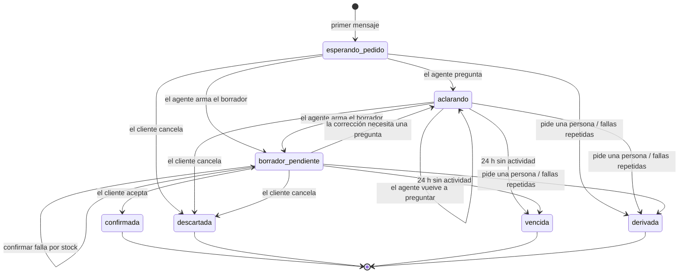
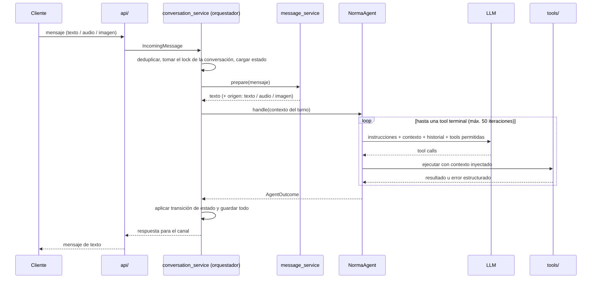
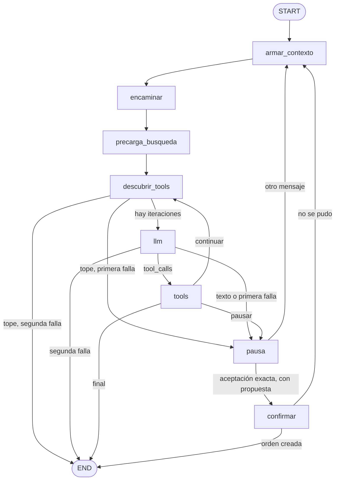
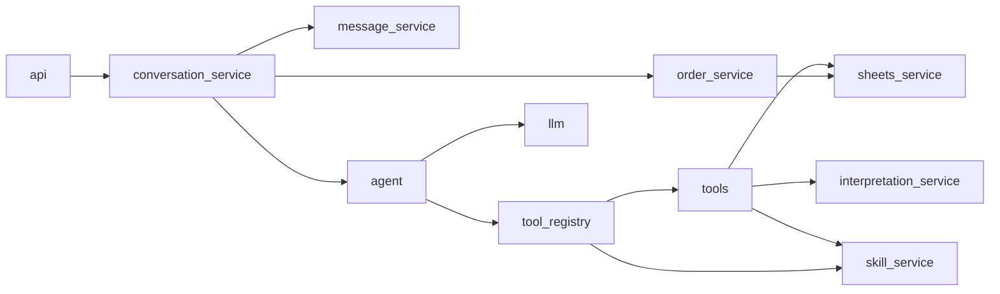

# 🤖 Spec del agente Norma

> Parte de la [spec del MVP](README.md). Define **cómo conversa el asistente**: el loop de cada turno,
> los estados de la conversación, las tools con sus contratos, el manejo de errores, la derivación a una
> persona, la memoria y cómo se organiza todo eso en el código.
>
> Los IDs `RF-xx`, `RNF-xx`, `CA-xx` y `D-xx` son los de la [spec del MVP](README.md).

## 1. Idea central

El agente **no maneja la conversación solo**. La conversación la conduce el backend con una máquina de estados
(el **orquestador**), y el LLM entra únicamente en los momentos en que hay que **interpretar lenguaje**:

| Lo decide el backend (determinístico) | Lo decide el LLM (dentro de un turno) |
|---|---|
| En qué estado está la conversación y qué eventos acepta | Qué quiso decir el cliente |
| Crear la orden exactamente con lo propuesto | Qué productos buscar y cuáles coinciden |
| Revalidar el stock al crear la orden | Si hace falta preguntar algo y qué |
| Qué se le puede registrar al cliente: solo la propuesta vigente | Si el cliente aceptó la propuesta, salvo una aceptación exacta (§2.1) |
| Completar nombre, presentación y precio desde el catálogo | Las cantidades y el SKU de cada línea |
| El mensaje final con el pedido registrado | Si el cliente quiere cancelar o hablar con una persona |
| Límites, reintentos, vencimientos y derivación por fallas | El texto de las preguntas y avisos al cliente |
| Qué tools y BR permite cada skill | Qué skill y qué BR leer en cada turno |

Así se cumple el principio rector: **el LLM interpreta; el backend valida y registra; el cliente confirma.**
El cliente confirma conversando: el LLM interpreta su respuesta, pero solo puede registrar lo que el backend ya
validó y guardó como propuesta (§5). El riesgo es que interprete mal una respuesta, y se mide con los casos de
evaluación de `data_example/mensajes.json`.

## 2. Estados de la conversación

> **Primer corte:** la conversación se guarda en la base con sus estados de ciclo de vida (`abierta`, `cerrada`,
> `fallida` y `vencida` tras 24 h sin actividad, RF-28). La derivación y descarte se suman en etapas siguientes.

Una **conversación** es el intento de armar **un** pedido de un cliente por un canal. Hay como máximo una
conversación abierta por `(customer_id, channel)`. Cuando termina (confirmada, descartada, vencida o derivada),
el siguiente mensaje del cliente abre una nueva.

| Estado | Significado | ¿Abierta? |
|---|---|---|
| `esperando_pedido` | Recién abierta, todavía no hay nada interpretado | Sí |
| `aclarando` | El agente hizo una pregunta y espera la respuesta | Sí |
| `borrador_pendiente` | Hay una propuesta vigente, esperando la respuesta del cliente | Sí |
| `confirmada` | El cliente confirmó y se creó la orden | No |
| `descartada` | El cliente canceló el pedido antes de confirmar | No |
| `vencida` | Pasaron 24 h sin actividad (D-07) | No |
| `derivada` | Se pasó a una persona del equipo | No |



### 2.1 Eventos que recibe el orquestador

| Evento | Origen | ¿Pasa por el LLM? |
|---|---|---|
| Mensaje de texto, audio o imagen | Cualquier canal | Sí, después del preprocesamiento |
| Una aceptación exacta (`OK`, `CONFIRMAR`, «dale», «sí», «listo», «de una» o «mandale»), con una propuesta vigente | Texto del cliente | **No**: el backend registra la propuesta (RF-64) |
| Vencimiento | Tarea del backend | No |

Ningún canal usa botones: el cliente confirma escribiendo. Cualquier otra respuesta («dale», «sí») va al agente, que
decide si acepta la propuesta vigente (RF-13, §5). Sin propuesta vigente, `OK` también va al agente.

### 2.2 Qué pasa en cada estado al recibir un mensaje

| Estado | Mensaje del cliente |
|---|---|
| `esperando_pedido` | Turno del agente |
| `aclarando` | Turno del agente (con la pregunta pendiente en contexto) |
| `borrador_pendiente` | Una aceptación exacta (§2.1): se registra la propuesta (§5). Otro mensaje: turno del agente, con la propuesta en contexto |
| Cerrada | Abre una conversación nueva (salvo `derivada`, ver §7) |

## 3. El loop de un turno

Un **turno** empieza con un mensaje del cliente y termina con **una sola respuesta** del sistema.



Reglas del loop:

1. **Cada turno termina con exactamente una tool terminal** (§4.2). Ese resultado decide la transición de estado.
2. **Máximo 50 iteraciones y 300 s** LLM ↔ tools por turno (RNF-16), configurables con `AGENT_MAX_ITERATIONS` y
   `AGENT_MAX_SECONDS_PER_TURN`. Un turno es la respuesta a un mensaje del cliente: la conversación no tiene tope. Si se
   alcanza sin tool terminal, el turno **cierra con lo encontrado**: el modelo recibe solo `respond_to_customer` y un
   aviso en el estado actual, y tiene 2 iteraciones más para responder con lo que ya buscó (lo resuelto en
   `propuesta`, lo que falta en `pendientes`, lo que no se trabaja en `afuera`). Solo si tampoco responde, el turno
   termina con un mensaje fijo de disculpa y suma una falla a la conversación (§6).
3. Si el LLM responde **solo texto** sin llamar a una tool terminal, se trata como
   `respond_to_customer(kind="informacion")`, descarta la propuesta y queda registrado como advertencia.
4. Las tools de lectura se pueden llamar varias veces en un turno. Las terminales, una sola vez: la primera
   que tenga éxito cierra el turno.
5. El **mensaje final** con el pedido registrado no lo escribe el LLM: lo arma `validation_service` a partir
   de la orden creada (RF-11). El **detalle de una propuesta** tampoco: cuando `respond_to_customer` deja una
   propuesta vigente, el backend agrega debajo del mensaje cada línea con su precio y el total (CA-58).
6. Los turnos de una misma conversación se procesan **de a uno** (lock por `(customer_id, channel)`). Un mensaje
   que llega durante un turno espera a que termine (RNF-05).
7. Cada turno empieza **sin skills activas**. Las tools que no son de base se habilitan al leer la skill que las
   permite (§4.5).

### 3.1 Fases del turno: L1 y L2

L1 y L2 son fases de **un mismo loop**, no dos agentes ni dos prompts. Comparten el tope de iteraciones y el
historial del turno.

| Fase | Qué hace | Tools típicas | Termina cuando |
|---|---|---|---|
| **L1 · Entender** | Junta los datos que necesita, sin decidir todavía | `search_products`, `get_product`, `check_stock` | Sabe qué pidió el cliente y qué hay en el catálogo |
| **L2 · Decidir** | Elige la skill, lee las BR que necesite y cierra el turno | `leer_skill`, `leer_br` y una tool terminal | Una tool terminal tiene éxito |

Ejemplo: el cliente pide 5 unidades y hay 3.

| Iteración | Fase | Tool | Resultado |
|---|---|---|---|
| 1 | L1 | `search_products` | Encuentra el producto con stock 3 |
| 2 | L2 | `leer_skill("tomar_pedido")` | Se habilitan sus tools y sus BR |
| 3 | L2 | `leer_br("BR-01")` | Lee cómo ofrecer lo disponible |
| 4 | L2 | `respond_to_customer(kind="sin_stock", propuesta=[{sku, 3}])` | «Me quedaron 3, ¿te armo el pedido con 3?». El backend guarda la propuesta y el grafo pausa |

Si el cliente acepta, el turno siguiente lee `confirmar_pedido` y termina en la tool `armar_pedido`, que crea la orden
con esas 3 unidades (§5).

> **Riesgo:** cada lectura suma una llamada al LLM, con todo el contexto. Hay que medir que el camino normal cumpla
> el p95 de 10 s (RNF-06). Un turno que agota el tope puede tardar varios minutos con la conversación bloqueada
> (el plazo de 300 s se controla entre una llamada y la siguiente, y cada llamada puede tardar hasta 30 s más un
> reintento), y en el free tier consume hasta 52 requests con el cierre (RNF-16); con modelos de unos 5 s por llamada, 50 iteraciones son unos 250 s, así que los dos topes quedan parejos. Si el proveedor limita los requests
> por minuto, bajar `AGENT_MAX_ITERATIONS`.

### 3.2 El grafo

El loop se implementa con LangGraph en `agent/graph.py`, y el modelo se llama con LangChain:



| Nodo | Qué hace |
|---|---|
| `armar_contexto` | Si no hay un contexto del cliente de hoy, lo arma sin LLM: últimos pedidos y SKU comprados. Vence con el cambio de fecha o al registrar un pedido ([orquestador §3.2](orquestador-y-sub-loops.md#32-el-turno-con-el-orquestador), RF-84) |
| `encaminar` | Abre el turno. Si el mensaje no admite dudas, lee la skill antes de la primera llamada al LLM: su texto va en el contexto y sus tools quedan habilitadas (RF-62) |
| `precarga_busqueda` | Busca sin LLM los renglones nuevos de forma inequívoca («2 mascara argan x 1k», «tinte 8.1/2») y deja el resultado en el contexto como nota de búsqueda (RF-86) |
| `descubrir_tools` | Calcula las tools permitidas: las de base más las de las skills leídas en el turno. Al llegar al tope de iteraciones o al plazo (RNF-16) deja solo `respond_to_customer` para cerrar con lo encontrado; si el cierre tampoco responde, corta |
| `llm` | Arma el contexto (§8) y llama al modelo solo con esas tools. Guarda el `AIMessage` completo para conservar las firmas de Gemini |
| `tools` | Rechaza lo no permitido, inyecta los datos del backend, ejecuta y guarda los resultados en el sobre común |
| `pausa` | Devuelve el mensaje con `interrupt()` y espera. Al retomar, agrega el mensaje del cliente y reinicia iteraciones y skills |
| `confirmar` | Registra la propuesta sin llamar al LLM, si el cliente respondió con una aceptación exacta (§2.1). Si no se puede, por ejemplo porque ya no alcanza el stock, sigue el agente |

- **Orquestador (`AGENT_ORQUESTADOR=true`):** el mismo grafo, pero `llm` es el orquestador: suma `delegar_skill`,
  que corre el sub-loop de una skill `sub_loop` dentro del nodo `tools` y devuelve su nota como resultado. Las
  vueltas del sub-loop cuentan para el tope del turno
  ([orquestador §3.3 y §3.4](orquestador-y-sub-loops.md#33-el-loop-vuelta-por-vuelta)).
- **Persistencia:** el estado del grafo se guarda con `SqliteSaver` en `CHECKPOINT_DB`, un archivo propio dentro de
  `data/`, con `LANGGRAPH_STRICT_MSGPACK=true`. El `thread_id` es el ID de la conversación, y una conversación
  sigue aunque el proceso se reinicie entre dos mensajes.
- **Un solo worker:** el lock por conversación vive en el proceso, así que la API corre con un solo worker mientras
  los checkpoints estén en SQLite. La conexión espera hasta 15 s si otro proceso, como el bot, está escribiendo.
- **Salidas por `END`:** un pedido registrado cierra la conversación. Una segunda falla la marca `fallida`, y el
  mensaje siguiente abre otra.
- **`recursion_limit`:** es solo una red de seguridad. El tope real es el contador de iteraciones (`AGENT_MAX_ITERATIONS`, 50 por defecto, más 2 para el cierre).
- **Tool obligatoria:** cada llamada al modelo lleva `tool_choice="any"` (RF-61). El camino de texto suelto queda
  para un proveedor que no lo respete.
- **BR junto al resultado:** cuando el resultado de una tool lleva a una sola BR (`sugerencias` o `aproximado` →
  BR-09, varias coincidencias → BR-03, nada parecido → BR-04, stock que no alcanza → BR-01), el sobre trae su
  texto en `regla`, una vez por turno y solo si una skill leída la permite (RF-63).

## 4. Tools

### 4.1 Contexto inyectado

Las tools reciben dos tipos de parámetros:

- **Del LLM**: solo lo que tiene que interpretar (texto de búsqueda, SKU, cantidades, notas, mensajes).
- **Del backend**, inyectados por `tool_registry` y **nunca visibles para el LLM**: `customer_id`, `channel`,
  `conversation_id`, `draft_id`. Así el LLM no puede registrar un pedido a nombre de otro cliente ni tocar
  otro borrador.

> La `propuesta` de `respond_to_customer` solo lleva `sku` y `quantity`. El resto lo completa el backend desde el
> catálogo, y `armar_pedido` no recibe productos.

### 4.2 Catálogo de tools

| Tool | Tipo | Archivo | Para qué |
|---|---|---|---|
| `search_products` | Lectura | `tools/catalog_tools.py` | Buscar candidatos por nombre, marca o presentación |
| `buscar_renglones` | Lectura | `tools/catalog_tools.py` | Buscar todos los renglones de una lista en una llamada: por cada uno, un estado y hasta 3 candidatos (RF-66) |
| `pedidos_anteriores` | Lectura | `tools/order_tools.py` | Los últimos pedidos del cliente del turno, sin precios, para «lo de siempre» (RF-73) |
| `get_product` | Lectura | `tools/catalog_tools.py` | Ver un producto por SKU |
| `explorar_catalogo` | Lectura | `tools/catalog_tools.py` | Explorar marcas o categorías del catálogo de forma agregada sin recorrer todo el catálogo |
| `check_stock` | Lectura | `tools/inventory_tools.py` | Saber si alcanza el stock para una cantidad |
| `leer_skill` | Lectura | `tools/skill_tools.py` | Leer una skill y habilitar sus tools y BR (§4.5) |
| `leer_br` | Lectura | `tools/skill_tools.py` | Leer una regla de negocio permitida (§4.6) |
| `armar_pedido` | **Terminal** | `tools/order_tools.py` | Registrar la propuesta vigente cuando el cliente la acepta |
| `discard_order_draft` | **Terminal** | `tools/order_tools.py` | El cliente cancela el pedido |
| `respond_to_customer` | **Terminal** | `tools/reply_tools.py` | Preguntar, proponer un pedido, avisar falta de stock o de producto, informar |
| `escalate_to_human` | **Terminal** | `tools/reply_tools.py` | Pasar la conversación a una persona |

`discard_order_draft` y `escalate_to_human` todavía no se implementan: quedan para cuando se sumen la cancelación
explícita y la derivación.

### 4.3 Contratos

Todas las tools devuelven un sobre común, para que el LLM pueda recuperarse de un error en la misma iteración:

```json
{"ok": true, "data": { ... }}
{"ok": false, "error": {"code": "sku_inexistente", "message": "No existe el SKU XX-000", "details": {"sku": "XX-000"}}}
```

#### `leer_skill`

Entrada `nombre: str`. Busca en el índice de skills cargado al arrancar. Salida `data`: `{nombre, instrucciones,
tools, br}`, donde `br` es la lista de `{id, titulo}`: el título sale del encabezado de cada BR
(«# BR-01: Falta de stock»), así el agente elige cuál leer sin leerlas todas. Una BR sin ese encabezado impide
arrancar. Desde la iteración siguiente, las tools de esa skill quedan disponibles y sus BR se pueden leer.
Errores: `skill_inexistente`, que lista las skills del índice (sin propuesta vigente, no las que la necesitan).

#### `leer_br`

Entrada `id: str`. Inyectado: `skills_activas`. Busca en el índice de BR cargado al arrancar. Salida `data`:
`{id, texto}`. Errores: `br_inexistente`, que lista las BR de las skills leídas con su título, y `br_no_permitida`
(ninguna skill leída en este turno la permite), que nombra la skill de esa BR.

Ninguna de las dos arma una ruta de archivo con lo que manda el LLM: el nombre o el ID solo se comparan contra el
índice. Así, un mensaje malicioso no puede hacer que el agente lea otro archivo del sistema, como `.env`.

#### `search_products`

| Entrada | Tipo | Reglas |
|---|---|---|
| `query` | `str` | No vacío. Texto libre del cliente o del LLM («pantene 400») |
| `limit` | `int` | 1 a 10, por defecto 5 |
| `quantity` | `int \| None` | Opcional, mayor que 0. La cantidad que pide el cliente |

Salida `data.matches`: lista de `{sku, name, brand, presentation, price, score, aproximado, hay_stock}`, ordenada
por `score` descendente (0 a 1), sin el número de stock. Con `quantity`, cada match y cada sugerencia suman
`alcanza` y, solo si no alcanza, `disponible`: las unidades que quedan, lo único que BR-01 deja decirle al cliente.
Así el agente no necesita `check_stock` después de buscar, y un único match que no alcanza adjunta BR-01. La búsqueda es aproximada: tolera mayúsculas, tildes,
plurales, errores de tipeo y de sonido, abreviaturas y medidas escritas de otra forma (RF-07, RF-36 a RF-38).
Los números no se aproximan: `340` no trae un producto de 400 ml, y `6.1` no trae el tono 7.1 (RF-08).
Si no hay coincidencias confiables, `data.sugerencias` trae los candidatos más parecidos, y `data.corregido` dice
qué palabras se interpretaron como otra (RF-39). Detalle en [busqueda-tolerante.md](busqueda-tolerante.md).
Errores: `catalogo_no_disponible`.

#### `get_product`

Entrada `sku: str`. Salida `data.product`: `{sku, name, brand, presentation, price, stock}` o `null`. Errores: `catalogo_no_disponible`.

#### `pedidos_anteriores`

Entrada `limite: int` (1 a 5, por defecto 3). Inyectado: `customer_id`. Salida `data.pedidos`: los últimos pedidos del
cliente, cada uno con `fecha` y `lineas` (`sku`, `name`, `cantidad`, `nota`), sin precios, número de orden ni estado
(RF-73). Cada línea suma `en_catalogo` y, si está, `hay_stock` y `alcanza` (si el stock de hoy cubre la `cantidad`
de esa vez; si no, `disponible`, como `search_products`): el catálogo cambia y lo de hace un mes puede no estar hoy.
Sin pedidos, o con productos que ya no están, trae `_hint`. Siempre adjunta BR-11, la regla de cómo usar lo que
trae; con un producto que ya no está suma BR-04, y con uno que no alcanza, BR-01.

#### `explorar_catalogo`

| Entrada | Tipo | Reglas |
|---|---|---|
| `brand` | `str | None` | Opcional. Marca a filtrar (insensible a mayúsculas/minúsculas). |
| `category` | `str | None` | Opcional. Categoría a filtrar (insensible a mayúsculas/minúsculas). |
| `limit` | `int` | 1 a 10, por defecto 5. Límite de productos de muestra cuando se filtran ambos. |

Permite responder preguntas abiertas exploratorias (ej.: «¿Qué marcas de shampoo tenés?» o «¿Qué productos tenés de Fidelité?») en una sola llamada sin requerir iteraciones múltiples ni saturar los tokens de contexto (RF-35, CA-55).

Devuelve un diccionario estructurado según los parámetros provistos:
- Si solo se indica `category`: lista de `marcas` que tienen productos en dicha categoría (`tipo_consulta: marcas_por_categoria`).
- Si solo se indica `brand`: diccionario de `categorias` con conteo de productos de la marca (`tipo_consulta: categorias_por_marca`).
- Si se indican ambos (`brand` y `category`): muestra acotada de nombres y presentaciones de productos (`tipo_consulta: productos_por_marca_y_categoria`).
- Si no se indican parámetros: listado general de categorías con su total de productos (`tipo_consulta: categorias_generales`).

Si la muestra se recorta por `limit`, `_hint` lo avisa y sugiere buscar el producto puntual con `search_products`.
La marca y la categoría se comparan sin mayúsculas, tildes ni signos: «L'Oréal» encuentra la marca cargada como
`LOREAL`. El apóstrofo se borra y los demás signos separan palabras: «Anti-Frizz» queda como «anti frizz». Sin resultados, `_hint` trae las marcas o categorías más parecidas. Si la marca existe pero no tiene esa
categoría, dice qué categorías tiene la marca y hasta cinco marcas que sí tienen la categoría, para ofrecerle otra
sin una vuelta más.


#### `check_stock`

Entrada `sku: str`, `quantity: int > 0`. Salida `data`: un `StockCheck` (`sku`, `requested`, `is_enough`). Solo si
no alcanza suma `available`, como `falta` en `buscar_renglones`: si alcanza, el LLM no necesita el número y no se lo
puede pasar al cliente. Errores: `sku_inexistente`, `catalogo_no_disponible`.

#### `armar_pedido` (terminal)

No recibe nada del LLM. Inyectados: `customer_id`, `channel` y la propuesta vigente.

Validaciones del backend, en este orden:

1. Hay una propuesta vigente → si no, `sin_propuesta`.
2. Si ya existe una orden con ese `draft_id`, la devuelve sin crear otra.
3. Alcanza el stock de cada línea, con una lectura fresca → si no, `stock_insuficiente` y no se crea nada.

Si todo pasa, crea la orden (§5) y cierra la conversación. Resultado del turno: `pedido`.

#### `discard_order_draft` (terminal)

Entrada `reason: str`. Marca el borrador (si hay) como `descartado` y la conversación como `descartada`.
Solo se usa cuando el cliente lo pide de forma explícita. Resultado del turno: `descartado`.

#### `respond_to_customer` (terminal)

| Entrada | Tipo | Reglas |
|---|---|---|
| `kind` | `propuesta \| aclaracion \| sin_stock \| fuera_de_catalogo \| informacion` | Ver tabla de abajo |
| `message` | `str` | El texto para el cliente. No vacío, máx. 600 caracteres. Con `propuesta`, no repite las líneas: el backend agrega el detalle debajo |
| `options` | `list[str]` | SKU que se le ofrecen al cliente. Cada uno tiene que existir (`sku_inexistente` si no) |
| `propuesta` | `list[{sku: str, quantity: int}] \| None` | Solo con `kind` `propuesta` o `sin_stock`. El backend valida cada SKU y el stock (`sku_inexistente`, `stock_insuficiente`) |
| `descartar_propuesta` | `bool` | Por defecto `false`. `true` solo cuando el cliente rechaza la propuesta vigente o saca todo (BR-05, BR-06). Va sin `propuesta` |

Con `propuesta`, el backend completa los datos desde el catálogo y guarda un `OrderDraft`. Si ya había una, conserva
el `draft_id` y sube la versión, y las líneas nuevas reemplazan a las anteriores. Sin `propuesta`, la vigente sigue
igual (RF-98): una aclaración, un aviso de fuera de catálogo o una consulta no la tiran, y el texto suelto tampoco. Solo
`descartar_propuesta` la descarta. Como lo último que leyó el cliente puede ser una pregunta y no la propuesta, una
aceptación exacta se registra sin el LLM solo si la respuesta anterior cerró con la propuesta (RF-99).

| `kind` | Cuándo | Nuevo estado |
|---|---|---|
| `propuesta` | El pedido está claro y alcanza el stock: se le pregunta si lo arma | `borrador_pendiente` |
| `aclaracion` | Producto, presentación, tono o cantidad no claros; varias opciones posibles | `aclarando` |
| `sin_stock` | No alcanza el stock; se ofrece lo disponible o una alternativa | `aclarando` |
| `fuera_de_catalogo` | El producto no está en el catálogo (sin inventar un SKU parecido) | `aclarando` |
| `informacion` | Saludo o consulta general | Sin cambio |

Los `kind` coinciden con los resultados esperados de [`data_example/mensajes.json`](../../data_example/mensajes.json),
así cada caso de ejemplo se puede verificar contra el resultado del turno (CA-08 a CA-11).

#### `escalate_to_human` (terminal)

Entrada `reason: str`. Solo cuando el cliente pide hablar con una persona o plantea algo que no es un pedido y
el agente no puede resolver (reclamos, devoluciones). La conversación pasa a `derivada` (§7).

### 4.4 Cómo se exponen al LLM

`agent/tool_registry.py` es el único lugar que conoce la lista de tools. Para cada una guarda: nombre,
descripción para el LLM, modelo pydantic de entrada (de él sale el JSON Schema que recibe el LLM), función, si es
terminal y qué parámetros se inyectan. Agregar una tool es agregar una entrada al registro, su modelo y sus tests.
LangChain traduce esos esquemas al formato del proveedor elegido (D-01).

Antes de cada iteración, el registro calcula las tools disponibles: las **tools de base** más las que permiten las
skills activas. Al LLM solo se le ofrecen esas, y si pide otra recibe el error `tool_no_permitida` sin ejecutarla.
El mensaje nombra la skill que la habilita, para que lea esa y no adivine. Sin propuesta vigente no sugiere las
skills que la necesitan: `armar_pedido` responde que no hay nada que registrar. En el cierre (RNF-16), cuando solo
queda `respond_to_customer`, no sugiere leer una skill: dice que responda con lo que ya averiguó.

### 4.5 Skills

Una **skill** es una receta para una situación: qué logra, cuándo aplica, qué tools y BR puede usar el agente y cómo
proceder.
Cada skill tiene su carpeta en `internal/skills/<nombre>/`. `skill.md` lleva los permisos en un encabezado YAML
y las instrucciones debajo, y `BR/` guarda un `.md` por cada regla que la skill puede leer:

```text
internal/skills/tomar_pedido/
├── skill.md
└── BR/
    ├── BR-01.md
    ├── BR-03.md
    ├── BR-04.md
    ├── BR-05.md
    ├── BR-09.md
    └── BR-10.md
```

Una skill con `modo: sub_loop` en el encabezado (hoy `tomar_pedido`) suma `sub_loop.md`, lo que hace su sub-loop, y
`respuesta.md`, cómo responde el orquestador con su nota. Su `skill.md` no lista `respond_to_customer`: la suma quien
la tiene activa, y su sub-loop termina con `entregar_nota`
([orquestador §4.1](orquestador-y-sub-loops.md#41-encabezado-de-la-skill)).

`informar/` suma `datos_negocio.md`: los datos del negocio que la skill le puede dar al cliente, en un encabezado YAML
con un texto o `null` por tema. `leer_skill` los devuelve en `datos_negocio`
([skills y respuestas §3.5](skills-y-respuestas.md#35-datos-del-negocio)).

Cada `skill.md` termina con una sección «Ejemplos», una respuesta por situación, ilustrativa y con cierres distintos
([skills y respuestas §3.2](skills-y-respuestas.md#32-ejemplos)). Cada regla se dice en un solo archivo: lo que vale
para todas las skills está en el system prompt
([skills y respuestas §3.1](skills-y-respuestas.md#31-dónde-vive-cada-regla)).

```markdown
---
nombre: tomar_pedido
funcion: Convierte lo que pide el cliente en una propuesta de pedido. Busca cada producto en el catálogo, resuelve dudas de tamaño, tono o cantidad, valida el stock y le propone el pedido. También responde consultas de precio, disponibilidad y marcas. Nunca registra el pedido.
cuando: El cliente pide o consulta productos, o quiere cambiar una cantidad o un producto de la propuesta vigente, sumar o sacar algo
tools: [search_products, get_product, check_stock, respond_to_customer]
---
1. Buscá cada producto y elegí el que coincide.
2. Compará su stock con la cantidad pedida.
3. Si identificaste todo y alcanza, respondé con `kind = propuesta`.

Si no, seguí el caso que corresponda: por ejemplo, si no alcanza el stock, leé BR-01.
```

**Cuándo crear una skill:** cuando habilita una tool distinta o aplica en un momento donde el resto no hace falta.
Si solo cambia cómo se responde, va como BR dentro de una skill existente. Por eso no hay una skill por cada
resultado de la búsqueda: el agente no lo conoce hasta buscar, y un mismo mensaje puede caer en varios.

Reglas:

- **Tools de base:** `leer_skill`, `leer_br`, `search_products`, `get_product` y `check_stock` están disponibles
  desde el inicio del turno, porque el agente necesita consultar el catálogo para saber qué skill elegir.
  `leer_br` igual respeta las BR permitidas.
- **Tools terminales:** solo se habilitan a través de una skill.
- **Varias skills:** los permisos se suman dentro del turno. Por ejemplo, si la tool `armar_pedido` recibe
  `stock_insuficiente`, el agente lee `tomar_pedido` para responder.
- **Duración:** los permisos valen solo para el turno. Leer una skill en un turno anterior no habilita nada.
- **Lectura opcional:** el agente decide si lee una BR. Las BR que hace cumplir el backend se aplican igual (§4.6).
- **Encabezado:** `nombre`, `funcion` (qué logra la skill y cómo termina el turno), `cuando` (en qué situación
  aplica), `tools` y, opcional, `requiere_propuesta`. Sin `funcion` o `cuando`, la aplicación no arranca.
- **BR permitidas:** son las que están en la carpeta `BR/` de la skill. No se listan en el encabezado.
- **Elegir la skill:** no hay una skill selectora, porque habría que leerla en todos los turnos. El agente elige del
  índice del system prompt (§8). El índice no muestra las skills con `requiere_propuesta: true` si no hay una propuesta
  vigente (CA-54). Es solo una ayuda para elegir: lo que protege la orden sigue siendo `sin_propuesta` (CA-42).
- **Validación al arrancar:** `skill_service` carga los archivos y `tool_registry` verifica que toda tool
  nombrada exista. Si algo no coincide, la aplicación no arranca.

| Skill | Función | Cuándo aplica | Tools que habilita, además de las de catálogo | BR |
|---|---|---|---|---|
| `tomar_pedido` | Convierte el pedido en una propuesta y responde consultas de precio, disponibilidad y marcas. Nunca registra | El cliente pide o consulta productos, o cambia la propuesta vigente | `respond_to_customer` | BR-01, BR-03, BR-04, BR-05, BR-09, BR-10 |
| `confirmar_pedido` | Registra la propuesta vigente si el cliente la acepta sin cambios; si no, le responde sin registrar | Hay una propuesta vigente y el cliente la acepta, la rechaza o duda | `armar_pedido`, `respond_to_customer` | BR-06 |
| `informar` | Responde lo que no es un pedido y vuelve a ofrecer tomar uno | Saludo, consulta general, «dale» sin propuesta o algo que no es un pedido | `respond_to_customer` | — (lee `datos_negocio`) |
| `derivar_o_cancelar` | Pasa la charla a una persona o descarta el pedido | Pide una persona o cancela el pedido | `escalate_to_human`, `discard_order_draft` | BR-08 |

`derivar_o_cancelar` todavía no existe: depende de las tools de §4.2. Mientras tanto, `informar` no promete
derivar a nadie, y un rechazo descarta la propuesta con `confirmar_pedido`.

### 4.6 Reglas de negocio (BR)

Una **BR** es una regla atómica con un ID fijo. Vive en la carpeta `BR/` de su skill
(`internal/skills/tomar_pedido/BR/BR-01.md`) y cambia
por PR, como el código. Que el agente lea una BR **no reemplaza** su control: lo que protege datos u órdenes lo
hace cumplir el backend, aunque el agente no la haya leído.

| ID | Regla | Quién la hace cumplir | Origen |
|---|---|---|---|
| BR-01 | Si no alcanza el stock, proponer lo disponible; si no queda nada, ofrecer una alternativa sin proponerla | LLM ofrece, backend bloquea con `stock_insuficiente` | RF-10 |
| BR-02 | Nunca inventar SKU, precio ni presentación | Backend y system prompt. No la permite ninguna skill | RF-08 |
| BR-03 | Ante una ambigüedad, hacer una sola pregunta con opciones del catálogo | LLM | RF-09 |
| BR-04 | Si el producto no está en el catálogo, decirlo sin ofrecer un SKU inventado; lo demás del pedido se propone igual | LLM y backend | RF-08, RF-10 |
| BR-05 | Una corrección vuelve a enviar la propuesta completa, en el mismo borrador y con otra versión | LLM arma las líneas, backend versiona | RF-12 |
| BR-06 | Armar el pedido solo si el cliente acepta la propuesta vigente sin cambios ni condiciones; si cambia algo, proponer de nuevo; si pone una condición, duda o pregunta, responder y volver a ofrecerla | LLM interpreta, backend registra solo la propuesta | RF-13 |
| BR-07 | Revalidar el stock al crear la orden | Backend. No la permite ninguna skill | RF-14 |
| BR-08 | Derivar si el cliente lo pide, tras 2 fallas o tras 3 aclaraciones seguidas | LLM y backend | RF-27 |
| BR-09 | Ante una coincidencia aproximada (`sugerencias` o `aproximado`), preguntar si se refería a ese producto antes de proponerlo; decir que no está en el catálogo solo sin `matches` ni `sugerencias` | LLM | RF-56 |
| BR-10 | Anotar preparación, retiro, fecha, envío, pago o descuento solicitados por el cliente (`notes`, `note` por línea), como dichos sujetos a validación del negocio; no implican condiciones aceptadas | LLM | RF-56 |

Las reglas que dependen solo del LLM, como BR-03, se controlan con la evaluación de `mensajes.json`, que registra
qué BR leyó el agente en cada caso (§10).

## 5. Confirmación

El cliente confirma conversando (RF-13). El LLM interpreta si aceptó, pero **no decide qué se registra**:

1. El bot propone un pedido con `respond_to_customer(propuesta=...)`. El backend valida SKU y stock, y guarda la
   propuesta como `OrderDraft`.
2. El cliente responde. Si el mensaje completo es una aceptación exacta (§2.1), el backend sigue en el paso 3 sin
   llamar al LLM. Con otra respuesta decide el agente: si acepta sin cambios («sí, dale», «perfecto»), usa la skill
   `confirmar_pedido` y llama a la tool. Si cambia algo, pone una condición o duda, propone de nuevo o pregunta (BR-06).
3. `armar_pedido` solo puede crear lo que está en la propuesta vigente.
4. Si ya hay una orden con ese `draft_id`, devuelve la existente (idempotencia, CA-15).
5. **Revalida el stock disponible** de cada línea con una lectura fresca descontando las órdenes activas previas
   (`stock_disponible = max(0, stock_base - unidades_comprometidas)`). Si alguna no alcanza, no crea nada, y el agente
   tiene que proponer de nuevo (CA-16).
6. En **una transacción** de la base crea la `Order`, con `order_id` correlativo `ORD-0001` y `draft_id` único,
   comprometiendo atómicamente el stock para consultas y órdenes posteriores.
7. Responde con un mensaje fijo armado por el backend: el detalle registrado y el número de orden.

> **Primer corte:** la orden solo queda en la base local. Escribir en Google Sheet 2 y reintentar si falla
> (`sheets_synced`, RNF-04) entra con la etapa 05.

> **Riesgo:** el LLM puede tomar como aceptación algo que no lo es. El mensaje final muestra qué se registró, y los
> casos de aceptación ambigua de `data_example/mensajes.json` miden cuánto pasa.

## 6. Errores

| Situación | Qué hace el sistema | Estado |
|---|---|---|
| Una tool devuelve `ok: false` | El error vuelve al LLM en la misma iteración para que corrija. Cada `error.message` dice qué hacer (p. ej. buscar de nuevo), así el system prompt no repite la lista de errores | Sin cambio |
| Argumentos que no cumplen el esquema | Error `argumentos_invalidos` al LLM, con el detalle de pydantic | Sin cambio |
| El LLM falla o tarda más de 30 s | 1 reintento. Si vuelve a fallar: mensaje fijo «Tuve un problema, probá de nuevo en unos minutos» y +1 falla | Sin cambio |
| Se alcanzan 50 iteraciones o 300 s sin tool terminal | El modelo cierra con lo encontrado usando solo `respond_to_customer` | Según la respuesta |
| Tampoco responde en las 2 iteraciones del cierre | Mensaje fijo de disculpa y +1 falla | Sin cambio |
| El LLM pide una tool que su skill no permite | Error `tool_no_permitida` al LLM, sin ejecutarla | Sin cambio |
| Audio o imagen sin texto útil (transcripción u OCR vacíos o fallidos) | Sin llamar al LLM: «No pude entender el audio / la imagen, ¿me lo escribís?» | Sin cambio |
| Catálogo no disponible al buscar | Se usa la última copia en caché si tiene menos de 1 h; si no, `catalogo_no_disponible` | Sin cambio |
| Catálogo no disponible al confirmar | No se confirma; «No pude verificar el stock, probá en unos minutos» | `borrador_pendiente` |
| Falla al escribir en Google Sheet 2 | La orden ya existe en la base; reintento en segundo plano | `confirmada` |
| Mensaje de WhatsApp repetido (mismo id de Meta) | Se ignora y se responde 200 | Sin cambio |
| **2 fallas** en la misma conversación, o **3 aclaraciones seguidas** sin llegar a un borrador | Derivación automática (§7) | `derivada` |

Todas las situaciones quedan registradas con `conversation_id` para poder reconstruir el turno (RNF-07). Con MLflow
prendido, además quedan en la traza del turno: el tipo de error del LLM o el código de la tool (§10.1).

## 7. Derivación a una persona

En el MVP la derivación es **mínima** (la atención humana completa y los avisos al equipo siguen en v2):

- La conversación pasa a `derivada` y se guarda el motivo.
- El cliente recibe un mensaje fijo: «Te va a responder una persona del equipo».
- La conversación aparece en el dashboard como **requiere atención** (RF-24).
- Durante 24 h el bot **no responde** automáticamente a ese cliente en ese canal; los mensajes se guardan para
  que los vea el equipo. Pasado ese plazo, un mensaje nuevo abre una conversación nueva.

> **Riesgo:** sin avisos al equipo (v2), una conversación derivada depende de que alguien mire el dashboard.

## 8. Memoria y contexto

**Memoria de corto plazo (en el MVP):** todo lo de la conversación abierta se guarda en la base interna:
mensajes del cliente (ya preprocesados), respuestas, tool calls con sus resultados, estado y borrador.

**Contexto que recibe el LLM en cada iteración**, armado por `agent/context.py`:

1. El system prompt de [`agent/system_prompt.md`](../../internal/agent/system_prompt.md), más un **índice de
   skills** con el `nombre`, la `funcion` y el `cuando` de cada una, generado desde los archivos. Sin propuesta vigente, no incluye
   las skills con `requiere_propuesta: true` (§4.5). Si el backend preactivó una skill en este turno (RF-62), sigue
   un bloque «Skill activa» con lo mismo que devuelve `leer_skill`.
2. Un bloque de **estado actual**, generado por el backend: estado de la conversación, borrador pendiente
   (líneas y versión), última pregunta hecha y opciones ofrecidas.
3. Los **últimos 20 mensajes** de la conversación abierta (D-07), con el origen de cada uno
   (`texto`, `audio transcripto`, `imagen leída`) para que el agente sea más prudente con audio e imagen.
4. Las tools disponibles en esa iteración (§4.4).

**No van al contexto:** el catálogo completo (se consulta con las tools, porque el real puede tener miles de
productos), conversaciones anteriores del cliente ni datos de otros clientes. Tampoco el texto de las skills
y las BR hasta que el agente las lee. Esas lecturas valen para su turno: quedan guardadas para reconstruirlo
(RNF-07), pero no se reenvían en los turnos siguientes ni ocupan lugar en el historial de 20 mensajes.

**Memoria de largo plazo:** no hay en el MVP. «Lo mismo que la otra vez» o un perfil del cliente quedan para v2.

**Estado del grafo:** el `SqliteSaver` guarda los mensajes y el estado de cada conversación en `CHECKPOINT_DB`. Es
texto de clientes: aplica la misma retención que al resto de la conversación (D-08).

**Retención:** los archivos de audio e imagen se procesan y **no se guardan**; se guarda solo el texto extraído
(RNF-03).

## 9. Organización del código

```text
internal/
├── api/
│   ├── chat.py                  # chat web: mensajes
│   ├── whatsapp_webhook.py      # webhook de Meta: firma, deduplicación, respuesta 200 rápida
│   ├── telegram_webhook.py      # NUEVO: webhook del bot de Telegram (canal de prueba de la beta)
│   └── dashboard.py             # NUEVO: endpoints del dashboard, con autenticación
├── agent/
│   ├── norma_agent.py           # inicia o retoma el grafo y devuelve un AgentOutcome
│   ├── graph.py                 # NUEVO: nodos y edges del loop con LangGraph
│   ├── state.py                 # NUEVO: EstadoNorma, el estado del grafo
│   ├── tool_registry.py         # NUEVO: tools disponibles, esquemas y parámetros inyectados
│   ├── context.py               # NUEVO: arma instrucciones + estado + historial para el LLM
│   ├── llm.py                   # NUEVO: crea el modelo de LangChain según LLM_PROVIDER
│   ├── observabilidad.py        # NUEVO: resumen del turno para el log y trazas opcionales en MLflow
│   └── system_prompt.md         # comportamiento del agente en lenguaje natural
├── skills/                      # una carpeta por skill
│   └── tomar_pedido/
│       ├── skill.md             # permisos e instrucciones
│       └── BR/                  # un .md por BR (BR-01.md)
├── tools/
│   ├── catalog_tools.py         # search_products, get_product
│   ├── inventory_tools.py       # check_stock
│   ├── order_tools.py           # armar_pedido
│   ├── skill_tools.py           # NUEVO: leer_skill, leer_br
│   └── reply_tools.py           # NUEVO: respond_to_customer, escalate_to_human
├── services/
│   ├── conversation_service.py  # NUEVO: orquestador y máquina de estados de la conversación
│   ├── message_service.py       # preprocesamiento: texto, audio → texto, imagen → texto
│   ├── interpretation_service.py# {sku, quantity} del LLM → OrderItem completos y validados
│   ├── validation_service.py    # resumen del borrador y mensaje final del pedido
│   ├── order_service.py         # el único lugar donde nace una Order
│   ├── sheets_service.py        # única capa que conoce Google Sheets (con caché del catálogo)
│   ├── skill_service.py         # NUEVO: carga skills y BR al arrancar y las sirve desde un índice
│   ├── whatsapp_service.py      # NUEVO: enviar mensajes, descargar multimedia
│   ├── telegram_service.py      # NUEVO: Bot API de Telegram, lista blanca y traducción de updates
│   └── dashboard_service.py     # NUEVO: indicadores, pedidos, stock y conversaciones derivadas
├── schemas/
│   ├── order_schema.py          # mensajes, borrador, orden
│   ├── catalog_schema.py        # producto y stock
│   ├── conversation_schema.py   # NUEVO: ConversationState, Conversation, Turn
│   └── agent_schema.py          # NUEVO: AgentOutcome, ToolResult y entradas de cada tool
└── database/
    ├── connection.py
    └── models.py                # tablas de la §5.7 de la spec del MVP
```

### 9.1 Reglas de dependencia



- `api/` solo traduce HTTP ↔ esquemas y llama al orquestador; no tiene lógica de negocio.
- El agente no conoce el canal ni HTTP: recibe un contexto y devuelve un `AgentOutcome`.
- Las tools no llaman al LLM y no conocen al agente.
- Solo `skill_service` lee los archivos de skills y BR. Los lee al arrancar: `PyYAML` pasa a ser dependencia de
  producción para leer el encabezado.
- Solo `order_service` crea una `Order`; solo `sheets_service` conoce gspread; solo `agent/llm.py` crea el modelo
  del proveedor; solo `whatsapp_service` conoce la API de Meta.
- Solo `telegram_service` conoce la Bot API de Telegram (`internal/telegram_polling.py` es el proceso que la
  consulta en desarrollo).
- Cambiar Google Sheets por el sistema de gestión real (v2) es reemplazar `sheets_service` sin tocar agente ni tools.

### 9.2 `AgentOutcome`

Reemplaza al `AgentReply` actual. Es lo que devuelve `NormaAgent.handle` al orquestador:

| Campo | Tipo | Notas |
|---|---|---|
| `kind` | `propuesta \| pedido \| aclaracion \| sin_stock \| fuera_de_catalogo \| informacion \| descartado \| derivado \| error` | Sale de la tool terminal |
| `message` | `str` | Lo que ve el cliente (en `pedido`, el mensaje de `validation_service`) |
| `draft` | `OrderDraft \| None` | La propuesta vigente |
| `order_id` | `str \| None` | Solo en `pedido` |
| `cerrada` | `bool` | Si el grafo terminó en `END` y la conversación se cierra |
| `options` | `list[str]` | SKU ofrecidos, en `aclaracion` y `sin_stock` |
| `iterations` | `int` | Para observabilidad |

## 10. Cómo se prueba el agente

- **Sin red y sin LLM real** (regla de `CONTRIBUTING.md`): un modelo falso con respuestas guionadas (tool calls)
  prueba el loop, los límites, los errores y las transiciones.
- **Tools y orquestador**: con `tests/datos_sinteticos.py` y `data_example/catalogo.csv`, sin LLM.
- **Skills y BR**: un test carga los archivos reales y falla si una skill nombra una tool que no existe
  (CA-40). Los permisos se prueban con el modelo falso (CA-37 a CA-39).
- **Casos de `data_example/mensajes.json`**: cada caso es un criterio de aceptación de interpretación
  (CA-08 a CA-11). Con el modelo falso se prueba que el orquestador produce el resultado esperado; con el LLM real se
  corren como **evaluación manual** fuera del CI (D-01), y el porcentaje de aciertos se anota en `MEJORAS.md`,
  junto con las skills y BR que leyó el agente en cada caso. Con `python -m internal.evaluar_agente --mlflow`, la
  corrida queda además en MLflow para comparar prompts y proveedores (§10.1).

### 10.1 Observabilidad con MLflow

Cada turno deja una línea de log con `conversation_id`, `draft_id`, `order_id`, `kind`, `via`, iteraciones, fallas,
tools, códigos de error, skills leídas, latencia, tokens y `prompt_version` (RNF-07). Ninguna lleva texto de los
mensajes (RNF-03). `prompt_version` es un hash corto del system prompt y de las skills con sus BR.

Con `MLFLOW_ENABLED=true` (D-10), `observabilidad.py` manda además cada turno a MLflow como una traza:

| Span | Atributos |
|---|---|
| `turno` (raíz) | `conversation_id` (también como sesión de MLflow), canal, `kind`, iteraciones, fallas, tools, errores, skills, tokens, latencia, `draft_id`, `order_id`. Etiquetas para filtrar: `kind`, `via`, `cerrada`, proveedor, modelo, `prompt_version`, skills, versión y entorno |
| `llm` (una por iteración) | iteración, proveedor, modelo, tools pedidas y tokens; si falla, solo el tipo de error |
| una por tool (`search_products`, `armar_pedido`…) | `ok` y, si falló, el código (`tool_no_permitida`, `sin_propuesta`…) |

- **Apagado** (por defecto, tests y CI): no se importa mlflow y el agente se comporta igual.
- **Sin servidor**: un aviso en el log y el proceso sigue sin trazas hasta reiniciarlo; una falla de MLflow nunca
  cambia la respuesta al cliente.
- **Privacidad**: la traza no lleva el texto de los mensajes, el prompt, los argumentos de las tools ni el
  `customer_id`, que puede ser un teléfono. `MLFLOW_TRACE_TEXT=true` suma el texto y los spans de LangChain con el
  prompt completo, para depurar con datos simulados; con `APP_ENV` distinto de `development`, la app no arranca
  (CA-57).
- **Evaluación**: `evaluar_agente --mlflow` abre un run con `proveedor`, `modelo` y `prompt_version` como parámetros,
  las métricas `aciertos_pct`, `evaluados`, `sin_evaluar`, `iteraciones_promedio`, tokens y latencia p50/p95, y la
  tabla `casos.json` con un caso por fila. Las trazas de los casos quedan vinculadas al run.

### Resolución humana: fallas y límite de notas

La base de negocio y el checkpointer del agente son persistencias distintas. Al resolver desde el
dashboard se conserva una copia de los campos del agente que se cambian (sin mensajes). Si falla
el envío por Telegram o el commit de negocio, se hace rollback y se restauran esos campos.
La resolución no devuelve éxito si falla la restauración: responde 503 y la conversación permanece
derivada en la base. En cada reintento se vuelven a cargar el descuento y acuerdo de la base,
respetando que omitir un campo conserva su valor y `null` lo borra.

Las notas del cliente y el acuerdo operativo deben entrar completos en el límite existente de
300 caracteres de `OrderDraft.notes`. No se recortan. Si exceden el límite, el dashboard responde
422 antes de enviar el mensaje o modificar el agente; el operador debe resumirlas. Una propuesta
del LLM que no entre recibe `notas_demasiado_largas`, sin guardar ni enviar el texto recortado.
El límite incluye el prefijo «Acuerdo confirmado:» y se valida incluso si todavía no hay borrador.

Pruebas: `tests/test_resolucion_derivaciones.py` cubre falla de Telegram/reintento, falla de commit,
falla de restauración, límite exacto de notas, rechazo sin efectos y error corregible de la tool.
Esto no constituye una transacción distribuida con Telegram: si el mensaje ya se envió y luego
falla el commit, no puede retirarse ni garantizarse que un reintento no duplique ese envío.
