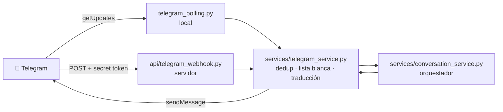

# Spec: canal Telegram para la beta y LLM gratuito para texto

> Detalla el issue [#7](https://github.com/FernandoMRestelli/norma-agentic-ai/issues/7). Los IDs son los de la
> [spec del MVP](README.md). Ver [cómo trabajamos con SDD](README.md#1-cómo-trabajamos-con-sdd).

| | |
|---|---|
| Etapa del roadmap | Transversal: canal de prueba de la beta, antes de la etapa 07 |
| Estado | Propuesto |
| Responsable | Federico |
| Requisitos de la spec del MVP | RF-29 a RF-32, RNF-14, CA-30 a CA-36, C-04, C-14, D-01 |

## 1. Objetivo

Que los tres integrantes puedan **simular pedidos a la perfumería** desde un canal real mientras WhatsApp
(etapa 07) no está listo, y que el agente tenga un LLM con el que interpretar pedidos **de texto** sin esperar la
elección final del proveedor (D-01).

Telegram se elige porque un bot se crea gratis en minutos con [@BotFather](https://t.me/BotFather), sin número
de teléfono ni aprobación de Meta.

## 2. Alcance

| Dentro | Fuera |
|---|---|
| Bot de Telegram como canal `telegram`: recibir texto, audio y foto; responder | Usar Telegram con clientes reales (es un canal de prueba) |
| Recepción por long polling (local) y por webhook con secret token (servidor) | Grupos y canales de Telegram: solo chats privados |
| Lista blanca de usuarios | Descargar audios y fotos (llega con el modelo de visión) |
| Cliente de Gemini (free tier) con LangChain para texto | El loop del agente, las tools y la confirmación (etapas 03 a 05) |
| Configuración separada para un modelo de visión pago, sin implementarlo | Elegir el LLM de producción (D-01 sigue abierta para eso) |

## 3. Comportamiento

### 3.1 Recepción

- **Polling** (`python -m internal.telegram_polling`): para desarrollo y la beta. No necesita URL pública. Al
  arrancar borra el webhook, porque Telegram no entrega updates por `getUpdates` si hay uno configurado.
  **Un solo proceso por token**: si dos corren el polling con el mismo bot, Telegram responde `409 Conflict`.
  Por eso hay dos tipos de bot (§3.5).
- **Webhook** (`POST /webhook/telegram`): para cuando haya servidor (D-03). Telegram manda el header
  `X-Telegram-Bot-Api-Secret-Token` con el valor que se fijó en `setWebhook`; se compara en tiempo constante.
  Sin `TELEGRAM_WEBHOOK_SECRET` configurado, el endpoint responde `403` (está apagado). Responde `200` enseguida y
  procesa en segundo plano.
- Las dos vías terminan en la misma función, que procesa un `Update` de Telegram.

### 3.2 Procesamiento de un update

1. **Deduplicación** por `update_id`: un update repetido se ignora (RF-31). En la beta el registro está en memoria,
   con los últimos 1000 ids; pasa a la tabla `processed_messages` cuando exista (§5.7 de la spec del MVP).
2. **Solo chats privados**: lo que llegue de grupos o canales se ignora.
3. **Lista blanca** (`TELEGRAM_ALLOWED_USER_IDS`): si el `from.id` no está, se responde un texto fijo con su id
   (para que un integrante pueda sumarse) y el mensaje no llega al orquestador. Lista vacía = nadie autorizado.
4. **Traducción** a los contratos del sistema:

| Telegram | Sistema |
|---|---|
| `message.text` | `IncomingMessage(type=text, text=...)` |
| `message.voice` o `message.audio` | `IncomingMessage(type=audio, media_url="telegram:<file_id>")` |
| `message.photo` (la de mayor tamaño) | `IncomingMessage(type=image, media_url="telegram:<file_id>", text=caption)` |
| Otro tipo (sticker, documento, ubicación…) | Texto fijo: «Por ahora solo entiendo texto, audios y fotos» |

   `customer_id` es `telegram:<from.id>`; `external_id` es el `update_id`.
5. **Respuesta**: se envía el texto que devuelve el orquestador, sin botones. El cliente confirma escribiendo
   (RF-13).

### 3.3 Audio e imagen

Mientras no esté el modelo de visión pago (§4.3), un audio o una foto reciben **sin llamar al LLM** el mensaje fijo
«Por ahora solo puedo leer pedidos escritos. ¿Me lo mandás por texto?» (RF-32). Es el mismo camino que la spec del
agente prevé para un audio o una imagen sin texto útil (§6 de la spec del agente).

El `media_url` guarda una referencia (`telegram:<file_id>`) y **no** la URL de descarga, porque esa URL contiene el
token del bot (RNF-14). Cuando se sume el modelo de visión, `message_service` resuelve la referencia con `getFile`.

Es la única excepción a la regla de `media_url` solo `https://` (§5.1 de la spec del MVP) y vale únicamente con
`channel = telegram`: en otro canal, `telegram:<file_id>` se rechaza. No abre una puerta a SSRF porque un `file_id`
no es una dirección: el sistema nunca se conecta a lo que trae, sino que le pregunta a la Bot API.

### 3.4 Conexión con el agente

El orquestador (`conversation_service`) le pasa cada texto al agente y devuelve su respuesta. El canal no conoce
los pedidos: solo recibe mensajes y envía texto.

### 3.5 Bots de desarrollo y bot beta

| Bot | Quién lo crea | Para qué | Lista blanca |
|---|---|---|---|
| **De desarrollo** | Cada integrante, el suyo | Programar y probar en su máquina sin cortarle el polling a otro | Solo su id |
| **Beta compartido** | Uno para el equipo, cuando el agente tome pedidos (etapa 03) | Simular muchos clientes que le piden al mismo negocio: todos los pedidos en la misma base y en Sheet 2 | Los tres ids |

El bot beta corre en un solo lugar, idealmente un servidor siempre prendido (D-03). Mientras no lo haya, lo corre
un integrante y responde solo mientras su máquina tenga el polling andando. El código es el mismo para los dos:
cambian el token y la lista blanca de cada `.env`.

## 4. Contratos

### 4.1 `Channel`

Se suma `telegram` (`web | whatsapp | telegram`) en `IncomingMessage`, `OrderDraft`, `Order` y en la columna
`canal` de Sheet 2. Lo que ya existe no cambia.

### 4.2 Configuración (`.env`)

| Variable | Obligatoria | Para qué |
|---|---|---|
| `TELEGRAM_BOT_TOKEN` | Sí, para el bot | Token que da @BotFather. Nunca en el repo ni en logs |
| `TELEGRAM_ALLOWED_USER_IDS` | Sí, para que responda | Ids numéricos separados por coma |
| `TELEGRAM_WEBHOOK_SECRET` | Solo con webhook | Valor de `X-Telegram-Bot-Api-Secret-Token` (1 a 256 caracteres: letras, números, `_` y `-`) |
| `LLM_PROVIDER` | Sí, para el agente | `gemini` |
| `LLM_MODEL` | Sí, para el agente | Un modelo del free tier, p. ej. `gemini-3.8-flash` |
| `LLM_API_KEY` | Sí, para el agente | API key de Google AI Studio |
| `LLM_VISION_PROVIDER`, `LLM_VISION_MODEL`, `LLM_VISION_API_KEY` | No | Modelo pago para audio e imagen; se leen pero todavía no se usan |

### 4.3 Modelo con LangChain

`agent/llm.py` crea el modelo según `LLM_PROVIDER` (RNF-09). El agente trabaja con los mensajes de LangChain y
guarda cada `AIMessage` completo: conserva las firmas de Gemini y no hay que reconstruirlas.

**Gemini** (`ChatGoogleGenerativeAI`, `LLM_PROVIDER=gemini`):

- Timeout de 30 s (RNF-06) y 1 reintento. Si vuelve a fallar, el grafo lo trata como una falla (§6 de la spec del
  agente).
- **Cuidados del free tier:** tiene límites de requests por minuto y por día por proyecto, y Google **usa** lo
  que se manda para mejorar sus productos. En la beta solo se usan datos simulados (el catálogo de
  `datos_ejemplo/` y pedidos inventados); nunca datos reales de clientes (RNF-03).

## 5. Requisitos

| ID | Requisito |
|---|---|
| RF-29 | El sistema recibe mensajes de texto, audio y foto por un bot de Telegram, por polling o por webhook con secret token, y solo atiende a los usuarios de la lista blanca |
| ~~RF-30~~ | ~~En Telegram, una respuesta con borrador lleva los botones Confirmar / Corregir~~ Eliminado: el cliente confirma escribiendo, en todos los canales |
| RF-31 | Un update de Telegram repetido (mismo `update_id`) se procesa una sola vez |
| RF-32 | Mientras no haya modelo de visión, un audio o una imagen reciben el pedido de escribirlo, sin llamar al LLM |
| RNF-14 | El token del bot y las API keys no aparecen en logs, URLs guardadas ni datos persistidos |

## 6. Criterios de aceptación

| ID | Dado | Cuando | Entonces | RF | Test |
|---|---|---|---|---|---|
| CA-30 | `TELEGRAM_WEBHOOK_SECRET` configurado / sin configurar | Llega un POST con el secret correcto, incorrecto o sin header | `200` / `403` / `403`; sin secret configurado, siempre `403` | RF-29 | `test_telegram.py::test_webhook_*` |
| CA-31 | Un usuario fuera de la lista blanca | Escribe al bot | Recibe un texto fijo con su id y el mensaje no llega al orquestador | RF-29 | `test_telegram.py::test_usuario_fuera_de_la_lista_blanca` |
| CA-32 | Un update ya procesado | Llega otra vez con el mismo `update_id` | No se procesa ni se responde de nuevo | RF-31 | `test_telegram.py::test_update_repetido_se_procesa_una_vez` |
| CA-33 | Un integrante de la lista blanca | Manda texto, un audio o una foto | Llega como `IncomingMessage` `text`, `audio` o `image` con `media_url = telegram:<file_id>`; audio y foto reciben el pedido de escribirlo | RF-29, RF-32, RNF-14 | `test_telegram.py::test_traduce_*`, `test_conversation.py`, `test_orders.py::test_incoming_message_*telegram*` |
| ~~CA-34~~ | ~~Botones Confirmar / Corregir en Telegram~~ Eliminado: el cliente confirma escribiendo, en todos los canales | — | — | ~~RF-30~~ | — |
| CA-35 | Un `AIMessage` de Gemini con tool calls | Vuelve al modelo dentro del mismo turno | Se reenvía completo, sin reconstruirlo, para conservar las firmas | RNF-09 | `test_agent_graph.py` |
| CA-36 | `LLM_PROVIDER` = `gemini` / vacío / otro | Se pide el modelo | `ChatGoogleGenerativeAI` / error que dice qué variable falta / error de proveedor no soportado | RNF-09 | `test_llm.py` |

## 7. Decisiones y riesgos

| Tema | Decisión |
|---|---|
| D-01 (parcial) | Para la beta, **Gemini free tier para texto**. Audio, imagen y el LLM de producción siguen abiertos |
| Un bot por integrante para desarrollar y uno compartido para la beta | Evita el `409 Conflict` del polling al desarrollar en paralelo, y en la beta concentra los pedidos en una sola base, como en la operación real |
| Deduplicación en memoria | Alcanza con una instancia y polling (el `offset` ya evita repetidos); se mueve a la base con `processed_messages` |
| Riesgo: límites del free tier | Un turno sin errores hace unas 4 llamadas y puede llegar a 15 (RNF-12), así que hay que medir el consumo con tres personas probando. Si no alcanza, se pasa a un modelo `flash-lite` o a pago |
| Riesgo: datos usados por Google | Solo datos simulados en la beta |
