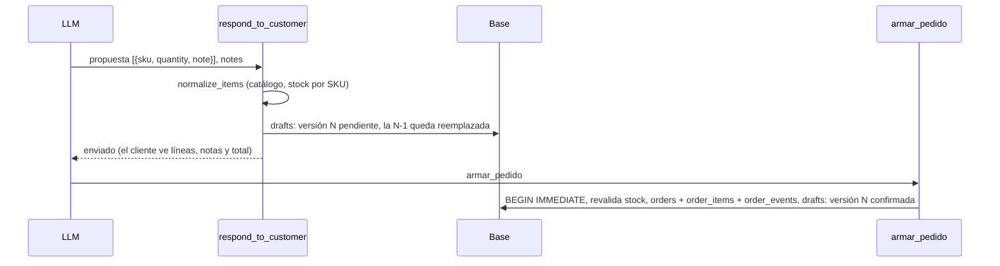

# Spec: Guardado de pedidos en la base

> Frente C del [plan de mejora del asistente](../plan-mejora-asistente.md#c--guardado-de-pedidos-en-la-base).
> Ver [cómo trabajamos con SDD](README.md#1-cómo-trabajamos-con-sdd).

| | |
|---|---|
| Etapa del roadmap | 05 · Registro y seguimiento |
| Estado | Implementado |
| Responsable | Frente C (rama `feature/guardado-de-pedidos`) |
| Requisitos de la spec del MVP | RF-15, RF-17, RF-19, RF-20, RF-21, RF-31, RNF-03, RNF-04 |

## 1. Objetivo

Que un pedido guardado diga quién pidió, qué pidió exactamente, con qué observaciones, cuánto suma y qué le pasó
después, sin depender del checkpoint del agente. Y que la base de cada integrante se actualice sola al desplegar,
sin perder las órdenes que ya tiene.

## 2. Alcance

| Dentro | Fuera |
|---|---|
| Tabla `order_items` con una fila por línea, con su nota | Descontar stock al despachar (issue #61): depende de definiciones del negocio |
| Total, nombre del cliente, conversación y observaciones en la orden | Guardar el texto de los mensajes (RNF-03) |
| Tabla `drafts` con cada versión propuesta y su desenlace | Descarte por pedido del cliente, derivación y vencimiento (RF-26 a RF-28) |
| Historial de estados (`order_events`) y endpoint de operador para cambiar el estado | Dashboard (etapa 06) |
| Observaciones general y por línea que manda el agente al proponer | La regla que le dice al agente cuándo usarlas (BR-10, frente E) |
| Migraciones numeradas que corren al arrancar | Alembic (ver D-C1) |
| Deduplicación de Telegram persistida en `processed_messages` (RF-31) | Deduplicación de WhatsApp: se suma con el canal (etapa 07) |
| Columnas nuevas de la fila de pedido (`format_order_row`, `ORDER_COLUMNS`) | Cómo se escribe la planilla (frente D) |

## 3. Comportamiento

### 3.1 De la propuesta a la orden

1. El LLM propone con `respond_to_customer`. Cada línea puede llevar `note` (por ejemplo el tono de una coloración
   mientras siga abierta V-01, o una variante) y el pedido puede llevar `notes` (observación general).
2. `normalize_items` completa cada línea desde el catálogo. Dos líneas con el mismo SKU y la **misma** nota se
   suman en una; con notas distintas quedan separadas (dos tonos de una coloración que es un solo SKU). El stock
   se controla por SKU, sumando todas sus líneas.
3. El borrador lleva el `customer_id`, el nombre del perfil (`customer_name`) y la conversación
   (`conversation_id`), que pone el backend, nunca el LLM.
4. Cada versión propuesta se guarda en `drafts`. La versión anterior del mismo borrador pasa a `reemplazado`. Si el
   agente responde sin propuesta y había una vigente, esa versión pasa a `descartado`. Guardar en `drafts` es un
   registro de trazabilidad: si falla, se anota en el log y la conversación sigue.
5. Al registrar la orden (`confirm_draft`), en la misma transacción `BEGIN IMMEDIATE` se guardan la orden con su
   total, sus líneas en `order_items`, el evento `→ Recibido` en `order_events` y la versión aceptada en `drafts`
   como `confirmado` con su `order_id`. Siguen valiendo `draft_id` único, la revalidación de stock y la
   idempotencia (CA-15, CA-16, CA-48 a CA-50).
6. El cliente ve las notas de cada línea y la observación general en la propuesta y en el mensaje de la orden.

### 3.2 Estados

`Recibido → Preparado → Retirado`, y `Cancelado` desde `Recibido` o `Preparado` (`can_transition`, RF-20). Cada
cambio guarda un evento con el estado anterior, el nuevo, quién lo hizo (`agente`, `operador` o `migracion`) y la
hora. El operador cambia el estado con `POST /orders/{order_id}/status`; `POST /orders/{order_id}/cancel` sigue
existiendo y también guarda su evento.

### 3.3 Migraciones

`init_db()` (al arrancar la API, el bot y `evaluar_agente`) llama a `migrations.migrate(engine)`:

1. Abre una transacción `BEGIN IMMEDIATE`: si la API y el bot arrancan a la vez, el segundo espera al primero y
   ve la base ya migrada.
2. Lee la versión de `schema_version`. Sin esa tabla: si existe `orders`, la base es de la 0.1.1 (versión 0); si
   no, es una base nueva.
3. `create_all` crea las tablas que falten (no cambia las existentes).
4. Corre en orden los pasos con número mayor a la versión de la base y guarda la última. Una base nueva queda
   directamente en la última versión.
5. Si algo falla, la transacción se deshace entera y la aplicación no arranca: la base queda como estaba.

Cada paso es idempotente (mira qué columnas y filas ya existen antes de agregarlas). **Paso 1** (de la 0.1.1):

- agrega a `orders` las columnas `customer_name`, `conversation_id` y `total`;
- copia cada línea del JSON `orders.items` a `order_items`, en el mismo orden, y calcula el total con los precios
  guardados en la orden (sin precio, la línea no suma);
- guarda el historial que se conoce: `→ Recibido` con la fecha de la orden y, si la orden ya no está en
  `Recibido`, el paso a su estado actual con la fecha de la migración, ambos con origen `migracion`;
- verifica que la cantidad de líneas copiadas coincida con las del JSON y recién entonces borra `orders.items`.

Las órdenes viejas quedan sin `customer_name` ni `conversation_id`: la 0.1.1 no los guardaba.

### 3.4 Deduplicación de Telegram

Cada `update_id` se registra en `processed_messages` (canal + id externo, únicos) antes de procesarlo. Si ya estaba,
el update se ignora, aunque el proceso se haya reiniciado o el mismo update llegue por polling y por webhook. Los
registros de más de 7 días se borran al registrar uno nuevo: Telegram no reenvía updates tan viejos.

## 4. Contratos

### 4.1 Lo que manda el LLM

| Campo | Tipo | Reglas |
|---|---|---|
| `ProposedItem.note` | `str \| None` | Hasta 120 caracteres. Nota de esa línea: tono, variante o aclaración del cliente |
| `RespondToCustomerInput.notes` | `str \| None` | Hasta 300 caracteres. Observación general del pedido. Solo con `propuesta` |

Los espacios se recortan y se colapsan; una nota vacía es `None`.

### 4.2 Esquemas

| Esquema | Campo nuevo | Tipo | Notas |
|---|---|---|---|
| `OrderItem` | `note` | `str \| None` | Viene de `ProposedItem.note` |
| `OrderDraft` | `customer_name` | `str \| None` | Nombre del perfil, hasta 64 caracteres, lo pone el backend |
| `OrderDraft` | `conversation_id` | `int \| None` | Id de `conversations`; lo pone el backend |
| `OrderDraft` | `total` | `Decimal` (calculado) | Suma de `quantity × unit_price` de las líneas con precio |
| `Order` | `customer_name`, `conversation_id` | | Copiados del borrador |
| `Order` | `total` | `Decimal` | Guardado en la base; si no viene, se calcula de las líneas |
| `Order` | `history` | `list[OrderEvent]` | Eventos de estado, del más viejo al más nuevo |
| `OrderEvent` | `from_status`, `to_status`, `source`, `created_at` | | `from_status` es `None` en el alta |
| `DraftStatus` | `reemplazado` | | Versión que dejó de valer porque llegó otra |

`OrderDraft.notes` y `Order.notes` ya existían y ahora se completan.

### 4.3 Tablas

| Tabla | Columnas | Claves |
|---|---|---|
| `orders` (cambia) | se agregan `customer_name`, `conversation_id`, `total`; se quita `items` | `draft_id` y `order_id` únicos |
| `order_items` | `order_pk`, `position`, `sku`, `product_name`, `presentation`, `quantity`, `unit_price`, `note` | `order_pk` → `orders.id`, borrado en cascada |
| `order_events` | `order_pk`, `from_status`, `to_status`, `source`, `created_at` | `order_pk` → `orders.id`, borrado en cascada |
| `drafts` | `draft_id`, `version`, `conversation_id`, `customer_id`, `channel`, `items` (JSON de las líneas propuestas), `notes`, `total`, `status`, `order_id`, `created_at`, `updated_at` | (`draft_id`, `version`) único |
| `processed_messages` | `channel`, `external_id`, `created_at` | (`channel`, `external_id`) único |
| `schema_version` | `version` | Una fila |

Los importes se guardan como texto decimal exacto (`"1234.50"`): SQLite no tiene un tipo decimal y un `REAL`
redondea. `conversation_id` no es clave foránea: una conversación puede borrarse por retención (D-08) y la orden
tiene que quedar. Con SQLite, cada conexión activa `PRAGMA foreign_keys = ON` para que el borrado en cascada valga.

**Privacidad (RNF-03):** el nombre del perfil se guarda solo en `orders.customer_name`; no va a `drafts`, ni a los
logs, ni a las trazas. Ninguna tabla nueva guarda el texto de los mensajes: las notas son lo que el agente resume
del pedido, con tope de largo.

### 4.4 API de operador

`POST /orders/{order_id}/status`, con la misma credencial que el resto de `/orders/*` (`X-Operator-Token` o
`Authorization: Bearer`). Cuerpo `{"status": "Preparado"}` (no distingue mayúsculas). Devuelve la `Order` con su
historial.

| Respuesta | Cuándo |
|---|---|
| 200 | La transición es válida; se guarda el estado y el evento con origen `operador` |
| 400 | La transición no es válida (por ejemplo `Recibido → Retirado`, o desde un estado terminal) |
| 401 | Falta la credencial o no coincide |
| 404 | La orden no existe |
| 422 | El estado no existe |

`GET /orders/{order_id}` devuelve ahora también `customer_name`, `conversation_id`, `total`, `history` y la nota de
cada línea.

### 4.5 Fila de pedido (Sheet 2 / `pedidos.csv`)

`ORDER_COLUMNS` suma dos columnas **al final**, para que un `pedidos.csv` de la 0.1.1 siga alineado:

`id_orden, fecha_hora, cliente, canal, productos, notas, estado, nombre_cliente, total`

- `productos`: `cantidad x nombre presentación (SKU)`, y ` [nota]` si la línea tiene nota; separadas por `; `. Un
  `;` dentro de una nota se escribe como `,` para no partir la línea.
- `total`: decimal con punto y dos decimales (`1234.50`).
- `nombre_cliente`: el nombre del perfil, o vacío.

## 5. Requisitos

| ID | Requisito |
|---|---|
| RF-45 | Cada orden guarda sus líneas en `order_items` (con la nota de cada línea), su total, el nombre del perfil del cliente y la observación general (detalla RF-21) |
| RF-46 | Cada versión propuesta queda en `drafts` con su conversación y su desenlace (pendiente, reemplazada, descartada o confirmada con su orden), y la orden guarda su `conversation_id` |
| RF-47 | Cada cambio de estado de una orden queda en `order_events`, y el operador puede pasar una orden a `Preparado` o `Retirado` por la API según `can_transition` |
| RF-48 | El agente puede mandar una observación general y una nota por línea al proponer; llegan a la orden y el cliente las ve en la propuesta y en el pedido registrado |
| RF-49 | Al arrancar, la base se actualiza sola con pasos numerados e idempotentes, en una sola transacción, sin perder órdenes |

RF-31 no cambia de texto: ahora vale también después de un reinicio.

## 6. Criterios de aceptación

| ID | Dado | Cuando | Entonces | Test |
|---|---|---|---|---|
| CA-81 | Una conversación de Telegram con nombre de perfil | El cliente acepta una propuesta con notas | Desde la base, sin el checkpoint, se reconstruye la orden: cliente, nombre, líneas con notas, total, conversación e historial; el nombre no aparece en los logs | `tests/test_guardado_pedidos.py::test_orden_se_reconstruye_desde_la_base` |
| CA-82 | Una propuesta con `notes` y `note` por línea | Se arma la respuesta y se registra la orden | Las notas llegan a `OrderDraft`, a `Order` y a los mensajes que ve el cliente | `tests/test_guardado_pedidos.py::test_notas_llegan_a_la_orden_y_al_mensaje` |
| CA-83 | Líneas del mismo SKU con notas iguales o distintas | Se normaliza la propuesta y se confirma | Las de igual nota se suman, las de nota distinta quedan separadas y el stock se controla con la suma por SKU | `tests/test_guardado_pedidos.py::test_lineas_del_mismo_sku_*` |
| CA-84 | Órdenes activas y canceladas | Se calcula el stock comprometido | Sale de `order_items`, suma todas las líneas de un SKU y no cuenta las canceladas | `tests/test_guardado_pedidos.py::test_stock_comprometido_sale_de_order_items` |
| CA-85 | Una conversación que propone, corrige, descarta y vuelve a proponer | Se registra la orden | `drafts` tiene cada versión con su conversación; las viejas quedan reemplazadas o descartadas y la aceptada confirmada con su `order_id` | `tests/test_guardado_pedidos.py::test_drafts_registra_cada_version` |
| CA-86 | Una orden recibida | El operador la pasa a `Preparado` y después a `Retirado`, o la cancela | Cada cambio queda en el historial con su origen | `tests/test_guardado_pedidos.py::test_operador_cambia_el_estado` |
| CA-87 | El endpoint de estado | Sin credencial, orden inexistente, estado desconocido o transición inválida | Responde 401, 404, 422 o 400 y no cambia nada | `tests/test_guardado_pedidos.py::test_cambio_de_estado_rechazado_*` |
| CA-88 | Una base con el esquema de la 0.1.1 y órdenes en varios estados | Arranca la versión nueva | No se pierde ninguna orden ni línea, se calculan los totales, queda el historial conocido y el stock comprometido es el mismo | `tests/test_guardado_pedidos.py::test_migra_una_base_de_la_0_1_1` |
| CA-89 | Una base ya migrada y una base nueva | Se arranca de nuevo | La migración no duplica nada, y las dos bases tienen las mismas tablas, columnas e índices | `tests/test_guardado_pedidos.py::test_migracion_idempotente_y_igual_a_base_nueva` |
| CA-90 | Una base de la 0.1.1 | La API y el bot arrancan a la vez | La migración corre una sola vez y las dos terminan bien | `tests/test_guardado_pedidos.py::test_migracion_concurrente` |
| CA-91 | Un update de Telegram ya procesado | Llega otra vez después de un reinicio | No se procesa de nuevo | `tests/test_guardado_pedidos.py::test_update_repetido_tras_reinicio` |
| CA-92 | Una orden con nombre, notas y total | Se arma la fila de la planilla | La fila trae las columnas nuevas al final y las notas entre corchetes | `tests/test_guardado_pedidos.py::test_fila_de_pedido_con_columnas_nuevas` |

## 7. Errores y casos borde

| Situación | Qué hace el sistema |
|---|---|
| Falla la escritura en `drafts` al proponer | Se anota en el log (solo ids) y la conversación sigue; al confirmar, la versión aceptada se guarda igual en `drafts` dentro de la transacción de la orden |
| Una propuesta guardada en un checkpoint de la 0.1.1 (sin conversación ni nombre) | Se completa con la conversación y el nombre del turno al registrar la orden |
| Una orden vieja sin precios | Su total es 0 |
| El JSON `items` de una orden vieja no se puede leer | La migración falla, la transacción se deshace y la aplicación no arranca: la base queda como estaba |
| La base está en una versión más nueva que el código (volver a una versión anterior) | No se toca y se anota una advertencia; volver atrás requiere restaurar la copia de la base |
| Dos pedidos de cambio de estado a la vez | `BEGIN IMMEDIATE`: el segundo ve el estado del primero y valida su transición contra ese |
| `thread_id` que no es un número (tests, evaluación) | `conversation_id` queda `None` |

## 8. Decisiones y preguntas abiertas

| ID | Decisión o pregunta | Estado |
|---|---|---|
| D-C1 | **Migraciones propias y no Alembic.** Una tabla `schema_version` y una lista de pasos numerados en `internal/database/migrations.py`, que corren al arrancar dentro de `BEGIN IMMEDIATE`. Alembic suma una dependencia, una carpeta de configuración y un paso de despliegue, y con SQLite necesita el modo *batch* para casi cualquier cambio; con una base por integrante y pocos cambios de esquema, el mecanismo propio es más corto, se prueba con un test y corre solo. Si el proyecto pasa a un servidor con otra base (D-03), conviene revisarlo | Decidido |
| D-C2 | El tono de una coloración se guarda como nota de la línea mientras siga abierta V-01. Si el negocio confirma que cada tono es un SKU, la nota queda para variantes y aclaraciones | Decidido, sujeto a V-01 |
| D-C3 | Se quita `orders.items` después de copiarlo: dejar dos copias de las líneas obliga a mantenerlas iguales. La copia de la base que se pide al desplegar es la vuelta atrás | Decidido |
| D-C4 | `drafts` no guarda el nombre del cliente: con `customer_id` y la orden alcanza (RNF-03) | Decidido |

## 9. Plan de implementación

1. `feature/guardado-de-pedidos`: esta spec, los tests de CA-81 a CA-92 y el código, en una PR a `develop` que
   depende de la PR de documentación (#68). Al integrar se suman RF-45 a RF-49 y CA-81 a CA-92 a la spec maestra
   y se actualizan §5.3 y §5.4 de la spec del MVP.
