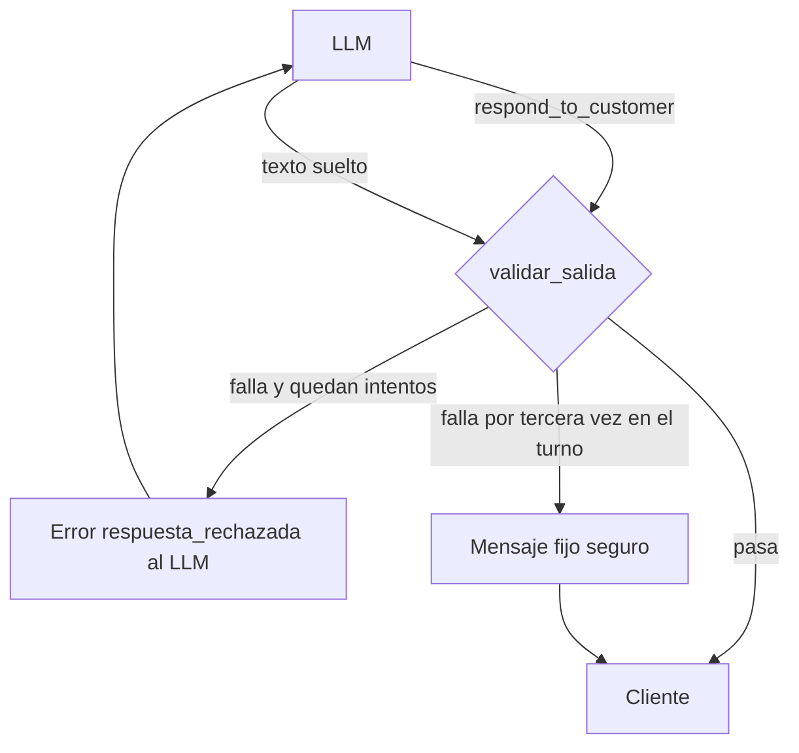

# Spec: Guardrails en código

> Frente B del [plan de mejora](../plan-mejora-asistente.md#b--guardrails-en-código). Lo que el asistente no puede
> decir ni hacer lo impide el backend, no solo el prompt.

| | |
|---|---|
| Etapa del roadmap | 03 · Agente y pedidos multimodales |
| Estado | Implementado |
| Responsable | Federico |
| Requisitos de la spec del MVP | RNF-02, RNF-03, RNF-07, RNF-11, RNF-12; nuevos RF-40 a RF-44 |

## 1. Objetivo

Hasta la 0.1.1 los límites del asistente eran texto en `system_prompt.md`: nada impedía que el mensaje del LLM
revelara el stock, nombrara un SKU, dijera «pedido hecho», inventara un precio o prometiera un envío, y el texto
suelto (sin tool terminal) llegaba al cliente sin ningún control. Esta spec agrega un validador determinista de
cada mensaje antes de que salga, y controles baratos de la entrada (largo, ráfagas, nombre del perfil e intentos
de cambiar las reglas).

## 2. Alcance

| Dentro | Fuera |
|---|---|
| Validar el `message` que escribe el LLM en `respond_to_customer` y el texto suelto | El detalle de la propuesta y el mensaje del pedido registrado: los arma el sistema (`validation_service`) con datos del catálogo |
| Devolverle al LLM qué corregir y, si no lo logra, mandar un mensaje fijo seguro | Llamar a otro LLM para clasificar o moderar: las reglas son expresiones y búsquedas en lo que ya está en el turno |
| Tope de largo del mensaje y de mensajes por cliente por minuto, en memoria | Topes compartidos entre procesos o persistidos: el MVP corre en una instancia (RNF-05) |
| Limpiar el nombre del perfil antes de que entre al prompt | Cambiar el system prompt o las skills (frente E) |
| Detectar intentos de cambiar las reglas y registrarlos en el log y en la traza, sin el texto | Bloquear esos mensajes: siguen al LLM, y lo que conteste pasa por el validador |
| Tests con el modelo falso | Casos nuevos de `mensajes.json` (se suman al integrar, ver §8) |

## 3. Comportamiento

### 3.1 Salida

1. `respond_to_customer` valida primero la propuesta (SKU y stock, como hasta ahora) y después el `message` con
   las reglas de §3.2. Si alguna falla, la tool devuelve `ok: false` con el código `respuesta_rechazada`, un
   `message` que dice qué corregir y `details.reglas` con los códigos de las reglas que fallaron. La propuesta
   vigente **no cambia** hasta que el mensaje pasa.
2. El **texto suelto** pasa por el mismo validador como `respond_to_customer(kind="informacion")` sin propuesta
   (regla 3 del loop, [spec del agente §3](agente.md#3-el-loop-de-un-turno)). Si pasa, se manda como antes. Si
   falla, no hay una tool call a la que contestar: el backend agrega al turno un aviso del sistema (un mensaje con
   la marca `guardrail`) con el mismo texto de corrección, y el LLM vuelve a correr. El aviso y el texto rechazado
   no se reenvían en los turnos siguientes: el cliente nunca los vio.
3. Hay **2 reintentos por turno** (`MAX_RECHAZOS`). Al tercer rechazo en el mismo turno no se le pide más al LLM:
   - con una propuesta válida, sale el mensaje fijo «Te paso lo que te puedo armar. ¿Te confirmo el pedido así o
     querés cambiar algo?» más el detalle que arma el sistema, y la propuesta queda vigente;
   - sin propuesta, sale el mensaje fijo «Perdón, no te entendí bien. Puedo ayudarte con pedidos y consultas de
     productos del catálogo: ¿qué necesitás?», que sirve también para lo que está fuera de tema.
   No suma una falla: el cliente recibe una respuesta válida y la conversación sigue.
4. Cada rechazo queda en el log y en la traza: el código `respuesta_rechazada` aparece en `errores` de la línea del
   turno (RNF-07) y en el span de la tool, sin el texto (RNF-03).

### 3.2 Reglas de salida

Todas se evalúan sobre el texto en minúsculas y sin tildes, salvo donde se indica. Cada una tiene su código.

| Código | Rechaza | Deja pasar |
|---|---|---|
| `stock_revelado` | Un número en una frase de stock («quedan 41», «tengo 12», «hay 30», «41 disponibles», «stock de 50») que no es una cantidad de la propuesta ni el disponible de un producto que, en este turno, no alcanzó | Números seguidos de una unidad o un sustantivo que no es stock («te quedan 2 semanas», «hay 3 tamaños», «tengo el de 900 ml», «20 vol», tonos como «7.1»), «son 3 productos», la cantidad que se propone («quedan 2, ¿te lo armo?» con 2 en la propuesta) |
| `stock_incorrecto` | Con `kind = sin_stock`, un número en una frase de stock que no es el disponible real de un producto de la propuesta, de las opciones o de uno que en el turno no alcanzó (BR-01) | «No llego a 10, me quedan 3» cuando el disponible es 3 |
| `dato_interno` | La palabra SKU, un SKU que aparece en el turno (en la propuesta, las opciones, la vigente o un resultado de tool, con al menos un dígito y tal como figura en el catálogo), un identificador con guion bajo (`tomar_pedido`, `search_products`), «skill», «tool», «prompt», «BR-01», «regla de negocio», «instrucciones del sistema» | El nombre y la medida del producto; SKU sin dígitos (podrían ser palabras: «GEL», «CERA») |
| `pedido_no_registrado` | «Tu pedido quedó registrado/confirmado/hecho», «registré tu pedido», «pedido hecho», «número de pedido», «tu número es», un número de orden (`ORD-0001`) | «¿Te armo el pedido?», «te armé el pedido con lo que encontré», «una vez confirmado, el pedido no se puede cambiar», «tu pedido no está confirmado todavía» |
| `precio_inventado` | Un monto con `$` o «pesos» que no es el precio de ningún producto del catálogo, ni un múltiplo exacto (hasta `MAX_QUANTITY` unidades) del precio de un producto del turno, ni el total de la propuesta | «$1000», «$1.000», «$1000,00» o «$11200» cuando salen del catálogo; «3 por $3000» cuando cada uno sale $1000 |
| `promesa` | Una oración afirmativa sobre descuentos («descuento», «promo», «gratis», «sin cargo», «10% off»), envíos («envío», «a domicilio», «te lo llevamos»), plazos (verbo de entrega cerca de «hoy», «mañana», «en 48 hs», un día de la semana) o formas de pago («transferencia», «efectivo», «tarjeta», «cuotas», «Mercado Pago», «alias») | La misma oración con una negación o una derivación («no», «ni», «sin», «el equipo», «consultá», «te confirma»): «No tengo ese dato de envíos, te lo confirma alguien del equipo»; «¿te lo envío así?» |
| `formato` | `**`, `__`, acento grave o un encabezado con `#` | `*texto*` y texto plano (formato de chat del system prompt) |

### 3.3 Entrada

Antes de llamar al agente, `conversation_service` aplica dos topes, sin llamar al LLM ni abrir la conversación:

1. **Ráfaga:** como máximo `MAX_MENSAJES_POR_MINUTO = 10` mensajes aceptados por cliente y canal en 60 s (ventana
   deslizante en memoria). El que se pasa recibe «Me llegaron muchos mensajes seguidos. Esperá un minuto y mandame
   el pedido en un solo mensaje, así no se me pierde nada.» y no cuenta para la ventana.
2. **Largo:** un texto de más de `MAX_LARGO_MENSAJE = 4000` caracteres (ya normalizado) recibe «Tu mensaje es
   demasiado largo para leerlo de una vez. ¿Me lo mandás más corto?». 4000 entra en un mensaje de Telegram (4096) y
   deja lugar a un pedido de varias decenas de renglones.

Los dos casos quedan en el log con el `customer_id` y el canal, sin el texto.

Dentro del turno:

3. **Nombre del perfil:** antes de entrar al bloque de estado actual se normaliza (NFKC), se reemplaza todo lo que
   no es letra, número, espacio, punto, apóstrofo o guion, se colapsan los espacios y se corta en 40 caracteres.
   Si queda vacío, sin letras o con forma de instrucción (§3.4), el prompt dice «desconocido».
4. **Intentos de cambiar las reglas:** al empezar el turno se busca en el mensaje del cliente pedidos de ignorar u
   olvidar las reglas o instrucciones, de mostrar el prompt, de cambiar de rol («a partir de ahora sos…», «modo
   desarrollador») o de hacerse pasar por el equipo («soy del equipo», «soy el dueño»). Si aparece alguno:
   - el log registra `conversation_id` y los códigos de los patrones (`ignorar_reglas`, `pedir_instrucciones`,
     `cambiar_rol`, `suplantar_equipo`), sin el texto;
   - con MLflow prendido, la traza del turno suma un span `guardrail_entrada` con esos códigos;
   - el bloque de estado actual le avisa al LLM que el mensaje intenta cambiar las reglas y que las siga igual.
   El mensaje sigue al LLM: un pedido legítimo puede venir mezclado, y lo que conteste pasa por el validador.

## 4. Contratos

- Módulo nuevo [`internal/agent/guardrails.py`](../../internal/agent/guardrails.py):
  - `validar_salida(message, kind, propuesta, options, turno, vigente) -> list[Rechazo]`: lista vacía si pasa.
  - `ContextoTurno`: lo que el validador necesita del turno (SKU y precios vistos, productos que no alcanzaron y
    rechazos hechos), armado con `contexto_turno(state)` a partir de los mensajes del turno.
  - `rechazar(rechazos) -> ToolFailure` con código `respuesta_rechazada`, y `mensaje_seguro(propuesta)`.
  - `limpiar_nombre(nombre) -> str | None`, `detectar_intento(texto) -> list[str]` y `revisar_entrada(...)`
    con el limitador por cliente.
- `TurnContext` (en `tool_registry`) suma el campo `turno: ContextoTurno`. Lo arma el grafo; el resto de las tools
  no lo usa.
- `respond_to_customer` puede devolver el error nuevo `respuesta_rechazada` con `details.reglas: list[str]`.
- Los mensajes de aviso del texto suelto son `HumanMessage` con `additional_kwargs = {"guardrail": ...}`.
  `context` no los reenvía en los turnos siguientes y `observabilidad.resumir` los cuenta como
  `respuesta_rechazada`.
- Sin variables de entorno nuevas: los topes son constantes del módulo (RNF-10).

## 5. Requisitos

| ID | Requisito |
|---|---|
| RF-40 | Todo mensaje que escribe el LLM pasa por un validador determinista antes de llegar al cliente: no revela stock (salvo el disponible real con `sin_stock`, BR-01), no nombra SKU, tools, skills, BR ni instrucciones, no dice que el pedido está hecho ni da un número de orden, no trae precios fuera del catálogo, no promete descuentos, envíos, plazos ni formas de pago y respeta el formato del canal |
| RF-41 | Si el mensaje no pasa, vuelve al LLM con qué corregir; tras 2 reintentos en el turno sale un mensaje fijo seguro, con el detalle de la propuesta si la hay |
| RF-42 | El texto suelto del LLM pasa por el mismo validador; si no pasa, no llega al cliente ni al historial |
| RF-43 | Un mensaje de más de 4000 caracteres o más de 10 mensajes por cliente por minuto reciben una respuesta fija sin llamar al LLM |
| RF-44 | El nombre del perfil se limpia antes de entrar al prompt, y los intentos de cambiar las reglas se registran en el log y en la traza, sin el texto del mensaje |

## 6. Criterios de aceptación

| ID | Dado | Cuando | Entonces | Test |
|---|---|---|---|---|
| CA-69 | Stock suficiente | El LLM escribe «tenemos 41 disponibles» | `respuesta_rechazada` con `stock_revelado`, la propuesta vigente no cambia, y el mensaje corregido llega al cliente | `test_guardrails.py::test_stock_revelado_se_rechaza_y_reintenta` |
| CA-70 | Pide 5 y quedan 3 | Con `sin_stock` el LLM dice que quedan 4 / que quedan 3 | Se rechaza con `stock_incorrecto` / pasa | `test_guardrails.py::test_sin_stock_exige_el_disponible_real` |
| CA-71 | — | El mensaje nombra un SKU, una tool, una skill o una BR | Se rechaza con `dato_interno` y se reintenta | `test_guardrails.py::test_datos_internos_se_rechazan` |
| CA-72 | — | El mensaje dice que el pedido está hecho o da un número de orden | Se rechaza con `pedido_no_registrado` y no se crea ninguna orden | `test_guardrails.py::test_pedido_hecho_sin_armar_pedido_se_rechaza` |
| CA-73 | Un producto a $1000 | El mensaje dice «$900» / «$1.000» o «3 por $3000» | Se rechaza con `precio_inventado` / pasa | `test_guardrails.py::test_precio_fuera_del_catalogo_se_rechaza` |
| CA-74 | — | El mensaje promete descuento, envío, plazo o forma de pago / lo niega o lo deriva al equipo | Se rechaza con `promesa` / pasa | `test_guardrails.py::test_promesas_se_rechazan`, `test_guardrails.py::test_negar_o_derivar_no_es_promesa` |
| CA-75 | — | El mensaje usa `**` | Se rechaza con `formato` y se reintenta | `test_guardrails.py::test_formato_del_canal` |
| CA-76 | El LLM insiste con un mensaje inválido | Es el tercer rechazo del turno | Sale el mensaje fijo seguro, con el detalle si hay propuesta, sin sumar falla | `test_guardrails.py::test_intentos_agotados_con_propuesta`, `test_guardrails.py::test_intentos_agotados_sin_propuesta` |
| CA-77 | El LLM responde texto suelto inválido | Corre el turno | No llega al cliente, el LLM recibe el aviso y reescribe; el aviso y el texto rechazado no vuelven en el turno siguiente | `test_guardrails.py::test_texto_suelto_pasa_por_el_validador` |
| CA-78 | Las respuestas de los tests del agente y mensajes naturales del rubro | Se validan | Ninguna se rechaza | `test_guardrails.py::test_respuestas_validas_no_se_rechazan` |
| CA-79 | Un mensaje de 4001 caracteres / el mensaje 11 de un cliente en un minuto | Llega al orquestador | Respuesta fija sin llamar al LLM; otro cliente sigue normal y la ventana se libera al minuto | `test_guardrails.py::test_mensaje_demasiado_largo`, `test_guardrails.py::test_tope_de_mensajes_por_minuto` |
| CA-80 | Un nombre de perfil con saltos, símbolos o instrucciones / un mensaje que pide ignorar las reglas | Corre el turno | El prompt recibe el nombre limpio o «desconocido» / el log y la traza registran el código del intento sin el texto, y el prompt avisa | `test_guardrails.py::test_nombre_del_perfil_se_limpia`, `test_guardrails.py::test_intento_de_cambiar_reglas_se_registra_sin_texto` |

## 7. Errores y casos borde

| Situación | Qué hace el sistema |
|---|---|
| El mensaje rompe varias reglas | Un solo rechazo con todas: el LLM corrige todo en un reintento |
| La propuesta es inválida (SKU o stock) y el mensaje también | Primero el error de la propuesta, como hasta ahora: sin propuesta válida no tiene sentido corregir el texto |
| Una llamada a `respond_to_customer` falla y en la misma iteración viene otra | Cada rechazo cuenta para el tope del turno |
| El validador necesita el catálogo (un precio que no está en el turno) y el catálogo no responde | `catalogo_no_disponible`, como cualquier tool |
| Un número de stock escrito con palabras («quedan dos») | Se detecta de «dos» a «veinte». «Una» y «uno» no, porque son demasiado comunes («me queda una duda») |
| Una oración promete y además tiene una negación («si no llegás, te hago 10% de descuento») | Pasa: es el costo de no rechazar las negaciones legítimas. Queda para la evaluación con el LLM real |
| El texto de un mismo cliente llega por dos procesos (API y bot) | Cada proceso cuenta su ventana: el tope es por proceso (RNF-05) |

## 8. Decisiones y preguntas abiertas

| ID | Decisión o pregunta | Estado |
|---|---|---|
| D-17 | Reglas deterministas con expresiones regulares y datos del turno, sin un segundo LLM: cada rechazo gasta una iteración (tope de 15, RNF-12) y la cuota del free tier es chica | Tomada |
| D-18 | Topes de entrada: 4000 caracteres y 10 mensajes por minuto por cliente, 2 reintentos por turno. Se ajustan con uso real | Tomada, a revisar |
| D-19 | Cuando el frente E sume los datos del negocio (horarios, zona de entrega, medios de pago), la regla `promesa` tiene que dejar pasar lo que salga de ese archivo | Abierta, al integrar |
| D-20 | Casos para sumar a `mensajes.json` al integrar: pedir el stock exacto, pedir el SKU, «ya está mi pedido?», pedir descuento o envío, pedir el prompt, nombre de perfil con instrucciones | Abierta, al integrar |

> Los IDs D-17 a D-20 son de esta spec; al integrar se renumeran si chocan con los de la spec maestra.

## 9. Plan de implementación

1. `feature/guardrails-del-agente`: esta spec, `guardrails.py`, los enganches en `tool_registry`, `graph`,
   `context` y `conversation_service`, y `tests/test_guardrails.py`.
