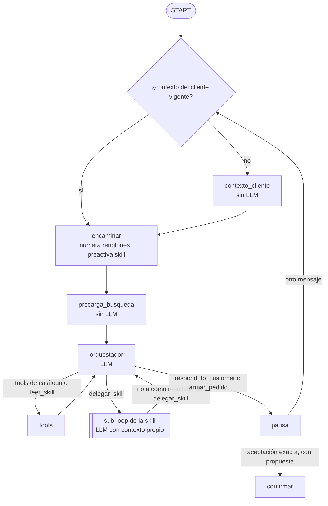
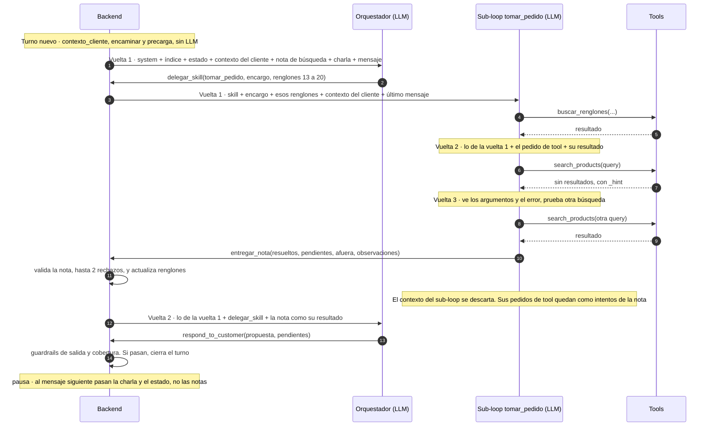
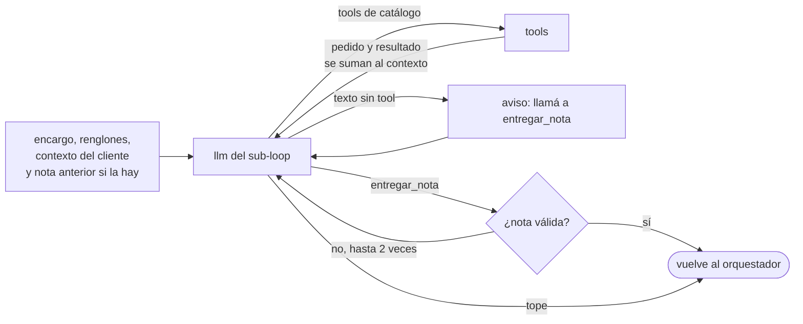

# Spec: Orquestador de skills con sub-loops y notas

> Cómo pasar de un solo loop por turno a un orquestador que elige skills por su descripción y delega el trabajo
> largo en sub-loops con contexto propio, que le devuelven una nota. Ver
> [cómo trabajamos con SDD](README.md#1-cómo-trabajamos-con-sdd).

| | |
|---|---|
| Etapa del roadmap | Transversal al agente: 03 · Pedidos multimodales, 04 · Confirmación |
| Estado | Implementado detrás de `AGENT_ORQUESTADOR`, sin medir todavía (§9, paso 5) |
| Responsable | Federico Picado |
| Requisitos de la spec del MVP | RF-62, RF-63, RF-65 a RF-68, RF-71 a RF-73, RNF-06, RNF-12, RNF-16 |
| IDs que reserva | RF-84 a RF-97, RNF-17, CA-144 a CA-161, D-30 a D-39 |

**Índice**

1. [Objetivo](#1-objetivo)
2. [Alcance](#2-alcance)
3. [Comportamiento](#3-comportamiento)
4. [Contratos](#4-contratos)
5. [Requisitos](#5-requisitos)
6. [Criterios de aceptación](#6-criterios-de-aceptación)
7. [Errores y casos borde](#7-errores-y-casos-borde)
8. [Decisiones y preguntas abiertas](#8-decisiones-y-preguntas-abiertas)
9. [Plan de implementación](#9-plan-de-implementación)

---

## 1. Objetivo

Hoy un turno es un único loop LLM ↔ tools ([spec del agente §3](agente.md#3-el-loop-de-un-turno)). Cada búsqueda
suma su pedido y su resultado al contexto del turno, que se reenvía entero en cada llamada. Entre un turno y el
siguiente ya se recorta, pero dentro del turno no: en un pedido largo el modelo da muchas vueltas con un contexto que
no para de crecer, y las vueltas son lo caro: una llamada al LLM tarda segundos y una tool, milisegundos.

Esta spec separa el turno en piezas con un trabajo cada una:

- Lo que no necesita al LLM lo hace el backend antes: el **contexto del cliente**, una vez por día, y una
  **precarga de la búsqueda** de los renglones de una lista.
- Un **orquestador** (el LLM) ve solo las descripciones de las skills y decide qué hacer.
- El trabajo largo de una skill corre en un **sub-loop** con su propio contexto, chico, y termina con una **nota**:
  qué resolvió y qué falta. El orquestador la lee y decide si delega otra cosa o le responde al cliente.

El objetivo es que un pedido largo cueste menos llamadas y menos tokens por llamada sin bajar el recall por línea, y
que sumar skills no agrande el contexto de las que ya están.

Es una propuesta: describe cómo debería funcionar el turno. Antes de implementarla se contrasta con lo que hace el
código hoy (§3.1) y, al terminar, con la evaluación (§9, paso 5). Lo que no coincida se corrige acá antes de
escribir código.

## 2. Alcance

| Dentro | Fuera |
|---|---|
| Contexto del cliente armado por el backend, con vencimiento diario (RF-84, RF-85) | Memoria de largo plazo más allá de los últimos pedidos (v2, [spec del agente §8](agente.md#8-memoria-y-contexto)) |
| Precarga de `buscar_renglones` sin LLM para los renglones de forma inequívoca (RF-86) | Interpretar renglones con el LLM fuera de un sub-loop |
| Orquestador con el índice de skills, las tools de catálogo y `delegar_skill` (RF-87, RF-88) | Cambiar las skills `informar` y `confirmar_pedido`, que siguen en el orquestador con una llamada (D-33) |
| Sub-loop para `tomar_pedido`, con su contexto, sus tools y `entregar_nota` (RF-89 a RF-92) | Sub-loops en paralelo (D-35) |
| Contrato de la nota y su validación (RF-91) | Preselección del índice para decenas de skills (D-34) |
| Presupuesto, trazas y métricas de la evaluación separados por orquestador y sub-loop (RF-93, RF-94, RNF-17) | Cambiar de proveedor de LLM |
| Bandera para comparar el grafo nuevo con el actual (RF-95, D-36) | Borrar el grafo actual: se decide después de medir |

## 3. Comportamiento

### 3.1 Lo que pasa hoy

| Punto | Qué hace el código | Por qué conviene cambiarlo |
|---|---|---|
| Un solo contexto | `ejecutar_tools` agrega cada `ToolMessage` al turno y `context.build_messages` reenvía todo en cada llamada | En una lista de 20 renglones, la décima llamada lleva los resultados de las nueve anteriores |
| La primera vuelta es ceremonia | `encaminar` numera los renglones (RF-65), pero espera a que el LLM pida `buscar_renglones` con esos mismos renglones | Una llamada al LLM solo para separar cantidad y tono y devolver lo que el backend ya tenía |
| Historial del cliente por tool | `pedidos_anteriores` es una tool: si el modelo la necesita, cuesta una vuelta | Es un dato fijo durante el día, que el backend puede leer una vez |
| Elegir la skill | El índice del system prompt muestra `nombre`, `funcion` y `cuando`, y el modelo elige con `leer_skill` (§4.5) | **Esto ya está bien y no se toca**: la nueva estructura se apoya en el mismo índice |
| Qué ve cada vuelta | `context.build_messages` arma de nuevo el system prompt con el estado actual (renglones, propuesta, avisos de cierre) y le suma la charla anterior y todo el turno: el mensaje del cliente, cada pedido de tool con sus argumentos y cada resultado, errores incluidos. De los turnos anteriores quedan solo los mensajes del cliente y las respuestas | **No se toca la forma**, sí el tamaño: el sub-loop acumula igual, pero solo con sus renglones, y el orquestador ve la nota en lugar de cada búsqueda (§3.3) |
| Quién decide que el turno sigue | El modelo. Cada llamada lleva `tool_choice="any"` (RF-61): siempre pide una tool y elige cuál. El turno sigue hasta que elige una tool terminal (`respond_to_customer`, `armar_pedido`) y esta se ejecuta con éxito en `ejecutar_tools`; no termina porque el modelo deje de pedir tools. El texto sin tool es una red de seguridad que pasa por los guardrails. El backend solo pone límites: tope de vueltas o de tiempo (cierre solo con `respond_to_customer`) y fallas del LLM | **No se toca**: el orquestador y el sub-loop terminan igual, cada uno con su tool terminal (RF-96) |

Una traza local de un pedido largo, la única que había al escribir esto, sirve como orden de magnitud: 8 llamadas al
LLM de 5,7 s en promedio y 13 tools de 43 ms en promedio, en un turno de 46 s. La línea de base real sale de
`evaluar_agente --set pedidos` (RF-60).

### 3.2 El turno con el orquestador



1. **Contexto del cliente (sin LLM, RF-84).** Si no hay uno vigente, el backend arma `contexto_cliente`: el nombre
   del perfil limpio, los últimos pedidos sin precios (lo mismo que devuelve hoy `pedidos_anteriores`) y los SKU que
   ya compró. Vence con el cambio de fecha en la zona horaria del negocio o al registrarse un pedido (D-31). Los
   mensajes siguientes del mismo día lo reusan sin tocar la base.
2. **`encaminar` (existe).** Numera los renglones nuevos y preactiva la skill cuando la ruta es clara (RF-62).
3. **Precarga de la búsqueda (sin LLM, RF-86).** Si hay renglones nuevos `sin_resolver`, el backend separa cantidad
   y tono solo cuando la forma no admite dudas (por ejemplo `2 mascara argan x 1k` o `tinte 8.1/2`) y corre
   `buscar_renglones` con esos. Los renglones que no pudo separar quedan sin buscar. El resultado entra al contexto
   del orquestador como **nota de búsqueda**, en un bloque de datos y no como una tool call (CA-35). La precarga no
   cambia el estado de los renglones: anota el tono y la coincidencia, como `buscar_renglones`, y cada renglón lo
   sigue ubicando la respuesta (RF-68).
4. **Orquestador (LLM, RF-87).** Ve el system prompt, el índice de skills, el contexto del cliente, el estado actual
   (propuesta, renglones, opciones previas), las notas de este turno y la charla anterior. Puede:
   - resolver una consulta corta con las tools de catálogo, que siguen siendo de base: una pregunta por un producto
     no necesita un sub-loop;
   - leer una skill `inline` con `leer_skill`, como hoy;
   - delegar en una skill `sub_loop` con `delegar_skill`, cuando hay renglones dudosos o trabajo largo;
   - responderle al cliente con la tool terminal de la skill leída.
5. **Sub-loop (LLM, RF-89).** Corre con un contexto propio y chico: instrucciones de la skill, el encargo del
   orquestador, el contexto del cliente, solo los renglones del encargo, el último mensaje del cliente y las
   opciones previas. No ve la charla anterior ni las notas de otras skills. Termina con `entregar_nota`, nunca con
   una respuesta al cliente (RF-90, D-30).
6. **Nota (RF-91).** El backend la valida (SKU que salieron de una búsqueda, cada renglón en un solo lugar),
   actualiza `renglones` y la devuelve al orquestador como resultado de su `delegar_skill`. Es una tool call real
   del orquestador, así que no hay llamadas inventadas en el historial (CA-35).
7. **Respuesta.** El orquestador decide si delega otra cosa o responde. La respuesta pasa por los mismos
   validadores de hoy: guardrails de salida y cobertura de renglones (RF-68).

### 3.3 El loop vuelta por vuelta

En cada vuelta hay dos decisiones distintas, y **las dos las toma el modelo**:

- **Qué hace en esta vuelta.** Pide otra tool o le responde al cliente. Lo decide con sus instrucciones y con lo
  que se acumuló en el turno: el system prompt le pide que lea la skill que corresponde, que lo que diga de un
  producto salga de un resultado de tool y que explique las políticas con las BR.
- **Si el loop sigue.** El loop sigue mientras el modelo pida tools de trabajo, y termina cuando elige su tool
  terminal: `respond_to_customer` o `armar_pedido` en el orquestador, `entregar_nota` en el sub-loop. El backend no
  fija cuántas vueltas da un turno: una consulta corta cierra en una o dos, y una lista larga da las que hagan falta.

El backend no decide si el loop sigue. Ejecuta lo que pidió el modelo, suma el pedido y el resultado al contexto y lo
vuelve a llamar. Interviene solo en tres casos, que son límites y no decisiones sobre el camino:

- rechaza una respuesta o una nota que no pasa la validación (guardrails, cobertura de renglones, RF-91), y el modelo
  vuelve a intentar;
- corta al llegar al tope de vueltas o de tiempo;
- corta si falla el LLM.

La señal de salida es la tool terminal, no una respuesta sin tool calls (D-39). Es la misma idea, que el modelo
diga cuándo terminó, pero en una forma que el backend puede validar: la respuesta trae como datos la propuesta, los
pendientes y lo que queda afuera. Además, con `tool_choice="any"` (RF-61) el modelo siempre pide una tool, así que
dejar de pedirlas no puede ser la señal (RF-96).

Para que el modelo pueda decidir las dos cosas, en cada vuelta ve todo lo anterior. Su entrada crece así:

```text
Vuelta 1 del orquestador
├── System prompt, con el estado actual
├── Índice de skills y contexto del cliente
├── Nota de búsqueda de la precarga
├── Charla anterior y mensaje del cliente
└── Tools disponibles
    → el modelo pide delegar_skill(tomar_pedido, encargo, renglones)

Vuelta 2 del orquestador
├── El system prompt, armado de nuevo con el estado actual
├── Índice de skills y contexto del cliente
├── Nota de búsqueda de la precarga
├── Charla anterior y mensaje del cliente
├── El pedido de tool de la vuelta 1: delegar_skill con sus argumentos
├── Su resultado: la nota del sub-loop
└── Tools disponibles en esta vuelta
    → el modelo pide respond_to_customer(...) y el loop termina

Vuelta N = lo que recibió la vuelta N-1 + sus pedidos de tool + sus resultados
```

El modelo no recibe solo el último resultado: el pedido y el resultado de cada tool quedan en el historial como dos
elementos distintos. El pedido registra qué quiso hacer el modelo y con qué argumentos. El resultado registra qué
pasó al ejecutarlo: los datos que volvieron o el error con su `_hint`. Así, después de una búsqueda fallida, el
modelo ve qué argumentos mandó y qué error volvió, y puede corregir.

La continuidad entre vueltas la da este contexto que arma el backend, no el modelo. Por eso el sub-loop podría
correr con otro modelo que el orquestador (D-38).

Lo que cambia respecto de hoy es dónde se acumula: las búsquedas largas crecen dentro del sub-loop, y al orquestador
le llega solo `delegar_skill` con la nota como resultado.



Cuándo termina cada loop:

| Loop | Termina bien | Responde texto sin tool | Llega al tope | Falla el LLM |
|---|---|---|---|---|
| Orquestador | `respond_to_customer` o `armar_pedido` con éxito | Como hoy: pasa por los guardrails como respuesta informativa y, si se rechaza, reescribe | Cierre de hoy, solo con `respond_to_customer` | Falla del turno, como hoy |
| Sub-loop | `entregar_nota` con una nota válida | No le llega a nadie: el backend responde con un aviso para que llame a `entregar_nota` y cuenta como iteración | Entrega la nota con lo que encontró (RF-93) | Falla del turno: la propuesta vigente no cambia |

### 3.4 El sub-loop por dentro



- Dentro del sub-loop el contexto se acumula igual que en el loop de hoy, pero solo con los renglones del encargo.
  Al entregar la nota ese contexto se descarta: el orquestador no ve las búsquedas, ve la nota.
- Tiene su propio tope de iteraciones (`max_iteraciones` de la skill), que también cuenta para el tope del turno
  (RF-93). Al llegar al tope entrega la nota con lo que encontró, igual que el cierre del turno de hoy.
- El backend guarda con la nota los **intentos** del sub-loop: cada pedido de tool con sus argumentos, sin los
  resultados. Si el orquestador vuelve a delegar esos renglones en el mismo turno, el sub-loop nuevo recibe la nota
  anterior y sus intentos, para no repetir búsquedas que ya fallaron (RF-97).
- Las BR llegan como hoy: adjuntas al resultado que las dispara (RF-63) o con `leer_br`, dentro del sub-loop.

### 3.5 Qué dura cada cosa

| Dato | Lo arma | Dura | Pasa al mensaje siguiente |
|---|---|---|---|
| `contexto_cliente` | Backend | Hasta el cambio de fecha o un pedido registrado | Sí |
| Nota de búsqueda | Backend | El turno | No: lo que resolvió queda en `renglones` |
| Nota de un sub-loop | LLM, validada por el backend | El turno | No: sus resueltos, pendientes y afuera quedan en `renglones` |
| `renglones`, `propuesta`, `opciones_previas` | Backend | La conversación abierta | Sí, como hoy |

Las observaciones de texto de una nota no pasan al turno siguiente (RF-92). Lo que necesita el próximo mensaje
queda en el estado estructurado, que ya existe y ya se muestra en el estado actual. Así el razonamiento de un turno
no se va acumulando como texto, y un error de un turno no se arrastra a los siguientes.

### 3.6 Ejemplos

Pedido en dos mensajes del mismo día. Las llamadas son las que se esperan con el diseño; las reales salen de la
evaluación.

| Mensaje | Contexto del cliente | Precarga | Orquestador | Sub-loop | Llamadas al LLM |
|---|---|---|---|---|---|
| «Hola, ¿tenés shampoo?» | Se arma | No hay lista | `search_products` y después pregunta cuál, con opciones | No hace falta | 2 |
| «Además quiero 3 jabones» | Se reusa | No hay lista | `search_products` y responde con los jabones y la duda del shampoo, que sigue en `opciones_previas` | No hace falta | 2 |

Lista de 20 renglones por marca, 15 de forma inequívoca:

| Paso | Qué pasa | Llamadas al LLM |
|---|---|---|
| Precarga | `buscar_renglones` con los 15; 12 salen exactos con stock | 0 |
| Orquestador | Ve la nota de búsqueda y delega los 8 restantes (5 sin separar y 3 dudosos) en `tomar_pedido` | 1 |
| Sub-loop | Separa, busca y entrega la nota: 6 resueltos, 1 pendiente, 1 afuera | 2 a 3, con un contexto de 8 renglones |
| Orquestador | Responde con la propuesta, la pregunta y el aviso | 1 |

### 3.7 Qué no cambia

`tool_choice="any"` en cada llamada al LLM (RF-61) y el cierre por tool terminal, el camino del texto sin tool del
orquestador, el índice de skills y sus encabezados, `leer_skill` y `leer_br`, las BR adjuntas al resultado, `confirmar` sin LLM
para una aceptación exacta, el filtro de temas y los topes de entrada previos al agente, los guardrails de salida,
`pausa` con `interrupt()`, el checkpointer y el mensaje final armado por `validation_service`.

## 4. Contratos

### 4.1 Encabezado de la skill

Dos campos opcionales nuevos en `skill.md`:

| Campo | Valores | Por defecto | Regla |
|---|---|---|---|
| `modo` | `inline`, `sub_loop` | `inline` | `inline` se lee con `leer_skill` dentro del orquestador, como hoy. `sub_loop` se usa con `delegar_skill` |
| `max_iteraciones` | Entero de 1 a 15 | 8 | Solo con `modo: sub_loop` |

Una skill `sub_loop` no puede listar tools terminales hacia el cliente (`respond_to_customer`, `armar_pedido`): el
sub-loop recibe `entregar_nota` en su lugar. Si algo no coincide, la aplicación no arranca, como hoy con una tool
inexistente (CA-40). Ninguna skill lista `delegar_skill` ni `entregar_nota`: las suma el backend según el modo.

Quien tiene activa una skill `sub_loop` (el orquestador, o el grafo de hoy con la bandera apagada) suma
`respond_to_customer` a sus tools. Además de `skill.md`, la carpeta de una skill `sub_loop` trae dos archivos, y sin
alguno la aplicación no arranca:

| Archivo | Lo lee | Qué dice |
|---|---|---|
| `skill.md` | El grafo de hoy, que usa la skill inline | Lo mismo que antes: buscar, resolver y responder |
| `sub_loop.md` | El sub-loop, debajo del prompt base `internal/agent/sub_loop.md` | Buscar y resolver los renglones del encargo y entregar la nota |
| `respuesta.md` | El orquestador, al leer la skill o cuando el backend la preactiva | Cómo delegar y cómo responder con la nota |

```yaml
---
nombre: tomar_pedido
funcion: Convierte lo que pide el cliente en líneas del pedido. Busca cada producto, resuelve dudas de tamaño, tono o cantidad y valida el stock. Nunca le habla al cliente ni registra el pedido.
cuando: Hay renglones sin resolver o dudosos, o el cliente pide varios productos o cambia la propuesta
modo: sub_loop
max_iteraciones: 8
tools: [search_products, buscar_renglones, get_product, check_stock, explorar_catalogo]
---
```

### 4.2 Tool `delegar_skill` (orquestador)

| Campo | Tipo | Regla |
|---|---|---|
| `skill` | `str` | Una skill del índice con `modo: sub_loop`. Otra devuelve `skill_no_delegable` |
| `encargo` | `str`, hasta 300 caracteres | Qué tiene que resolver, en palabras del orquestador |
| `renglones` | `list[int]` | Números de renglones del estado. Puede ir vacía para una consulta sin renglones |

Devuelve la nota validada (§4.3) en el sobre común, sin los intentos. Se puede llamar más de una vez por turno: si
algún renglón ya tiene una nota en este turno, el sub-loop nuevo recibe esa nota y sus intentos (RF-97).

### 4.3 Tool `entregar_nota` (sub-loop, terminal del sub-loop)

| Campo | Tipo | Regla |
|---|---|---|
| `resueltos` | `[{renglon, sku, cantidad, tono?}]` | El SKU tiene que haber salido de una búsqueda de este sub-loop o de la precarga |
| `pendientes` | `[{renglon, pregunta, opciones: [sku]}]` | Lo que hay que preguntarle al cliente. Mismas reglas para los SKU |
| `afuera` | `[{renglon, motivo}]` | Los motivos de `respond_to_customer`: `fuera_de_catalogo`, `sin_stock`, `lo_saco_el_cliente` o `no_es_producto` |
| `observaciones` | `str`, hasta 300 caracteres | El razonamiento corto para el orquestador. No va al cliente ni al turno siguiente |

Cada renglón del encargo tiene que quedar en un solo lugar. Si no, el backend devuelve el error al sub-loop, hasta
2 veces; a la tercera, la nota sale con los renglones sin cuenta en `pendientes`, con la pregunta
«¿me confirmás qué querías en este renglón?».

Además de las búsquedas del sub-loop y de la precarga, valen sin buscar de nuevo los SKU que ya se le ofrecieron al
cliente (`opciones_previas`), los de una nota anterior del turno, los de los pedidos anteriores del contexto del
cliente y los que ya estaban resueltos o preguntados en esos renglones: «el de 900» y «lo de siempre» se resuelven
sin volver a buscar (RF-71, BR-11).

`delegar_skill` le devuelve al orquestador la nota con tres campos más: `productos`, el nombre de cada SKU para
nombrarlo en el mensaje; `disponibles`, lo que queda de cada SKU que no alcanzó, para decirlo como pide BR-01; y
`completa`, que es `false` si la nota la armó el backend (al tope o tras 2 rechazos).

Los **intentos** no los escribe el modelo: el backend los toma de los pedidos de tool del sub-loop (nombre y
argumentos, sin resultados, hasta 10) y los guarda junto a la nota en `notas_turno`. El orquestador no los ve.

### 4.4 Estado del grafo

| Campo nuevo | Tipo | Qué guarda |
|---|---|---|
| `contexto_cliente` | `{nombre, pedidos, comprados, desde, fecha}` o `None` | Lo que arma el backend (RF-84). `comprados` reemplaza la lectura perezosa de `TurnContext.comprados` |
| `notas_turno` | `list[dict]` | La nota de búsqueda y las de los sub-loops de este turno, cada una con sus renglones y sus intentos. `pausa` la vacía |
| `iteraciones_sub_loop` | `int` | Llamadas al LLM de los sub-loops en este turno, para el tope (RF-93) y las métricas |

Todo serializable, como el resto de `EstadoNorma`. Un checkpoint anterior sin estos campos arranca con
`contexto_cliente = None` y arma el contexto en el próximo mensaje.

### 4.5 Configuración

| Variable | Por defecto | Qué hace |
|---|---|---|
| `AGENT_ORQUESTADOR` | `false` | Usa el grafo de esta spec. Con `false`, el de hoy (RF-95) |

El cambio de fecha del contexto del cliente usa la zona del negocio que ya usa el dashboard
(`America/Argentina/Buenos_Aires`, hoy `AR_TZ` en `dashboard_service`): no hay una variable nueva.

`contexto_cliente` y la precarga también sirven con el grafo de hoy: entran antes, con sus propias PR (§9), y no
dependen de la bandera.

### 4.6 Lo que ya usa los contratos que cambian

- `pedidos_anteriores` sigue existiendo mientras haya skills `inline` que la listen (D-37).
- `tomar_pedido` pierde `respond_to_customer` al pasar a `sub_loop`: responder con la propuesta pasa al orquestador.
  Sus instrucciones de cómo responder van en `internal/skills/tomar_pedido/respuesta.md`, que el orquestador ve al
  leer la skill o cuando el backend la preactiva (§4.1). Se eligió así, y no una skill `proponer_pedido`, para que
  el orquestador no gaste una vuelta en leerla y para que `skill.md` siga intacto mientras conviven los dos grafos.
  Si se borra el grafo de hoy (D-36), el cuerpo de `skill.md` se reemplaza por estos dos archivos.
- El agregado del system prompt para el orquestador está en `internal/agent/orquestador.md` y se suma solo con la
  bandera prendida; `prompt_version` lo incluye, así las dos corridas de la evaluación se distinguen.
- `evaluar_agente` suma columnas, sin cambiar las que hay (RF-94).

## 5. Requisitos

| ID | Requisito |
|---|---|
| RF-84 | En el primer mensaje del día de una conversación, el backend arma `contexto_cliente` (nombre limpio, últimos pedidos sin precios y SKU comprados) sin llamar al LLM. Lo reusa hasta el cambio de fecha en la zona del negocio o hasta que se registra un pedido. Si la base falla, sigue sin ese contexto |
| RF-85 | El contexto del cliente entra al prompt como un bloque de datos, no como una tool call puesta por el backend |
| RF-86 | Con renglones nuevos `sin_resolver`, el backend separa cantidad y tono de los que tienen una forma inequívoca y corre `buscar_renglones` con esos antes de la primera llamada al LLM. El resultado entra como nota de búsqueda y actualiza `renglones`. Un renglón sin forma inequívoca queda `sin_resolver` |
| RF-87 | El orquestador ve el índice de skills, el contexto del cliente, el estado actual, las notas del turno y la charla anterior. Tiene las tools de catálogo de base, `leer_skill` para las skills `inline` y `delegar_skill` para las `sub_loop` |
| RF-88 | El encabezado de una skill admite `modo` (`inline` o `sub_loop`) y `max_iteraciones` (1 a 15). Un valor inválido, o una skill `sub_loop` que lista una tool terminal hacia el cliente, impide arrancar |
| RF-89 | Un sub-loop recibe las instrucciones de su skill, el encargo, el contexto del cliente, solo los renglones del encargo, el último mensaje del cliente y las opciones previas. No recibe la charla anterior ni las notas de otras skills. Dentro del sub-loop cada vuelta suma sus pedidos de tool y sus resultados; al entregar la nota ese contexto se descarta y el orquestador ve solo `delegar_skill` y la nota |
| RF-90 | Un sub-loop nunca le responde al cliente: termina con `entregar_nota`. La respuesta al cliente es siempre del orquestador |
| RF-91 | El backend valida cada nota: todo SKU salió de una búsqueda del sub-loop o de la precarga, y cada renglón del encargo queda en un solo lugar. Rechaza hasta 2 veces; a la tercera, los renglones sin cuenta salen en `pendientes` |
| RF-92 | Las notas valen para el turno. Al mensaje siguiente pasan solo `contexto_cliente`, `renglones`, `propuesta` y `opciones_previas` |
| RF-93 | Las iteraciones de los sub-loops cuentan para el tope del turno (RNF-16). Un sub-loop que llega a su `max_iteraciones`, o al tope del turno, entrega la nota con lo que encontró |
| RF-94 | La traza de cada turno tiene spans `contexto_cliente`, `precarga_busqueda`, `sub_loop` (con la skill) y `nota`. La evaluación reporta llamadas al LLM y tokens de entrada por turno, separados por orquestador y sub-loop |
| RF-95 | Con `AGENT_ORQUESTADOR=false` el turno corre como hoy, con el contexto del cliente y la precarga |
| RF-96 | Cada llamada al LLM, del orquestador y del sub-loop, lleva `tool_choice="any"`. Un loop termina cuando su tool terminal se ejecuta con éxito (`respond_to_customer` o `armar_pedido` en el orquestador, `entregar_nota` en el sub-loop), al llegar a su tope o con una falla del LLM, nunca porque la respuesta no traiga tool calls. El texto sin tool del orquestador sigue el camino de hoy; el del sub-loop recibe un aviso para llamar a `entregar_nota` y cuenta como iteración |
| RF-97 | Si el orquestador delega renglones que ya tienen una nota en el turno, el sub-loop nuevo recibe esa nota y sus intentos (pedidos de tool con sus argumentos, hasta 10). La nota nueva reemplaza a la anterior para esos renglones |
| RNF-17 | En `evaluar_agente --set pedidos`, con el orquestador: menos llamadas al LLM por caso que la línea de base, tokens de entrada por llamada del sub-loop en la mitad o menos que los del loop de hoy, y recall por línea sin bajar más de 2 puntos |

## 6. Criterios de aceptación

| ID | Dado | Cuando | Entonces | Test |
|---|---|---|---|---|
| CA-144 | Una conversación sin `contexto_cliente` y un cliente con pedidos anteriores | Llega un mensaje | Se lee la base una vez, el estado guarda el contexto con la fecha y la traza tiene el span `contexto_cliente` | `tests/test_contexto_cliente.py::test_primer_mensaje_del_dia_arma_el_contexto` |
| CA-145 | Un `contexto_cliente` de hoy | Llega otro mensaje | No se lee la base y el prompt trae el mismo bloque | `tests/test_contexto_cliente.py::test_segundo_mensaje_reusa_el_contexto` |
| CA-146 | Un `contexto_cliente` de ayer / un pedido registrado después de armarlo | Llega un mensaje | El contexto se vuelve a armar | `tests/test_contexto_cliente.py::test_el_contexto_vence` |
| CA-147 | La base de pedidos falla | Se arma el contexto | El turno sigue, el contexto queda sin pedidos y queda un warning sin texto del cliente | `tests/test_contexto_cliente.py::test_si_falla_la_base_sigue_sin_contexto` |
| CA-148 | Una lista «2 shampoo x900» y «3 jabon glicerina» | Abre el turno | `buscar_renglones` corre antes del LLM con cantidades 2 y 3, y el modelo falso recibe la nota de búsqueda en el contexto, sin tool calls inventadas | `tests/test_precarga.py::test_la_lista_se_busca_antes_del_llm` |
| CA-149 | Un renglón sin forma inequívoca («lo de siempre de keratina») | Abre el turno | No se busca en la precarga y queda `sin_resolver` | `tests/test_precarga.py::test_renglon_ambiguo_queda_para_el_llm` |
| CA-150 | Una lista en la que todos los renglones salen exactos y con stock en la precarga | Corre el turno con el modelo falso | Cierra con una sola llamada al LLM, que responde con la propuesta | `tests/test_precarga.py::test_lista_exacta_cierra_en_una_llamada` |
| CA-151 | Una skill con `modo: otro`, `max_iteraciones: 0` o `modo: sub_loop` con `respond_to_customer` | Arranca la aplicación | No arranca y el error nombra la skill | `tests/test_skills.py::test_encabezado_de_sub_loop_invalido` |
| CA-152 | El orquestador llama a `delegar_skill` con una skill `inline` | Se ejecuta la tool | Devuelve `skill_no_delegable` y el orquestador sigue | `tests/test_orquestador.py::test_no_se_delega_una_skill_inline` |
| CA-153 | Un turno con charla anterior y una delegación | Corre el sub-loop | Su contexto no trae la charla anterior ni otras notas, y sus tools no incluyen `respond_to_customer` ni `armar_pedido` | `tests/test_orquestador.py::test_el_sub_loop_tiene_contexto_propio` |
| CA-154 | Un sub-loop que entrega una nota con un SKU que no salió de ninguna búsqueda | Se valida la nota | Se rechaza con el error y el sub-loop vuelve a intentar | `tests/test_orquestador.py::test_nota_con_sku_inventado_se_rechaza` |
| CA-155 | Un sub-loop que deja un renglón sin cuenta tres veces | Se valida la tercera nota | La nota sale con ese renglón en `pendientes` y el turno sigue | `tests/test_orquestador.py::test_renglon_sin_cuenta_sale_como_pendiente` |
| CA-156 | Un sub-loop que nunca llama a `entregar_nota` | Llega a `max_iteraciones` | Entrega la nota con lo encontrado, el orquestador responde y no suma una falla | `tests/test_orquestador.py::test_sub_loop_al_tope_entrega_lo_encontrado` |
| CA-157 | Una nota con `observaciones` | Termina el turno y llega el mensaje siguiente | Las observaciones no están en el contexto; los renglones resueltos y pendientes sí | `tests/test_orquestador.py::test_las_notas_no_pasan_al_turno_siguiente` |
| CA-158 | Un mensaje que pregunta por shampoo y, el mismo día, otro que suma 3 jabones | Corren los dos turnos con el modelo falso | El segundo no rehace el contexto del cliente, y su respuesta trae los jabones y la pregunta pendiente por el shampoo | `tests/test_orquestador.py::test_pedido_en_dos_mensajes_del_mismo_dia` |
| CA-159 | Un sub-loop cuyo modelo falso responde texto sin tool y después llama a `entregar_nota` | Corre el sub-loop | El texto no llega al cliente ni al orquestador, el sub-loop recibe el aviso, la vuelta cuenta para `max_iteraciones` y la nota sale normal | `tests/test_orquestador.py::test_sub_loop_con_texto_suelto_recibe_aviso` |
| CA-160 | Un sub-loop que buscó un renglón sin encontrarlo y lo dejó en `pendientes` | El orquestador vuelve a delegar ese renglón en el mismo turno | El sub-loop nuevo recibe la nota anterior y sus intentos con los argumentos de cada búsqueda | `tests/test_orquestador.py::test_redelegar_trae_los_intentos_anteriores` |
| CA-161 | Un turno con una delegación cuyo sub-loop hizo tres búsquedas | Vuelve el control al orquestador | Sus mensajes traen la llamada a `delegar_skill` y la nota como resultado, no las búsquedas ni los intentos del sub-loop | `tests/test_orquestador.py::test_el_orquestador_ve_solo_la_nota` |

## 7. Errores y casos borde

| Situación | Qué hace el sistema |
|---|---|
| La base falla al armar el contexto del cliente | Sigue sin pedidos ni comprados, con un warning. El próximo mensaje vuelve a intentar |
| El catálogo no se puede leer en la precarga | No precarga. El orquestador o el sub-loop buscan como hoy y las tools avisan que no está disponible |
| La precarga separa mal una cantidad | El renglón queda con la cantidad equivocada en la nota de búsqueda. El orquestador puede volver a delegarlo, y la propuesta muestra cada línea con su cantidad para que el cliente la corrija. La evaluación mide cuántas veces pasa (D-32) |
| Falla el LLM dentro de un sub-loop | Cuenta como falla del turno, igual que hoy (§6 de la spec del agente). La propuesta vigente no cambia |
| El orquestador delega dos veces los mismos renglones | El sub-loop nuevo recibe la nota anterior y sus intentos, para no repetir lo que ya falló, y su nota reemplaza a la primera para esos renglones (RF-97) |
| El sub-loop responde texto sin tool | El texto no sale: recibe un aviso para llamar a `entregar_nota` y la vuelta cuenta como iteración. Si llega al tope, entrega lo que encontró (RF-96) |
| Se agota el tope del turno con un sub-loop corriendo | El sub-loop entrega lo que tiene y el orquestador entra en el cierre de hoy, solo con `respond_to_customer` |
| Una conversación abierta antes del cambio de versión | Su checkpoint no tiene los campos nuevos: arranca con `contexto_cliente = None` y sigue |
| El cliente cambia de nombre de perfil en el día | El contexto no se rehace por eso: el nombre que va a la orden sale del mensaje, como hoy |

## 8. Decisiones y preguntas abiertas

| ID | Decisión o pregunta | Estado |
|---|---|---|
| D-30 | **Quién le habla al cliente.** Solo el orquestador. Los sub-loops entregan notas: la voz es una sola y los guardrails de salida se aplican en un solo lugar | Propuesta |
| D-31 | **Cuándo vence el contexto del cliente.** Con el cambio de fecha en la zona del negocio y al registrar un pedido. La alternativa es por horas sin mensajes: sirve mejor a un cliente que pide de noche, pero es menos predecible | Abierta |
| D-32 | **Forma de la nota.** Datos estructurados más `observaciones` cortas, no el razonamiento completo del modelo. El razonamiento largo gasta tokens y arrastra errores al paso siguiente | Propuesta |
| D-33 | **Qué skills pasan a sub-loop.** Solo `tomar_pedido`, la que más itera. `informar` y `confirmar_pedido` resuelven con una llamada: un sub-loop les sumaría una vuelta sin ganar nada | Propuesta |
| D-34 | **Muchas skills.** Con 3 skills el índice son 3 líneas. A partir de unas 20 conviene preseleccionar antes de mostrarle el índice al orquestador (por una categoría en el encabezado o por similitud con el mensaje). Se diseña cuando haga falta | Abierta |
| D-35 | **Sub-loops en paralelo.** LangGraph lo permite con `Send`, por ejemplo uno por marca. Se evalúa después de medir, porque en el free tier suma requests por minuto | Abierta |
| D-36 | **Convivencia con el grafo de hoy.** El grafo nuevo entra detrás de `AGENT_ORQUESTADOR` y se compara con la evaluación. El de hoy se borra en otra PR, si el nuevo cumple RNF-17 | Propuesta |
| D-37 | **`pedidos_anteriores`.** Con el contexto del cliente, la tool queda redundante. Se mantiene hasta ver en las trazas que nadie la llama | Abierta |
| D-38 | **Modelo del sub-loop.** La continuidad entre el orquestador y el sub-loop la da el contexto que arma el backend, no el modelo, así que el sub-loop podría correr con otro modelo, por ejemplo uno más barato para las búsquedas. Arranca con el mismo y se prueba después de medir | Abierta |
| D-39 | **Señal de fin del loop.** El modelo decide cuándo termina el loop al elegir su tool terminal, no al responder sin tool calls, que es como cortan otros loops de agentes. Se elige así por dos motivos: la respuesta al cliente y la nota son datos que el backend valida antes de cerrar (guardrails, cobertura, RF-91), y `tool_choice="any"` (RF-61) bajó las vueltas por turno. En las dos formas decide el modelo; el backend solo pone límites | Propuesta |

## 9. Plan de implementación

Una tarea, una rama, una PR, en este orden. Las dos primeras ya bajan llamadas con el grafo de hoy.

1. `feature/spec-orquestador-skills`: esta spec, sola.
2. `feature/contexto-cliente`: RF-84, RF-85 y la parte de RF-92 que toca al contexto. CA-144 a CA-147.
   Archivos: `internal/agent/state.py`, `internal/agent/graph.py` (nodo `contexto_cliente`),
   `internal/agent/context.py`, `internal/agent/tool_registry.py` (`comprados` desde el estado), `internal/config.py`.
3. `feature/precarga-busqueda`: RF-86. CA-148 a CA-150. Archivos: `internal/services/interpretation_service.py`
   (separar cantidad y tono), `internal/agent/graph.py` (nodo `precarga_busqueda`), `internal/agent/context.py`.
4. `feature/orquestador-sub-loops`: RF-87 a RF-91, RF-93 a RF-97. CA-151 a CA-161. Archivos nuevos
   `internal/agent/sub_loop.py` (el subgrafo) y `internal/agent/nota.py` (contrato y validación), más
   `internal/services/skill_service.py`, `internal/agent/tool_registry.py`, `internal/skills/tomar_pedido/skill.md`,
   `internal/agent/system_prompt.md` y `docs/spec/agente.md` §3 y §4.5.
5. `feature/medir-orquestador`: corridas de `evaluar_agente --set pedidos` con y sin `AGENT_ORQUESTADOR`, resultado
   en `MEJORAS.md` y decisión de D-36.

### 9.1 Cómo quedó implementado

Los pasos 2 a 4 están hechos y probados con el modelo guionado (CA-144 a CA-161). Falta el paso 5: medir.

- **Nodos nuevos:** `armar_contexto` (el contexto del cliente; LangGraph no deja que un nodo se llame como una clave
  del estado, por eso no es `contexto_cliente`) y `precarga_busqueda`, en `internal/agent/contexto_cliente.py` y
  `internal/agent/precarga.py`. Los dos corren con la bandera prendida o apagada (RF-95).
- **El sub-loop no es un subgrafo de LangGraph:** es un loop de Python que corre dentro del nodo `tools` del
  orquestador, en `internal/agent/sub_loop.py`. No necesita checkpoints propios porque nunca espera al cliente, y así
  su contexto queda fuera del estado: solo la nota y su uso del LLM pasan a `notas_turno`.
- **La forma inequívoca de la precarga** (`interpretation_service.separar_renglon`): una cantidad de 1 o 2 cifras
  adelante, que no sea una medida («500 ml shampoo» no), o un tono con punto y su cantidad al final («tinte 8.1/2»).
  Queda para el LLM lo que depende del historial («lo de siempre»), «821/2», «7/3» sin producto y lo que no trae
  cantidad.
- **Métricas (RF-94):** `AgentOutcome.llamadas_sub_loop`, el log del turno y la traza suman las llamadas y los tokens
  de los sub-loops; `evaluar_agente` reporta `llamadas_sub_loop`, `tokens_entrada_sub_loop` y los tokens de entrada
  por llamada del orquestador y del sub-loop.
- **Guardrails de salida:** el validador arma lo que vio el turno con sus resultados de tools. La nota de búsqueda y
  las notas de los sub-loops no son resultados de tools del loop principal, así que se le suman aparte
  (`guardrails.sumar_notas`): sin eso, «me queda 1» después de una precarga o de un sub-loop se rechazaba como stock
  revelado.
- **Riesgo a medir:** las BR de `tomar_pedido` están escritas para quien responde («respondé con `kind = aclaracion`»).
  El sub-loop las recibe igual y `sub_loop.md` le dice dónde va cada caso en la nota. Si la evaluación muestra que el
  sub-loop se confunde, conviene separar en cada BR qué decide y cómo se responde.
