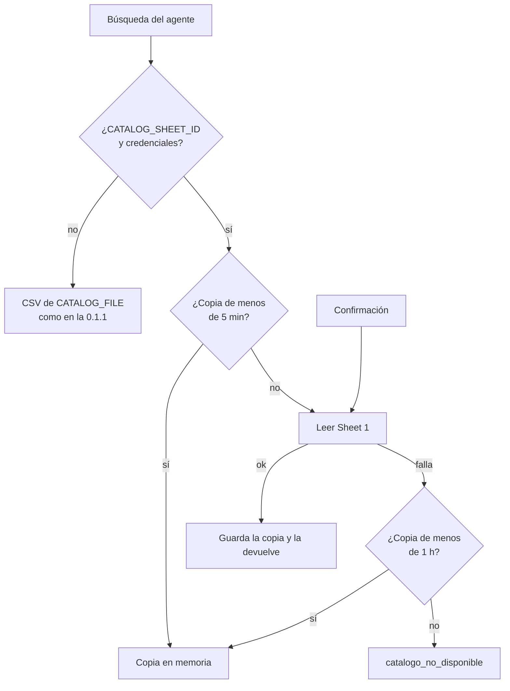

# Spec: Google Sheets y Excel

> Frente D del [plan de mejora del asistente](../plan-mejora-asistente.md#d--google-sheets-y-excel). Los IDs son
> los reservados para este frente; los demás son los de la [spec del MVP](README.md). Ver
> [cómo trabajamos con SDD](README.md#1-cómo-trabajamos-con-sdd).

| | |
|---|---|
| Etapa del roadmap | 02 · Datos del negocio (Sheet 1) y 05 · Registro y seguimiento (Sheet 2) |
| Estado | Implementado con un cliente falso de Google; falta la prueba contra las planillas reales ([§10](#10-verificación-con-las-planillas-reales)) |
| Responsable | Federico |
| Requisitos de la spec del MVP | RF-07, RF-14, RF-19, RNF-04, RNF-10, RNF-13, CA-19, CA-53 |

## 1. Objetivo

Que el catálogo se lea de la planilla del negocio (Sheet 1) y que el equipo vea los pedidos en otra planilla
(Sheet 2) sin abrir archivos en la máquina donde corre el bot. Una falla de Google no puede perder un pedido ni
cambiarle la respuesta al cliente, y el operador puede bajar todos los pedidos a Excel.

## 2. Alcance

| Dentro | Fuera |
|---|---|
| Catálogo desde Sheet 1 con `gspread` cuando hay `CATALOG_SHEET_ID` y `GOOGLE_CREDENTIALS_FILE` | El descuento de stock en Sheet 1 al despachar (issue #61) |
| Caché del catálogo según RNF-13 y lectura fresca al confirmar | Que el estado editado en Sheet 2 vuelva a la base (D-06) |
| Una fila por orden en Sheet 2, sin duplicar en reintentos (RNF-04) | Columnas nuevas de la fila de pedido: son del frente C (`format_order_row`, `ORDER_COLUMNS`) |
| Reintento automático en segundo plano de las órdenes que no llegaron | Escribir en Sheet 1 |
| `GET /orders/export`: las órdenes en `.xlsx` para el operador | Filtros de la exportación (por fecha o estado) |
| Bloqueo de archivo al escribir el CSV local de pedidos | Bloqueo entre máquinas distintas (cada `~/norma-prod` tiene su `data/`) |
| `python -m internal.verificar_claves` prueba el acceso a las dos planillas | |

## 3. Comportamiento

### 3.1 De dónde sale el catálogo

- **Sin planilla configurada** el catálogo sale del CSV de `CATALOG_FILE`, con el fallback de CA-53, y se lee en
  cada consulta como en la 0.1.1. No se crea ningún cliente de Google.
- **Con planilla** se lee la primera hoja de Sheet 1 (o la que diga `CATALOG_WORKSHEET`). La primera fila es el
  encabezado, con las mismas columnas que [`catalogo.csv`](../../data_example/catalogo.csv); no importan las
  mayúsculas, los espacios ni el orden de las columnas. Los valores se piden sin formato, así un precio
  `$ 4.200,00` llega como el número `4200`.
- **Caché:** la copia sirve 5 minutos para buscar. Si Google no responde, se sigue usando la última copia buena
  mientras tenga menos de 1 hora, y no se vuelve a llamar a Google durante 1 minuto para no demorar cada búsqueda
  con el timeout. Pasada la hora, la tool devuelve `catalogo_no_disponible` y el agente no propone nada.
- **Lectura fresca:** `confirm_draft` pide el catálogo con `inventory_service.get_catalog(fresh=True)`, que lee
  Sheet 1 aunque la copia sea reciente, y la renueva. Si en ese momento Google falla, usa la última copia buena de
  la última hora para no frenar el pedido (DP-01).
- Las filas vacías se ignoran. Una fila con un precio o un stock que no es un número se saltea y queda en el log
  con su número de fila, sin sus valores; el resto del catálogo sigue andando.

### 3.2 Pedidos en Sheet 2

Al confirmar, `confirm_draft` guarda la orden en la base y después llama a `sheets_service.append_order`:

1. Toma el bloqueo de pedidos (`ORDERS_FILE` + `.lock`), que comparten la API y el bot porque usan el mismo `data/`.
2. Agrega la fila al CSV de `ORDERS_FILE` si no está, como en la 0.1.1. El CSV queda como copia local aunque haya
   Sheet 2.
3. Con `ORDERS_SHEET_ID` y credenciales, lee la columna A de la primera hoja de Sheet 2 (o de `ORDERS_WORKSHEET`).
   Si el `order_id` ya está, no hace nada. Si la hoja está vacía, escribe primero el encabezado `ORDER_COLUMNS`.
   Después agrega la fila de `format_order_row`.
4. Suelta el bloqueo.

Si algo falla, la orden queda en la base con `sheets_synced = false` y el cliente recibe la misma respuesta que
si hubiera andado: la orden ya existe (CA-19).

Después de una falla de Sheet 2, durante 1 minuto (`ORDERS_PAUSE_AFTER_FAILURE_SECONDS`) la confirmación no llama a
Google: escribe el CSV, deja la orden con `sheets_synced = false` y se la pasa al reintento de §3.3. Así, con Google
caído, cada cliente no espera los 10 segundos del timeout. La pausa es de cada proceso: la API y el bot llevan la
suya. Las celdas se escriben sin interpretar (`RAW`): un texto que empieza
con `=` no se vuelve una fórmula.

### 3.3 Reintento automático

Al arrancar, la API lanza una tarea en segundo plano que cada 3 minutos llama a
`order_service.sync_pending_orders()`. El reintento prueba Sheet 2 aunque esté en la pausa de §3.2: si anda, la
pausa se levanta; si falla, empieza otra. Un error en una pasada queda en el log y la tarea sigue con la siguiente;
al apagar la API se cancela. El bot no la corre: alcanza con un proceso, y el bloqueo de §3.2 evita que el
reintento de la API y una confirmación del bot agreguen la misma orden a la vez.

### 3.4 Exportación a Excel

`GET /orders/export`, con la credencial de operador de los demás `/orders/*`, devuelve un `.xlsx` con todas las
órdenes de la base:

- Hoja **Órdenes**: el encabezado `ORDER_COLUMNS` y una fila por orden con `format_order_row`, igual que Sheet 2.
- Hoja **Líneas**: una fila por producto de cada orden, con los campos de `OrderItem`.

Los textos se guardan como texto, nunca como fórmula. Los números de la hoja de líneas (cantidad, precio,
subtotal) quedan como números para poder sumarlos.

## 4. Contratos

### 4.1 Variables de entorno

| Variable | Obligatoria | Por defecto | Para qué |
|---|---|---|---|
| `GOOGLE_CREDENTIALS_FILE` | Para usar planillas | `credentials/google-service-account.json` en `.env.example` | JSON de la cuenta de servicio. Ruta relativa a la raíz del proyecto (en Docker, `/app`) |
| `CATALOG_SHEET_ID` | No | vacío: CSV | Id de Sheet 1, el tramo de la URL entre `/d/` y `/edit` |
| `ORDERS_SHEET_ID` | No | vacío: solo CSV | Id de Sheet 2 |
| `CATALOG_WORKSHEET` | No | vacío: la primera hoja | Nombre de la hoja del catálogo dentro de Sheet 1 |
| `ORDERS_WORKSHEET` | No | vacío: la primera hoja | Nombre de la hoja de pedidos dentro de Sheet 2 |

Los tiempos (5 minutos de caché, 1 hora de copia vieja, 1 minuto sin reintentar tras una falla, 3 minutos entre
reintentos de pedidos y 10 segundos de timeout con Google) van en el código, según RNF-10.

### 4.2 Código

| Dónde | Qué |
|---|---|
| `internal/services/google_sheets_client.py` | `SheetsClient`: `get_values`, `get_column`, `append_row`, `update_cell` y `service_account_email`. `get_client()` arma el cliente de `gspread` (solo con permiso sobre planillas, sin Drive) y es lo que los tests reemplazan por uno falso |
| `sheets_service.get_catalog()` | Mismo nombre y firma que en la 0.1.1. Lee Sheet 1 con caché o el CSV |
| `sheets_service.lectura_fresca()` | Context manager que hace que `get_catalog()` lea Sheet 1 aunque la copia sea reciente |
| `sheets_service.CatalogoNoDisponibleError` | Subclase de `OSError`: la tool la traduce a `catalogo_no_disponible` como cualquier falla de lectura del catálogo |
| `inventory_service.get_catalog(session, fresh=False)` | `fresh=True` lo usa `confirm_draft` |
| `sheets_service.append_order(order)` | CSV y, si está configurada, Sheet 2, bajo el bloqueo de pedidos |
| `order_service.list_orders()` | Todas las órdenes, para la exportación |
| `internal/services/excel_service.py` | `build_orders_workbook(orders) -> bytes` |
| `GET /orders/export` | `200` con `application/vnd.openxmlformats-officedocument.spreadsheetml.sheet` y `Content-Disposition: attachment; filename="pedidos-AAAAMMDD-HHMM.xlsx"`; `401` sin credencial |

Lo que ya usa `sheets_service.get_catalog()` y `append_order()` sigue igual. Las columnas de la fila de pedido
salen de `format_order_row` y `ORDER_COLUMNS` (frente C): si suma columnas, Sheet 2 y el Excel las toman solas.

## 5. Requisitos

| ID | Requisito |
|---|---|
| RF-50 | Con `CATALOG_SHEET_ID` y `GOOGLE_CREDENTIALS_FILE`, el catálogo se lee de Sheet 1 con las columnas de `catalogo.csv`; sin ellas, del CSV de `CATALOG_FILE` como en la 0.1.1 |
| RF-51 | El catálogo de Sheet 1 se cachea 5 minutos para buscar; si Google no responde se usa la última copia buena hasta 1 hora; la confirmación lee fresco y, si Google falla, usa esa copia (detalla RNF-13) |
| RF-52 | Con `ORDERS_SHEET_ID`, cada orden se agrega una sola vez en Sheet 2 (encabezado si la hoja está vacía, búsqueda del `order_id` antes de agregar, valores sin interpretar), además del CSV local; la escritura de pedidos se hace bajo un bloqueo de archivo compartido por la API y el bot; tras una falla de Sheet 2, durante 1 minuto la confirmación no llama a Google y deja la orden para el reintento |
| RF-53 | La API reintenta cada 3 minutos, en segundo plano, las órdenes con `sheets_synced = false`; una falla del reintento no tumba la API |
| RF-54 | El operador descarga las órdenes en `.xlsx` desde `GET /orders/export`, con una hoja de órdenes y otra de líneas |

## 6. Criterios de aceptación

| ID | Dado | Cuando | Entonces | Test |
|---|---|---|---|---|
| CA-93 | `CATALOG_SHEET_ID` y credenciales, con un Sheet 1 de encabezado en otro orden y mayúsculas, números sin formato, una fila vacía y una fila con precio inválido | Se pide el catálogo | Salen los productos de la planilla con los mismos campos que del CSV, sin la fila vacía ni la inválida. Sin `CATALOG_SHEET_ID`, sale el CSV y no se crea el cliente de Google | `test_planillas.py::test_catalogo_sale_de_la_planilla`, `test_planillas.py::test_sin_planillas_todo_sigue_con_los_csv` |
| CA-94 | El catálogo leído de Sheet 1 | Se busca otra vez antes de 5 minutos y después de 5 minutos | La segunda búsqueda no llama a Google; la tercera sí y ve los cambios de la planilla | `test_planillas.py::test_catalogo_se_cachea_cinco_minutos` |
| CA-95 | Una copia buena del catálogo | Google deja de responder | Antes de 1 hora se usa la copia, sin llamar a Google durante 1 minuto; pasada la hora, o sin copia, `search_products` devuelve `catalogo_no_disponible` | `test_planillas.py::test_google_caido_usa_la_copia_de_la_ultima_hora`, `test_planillas.py::test_sin_copia_y_sin_google_el_catalogo_no_esta_disponible` |
| CA-96 | Una copia de menos de 5 minutos y un cambio de stock en Sheet 1 | El cliente confirma | La confirmación lee Sheet 1 y usa el stock nuevo; si Google falla, usa la copia y la orden se crea igual | `test_planillas.py::test_confirmar_lee_el_catalogo_fresco`, `test_planillas.py::test_confirmar_con_google_caido_usa_la_copia` |
| CA-97 | `ORDERS_SHEET_ID` y un Sheet 2 vacío | Se agrega una orden dos veces | Queda el encabezado `ORDER_COLUMNS` y una sola fila de `format_order_row`; un texto con `=` se escribe sin interpretar | `test_planillas.py::test_pedido_en_sheet2_con_encabezado_y_sin_duplicar` |
| CA-98 | Sheet 2 falla al confirmar, antes o después de escribir la fila | Se confirma y después corre el reintento | La orden queda en la base con `sheets_synced = false`, la confirmación devuelve la orden igual, y tras el reintento hay una sola fila de la orden en Sheet 2. Durante el minuto que sigue a la falla, confirmar no llama a Google (la orden va al CSV y queda pendiente); el reintento prueba igual y, si anda, levanta la pausa | `test_planillas.py::test_falla_sheet2_y_el_reintento_agrega_una_sola_fila`, `test_planillas.py::test_tras_una_falla_de_sheet2_la_confirmacion_no_espera_a_google`, `test_planillas.py::test_el_reintento_no_respeta_la_pausa_y_la_levanta` |
| CA-99 | La API arrancada | Pasa el intervalo de reintento, con una pasada que falla | Se llama a `sync_pending_orders` en cada intervalo, la falla queda en el log y la tarea sigue; al apagar la API se cancela | `test_planillas.py::test_reintento_en_segundo_plano_sigue_tras_una_falla`, `test_planillas.py::test_la_api_arranca_y_apaga_el_reintento` |
| CA-100 | Órdenes en la base | El operador pide `GET /orders/export` con y sin credencial | Con credencial, un `.xlsx` con la hoja Órdenes (como Sheet 2) y la hoja Líneas (una por producto, con números), sin fórmulas; sin credencial, `401` | `test_planillas.py::test_exportar_pedidos_a_excel`, `test_planillas.py::test_exportar_pide_credencial` |
| CA-101 | Varios hilos que agregan pedidos al mismo CSV a la vez, algunos repetidos | Escriben | Cada orden queda una sola vez y ninguna fila queda mezclada con otra | `test_planillas.py::test_escrituras_simultaneas_no_duplican_ni_mezclan` |
| CA-102 | Las planillas configuradas, o no | Se corre `python -m internal.verificar_claves` | Con planillas, informa cuántos productos y pedidos leyó y prueba el permiso de edición de Sheet 2, sin mostrar filas ni claves; sin planillas, dice que se usan los CSV | `test_planillas.py::test_verificar_claves_prueba_las_planillas_sin_mostrar_datos`, `test_planillas.py::test_verificar_claves_sin_planillas` |

También siguen pasando CA-19 (`test_orders.py::test_confirm_draft_falla_sheets_resiliente_y_reintento`) y CA-53
(`test_catalog.py::test_get_catalog_configurable_y_fallback`).

## 7. Errores y casos borde

| Situación | Qué hace el sistema |
|---|---|
| `CATALOG_SHEET_ID` configurado pero el JSON de credenciales no existe o no tiene permiso | Es una falla de Google: copia de la última hora o `catalogo_no_disponible`. No vuelve al CSV, que puede tener precios viejos |
| Sheet 1 sin alguna de las columnas `sku`, `nombre`, `precio` o `stock` | Falla de lectura (igual que si Google no respondiera); el log dice qué columna falta |
| Fila de Sheet 1 con precio o stock que no es un número | Se saltea; el log dice el número de fila, sin los valores |
| Google tarda | Timeout de 10 segundos por llamada |
| Sheet 2 escribió la fila pero la respuesta no llegó | El reintento encuentra el `order_id` en la columna A y no la repite |
| Sheet 2 tiene un encabezado viejo, con menos columnas que `ORDER_COLUMNS` | Se agrega la fila igual; el encabezado se corrige a mano |
| La API y el bot escriben pedidos a la vez | El segundo espera el bloqueo (`fcntl.flock`); en sistemas sin `fcntl` el bloqueo es solo entre hilos del mismo proceso |
| Google está caído un rato largo | Las confirmaciones no esperan a Sheet 2 durante el minuto que sigue a cada falla. Cada pasada del reintento prueba las órdenes pendientes y deja el error en el log; la siguiente vuelve a probar. Mientras una pasada espera a Google tiene tomado el bloqueo, así que una confirmación que llega justo en ese momento espera a que termine |
| Un texto del cliente empieza con `=`, `+` o `@` | Sheet 2 y el Excel lo guardan como texto, no como fórmula |

## 8. Decisiones y preguntas abiertas

Los IDs `DP-xx` son de esta spec; al integrar se pasan a la tabla de decisiones de la spec del MVP.

| ID | Decisión o pregunta | Estado |
|---|---|---|
| DP-01 | Si Google falla justo al confirmar, se confirma con la copia de la última hora en vez de frenar el pedido. El stock comprometido de las órdenes activas se descuenta igual desde la base, así que el riesgo es solo un cambio de stock hecho en Sheet 1 en esa hora | Tomada en esta spec, a revisar con el negocio |
| DP-02 | Con Sheet 2 configurado se sigue escribiendo el CSV local: es la copia que no depende de Google y la escritura es idempotente | Tomada en esta spec |
| DP-03 | Sin planilla, el CSV del catálogo no se cachea: es local, se lee rápido y el equipo ve sus cambios al instante | Tomada en esta spec |
| DP-04 | El reintento corre solo en la API (no en el bot) cada 3 minutos | Tomada en esta spec |

## 9. Plan de implementación

1. `feature/planillas-google-sheets`: esta spec, los tests de `tests/test_planillas.py` con un cliente falso de
   Google y el código. Depende de la PR de documentación (#68). Al integrar el frente C, se rebasa sobre él: las
   columnas nuevas de `format_order_row` llegan solas a Sheet 2 y al Excel.

## 10. Verificación con las planillas reales

Los tests usan un cliente falso. La prueba con Google la hace una persona del equipo con sus credenciales:

1. **Cuenta de servicio.** En [Google Cloud Console](https://console.cloud.google.com/), en un proyecto propio:
   habilitar la **Google Sheets API**, crear una cuenta de servicio (IAM → Cuentas de servicio) y generarle una
   clave JSON. Guardarla como `credentials/google-service-account.json` (la carpeta no se versiona). No hace falta
   habilitar la API de Drive.
2. **Compartir las planillas.** Abrir el JSON y copiar `client_email` (algo como
   `norma@<proyecto>.iam.gserviceaccount.com`). En cada planilla, **Compartir** con ese correo: Sheet 1 como
   **Lector** y Sheet 2 como **Editor**, sin notificar.
3. **Sheet 1.** La primera hoja (o la de `CATALOG_WORKSHEET`) con el encabezado
   `sku, nombre, marca, presentacion, categoria, precio, stock, stock_minimo` en la fila 1. Para probar sin datos
   reales, se puede importar [`data_example/catalogo.csv`](../../data_example/catalogo.csv).
4. **Sheet 2.** Una planilla vacía (el sistema escribe el encabezado).
5. **`.env`.** Completar `GOOGLE_CREDENTIALS_FILE`, `CATALOG_SHEET_ID` y `ORDERS_SHEET_ID` con el tramo de la URL
   entre `/d/` y `/edit`.
6. **Acceso.** `python -m internal.verificar_claves` tiene que decir cuántos productos leyó de Sheet 1 y que pudo
   editar Sheet 2. Si dice que no tiene permiso, muestra el correo de la cuenta de servicio con el que hay que
   compartir.
7. **Pedido.** Con el bot de Telegram, hacer un pedido y confirmarlo (`POST /chat/messages` todavía devuelve
   `501`, así que por la API no se puede): aparece una fila en Sheet 2. Cambiar un
   precio en Sheet 1 y confirmar otro pedido: la confirmación usa el precio nuevo.
8. **Falla.** Quitarle a la cuenta de servicio el permiso de Sheet 2, confirmar un pedido (el cliente recibe su
   número igual), devolver el permiso y esperar hasta 3 minutos con la API prendida: la fila aparece una sola vez.
9. **Excel.** `curl -H "X-Operator-Token: $OPERATOR_TOKEN" -o pedidos.xlsx http://localhost:8000/orders/export` y
   abrirlo: hojas Órdenes y Líneas.
