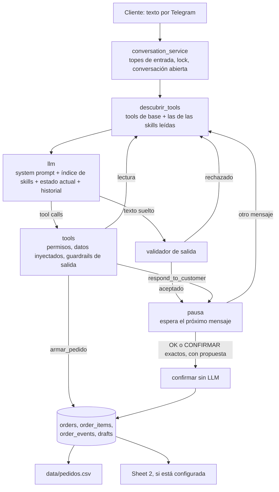
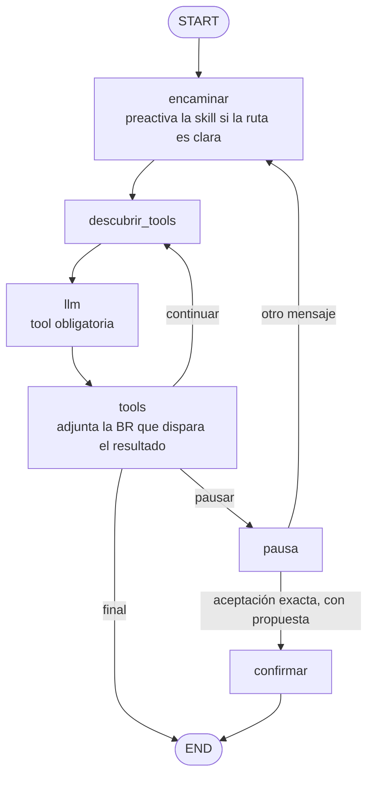
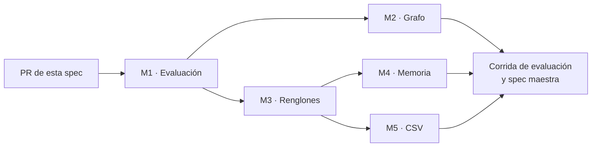

# Spec: Toma de pedidos por texto y registro en CSV — estado al 2026-11-12 y mejoras

> Foto de lo que hace hoy el agente en `develop` (`7c77d50`) y de los cinco puntos donde más conviene reforzarlo
> antes de sumar audio e imagen. Ver [cómo trabajamos con SDD](README.md#1-cómo-trabajamos-con-sdd).

| | |
|---|---|
| Etapa del roadmap | 03 · Pedidos multimodales (solo texto), 04 · Confirmación, 05 · Registro y seguimiento |
| Estado | Propuesto |
| Responsable | Federico Picado |
| Requisitos de la spec del MVP | RF-07, RF-11, RF-13, RF-19, RF-21, RF-28, RF-36 a RF-39, RNF-03, RNF-06, RNF-07 |
| IDs que reserva | RF-63 a RF-83, RNF-15 y RNF-16, CA-121 a CA-142, D-21 a D-29, BR-11 |

**Índice**

1. [Objetivo](#1-objetivo)
2. [Alcance](#2-alcance)
3. [Qué hace hoy el agente](#3-qué-hace-hoy-el-agente)
4. [Los cinco puntos más flojos](#4-los-cinco-puntos-más-flojos)
5. [Mejoras, una por una](#5-mejoras-una-por-una)
6. [Requisitos](#6-requisitos)
7. [Criterios de aceptación](#7-criterios-de-aceptación)
8. [Errores y casos borde](#8-errores-y-casos-borde)
9. [Decisiones y preguntas abiertas](#9-decisiones-y-preguntas-abiertas)
10. [Plan de implementación](#10-plan-de-implementación)
11. [Cómo queda preparado para audio e imagen](#11-cómo-queda-preparado-para-audio-e-imagen)
12. [Otros puntos flojos, fuera de los cinco](#12-otros-puntos-flojos-fuera-de-los-cinco)

---

## 1. Objetivo

Hoy todos los pedidos llegan por texto, muchas veces mal escrito. El agente ya busca con tolerancia a errores,
valida lo que dice y guarda la orden completa en la base. Lo que falta para que tome bien un pedido real, que es
una lista de 20 a 40 renglones agrupada por marca, es medir cuánto acierta, gastar menos llamadas al LLM por turno,
no perder ningún renglón, acordarse de lo que preguntó y dejar en el CSV algo que el equipo pueda preparar sin
abrir el chat.

Esta spec deja escrito qué hace el sistema hoy y propone esas cinco mejoras, cada una con su contrato, sus
requisitos y sus criterios de aceptación. Audio e imagen quedan para después, pero las mejoras se diseñan para que
entren por el mismo camino ([§11](#11-cómo-queda-preparado-para-audio-e-imagen)).

## 2. Alcance

| Dentro | Fuera |
|---|---|
| Evaluación con pedidos de formato real y métricas por línea | Transcripción de audio y lectura de imágenes (RF-04, RF-05) |
| Cambios al grafo para gastar menos iteraciones y no responder con texto suelto | Reemplazar LangGraph o el esquema de skills y BR en el repo |
| Tool de búsqueda por lote, estado por renglón y control de cobertura | Búsqueda semántica con embeddings (D-29: primero se mide) |
| Estado actual completo, precios revalidados al confirmar, pedidos anteriores, mensajes agrupados | Perfil del cliente con preferencias, precios por cliente o cuenta corriente |
| CSV por línea, lo que quedó afuera del pedido, estado sincronizado | Dashboard (etapa 06), estado editado en Sheet 2 que vuelve a la base (D-06) |
| El origen del mensaje (`texto`, `audio`, `imagen`) guardado de punta a punta | Derivación a una persona con aviso al equipo (RF-27, etapa 04) |

## 3. Qué hace hoy el agente

### 3.1 Recorrido de un mensaje



1. **Entrada.** `conversation_service.handle_message` rechaza audio e imagen con un mensaje fijo (RF-32), aplica
   los topes de 4000 caracteres y 10 mensajes por minuto, y procesa de a un turno por cliente y canal.
2. **Elegir la skill.** Cada turno empieza sin skills activas. El LLM ve un índice con `funcion` y `cuando` de cada
   skill y tiene que leer una con `leer_skill`: recién ahí aparecen las tools para responder.
3. **Entender.** Busca cada producto con `search_products`, que tolera errores de tipeo, abreviaturas, sinónimos y
   medidas escritas de otra forma, y nunca aproxima números.
4. **Proponer.** `respond_to_customer` valida SKU y stock, arma el `OrderDraft` con nombre y precio del catálogo, pasa
   el mensaje por los guardrails y agrega debajo el detalle con precios y total. El grafo queda en pausa.
5. **Confirmar.** Con `OK` o `CONFIRMAR` exactos el backend registra la propuesta sin llamar al LLM. Con otra
   respuesta decide el agente con la skill `confirmar_pedido` y la BR-06.
6. **Registrar.** `order_service.confirm_draft` revalida el stock con una lectura fresca, crea la orden una sola vez
   por `draft_id` y la vuelca al CSV y, si está configurada, a Sheet 2, con reintento cada 3 minutos.

### 3.2 Skills, BR y tools

| Skill | Cuándo se elige | Tools que habilita | BR |
|---|---|---|---|
| `tomar_pedido` | Pide o consulta productos, o cambia la propuesta | `search_products`, `get_product`, `check_stock`, `respond_to_customer` | BR-01 falta de stock, BR-03 aclaraciones, BR-04 fuera de catálogo, BR-05 corrección, BR-09 coincidencia aproximada, BR-10 observaciones |
| `confirmar_pedido` | Hay propuesta vigente y el cliente acepta, rechaza o duda | `armar_pedido`, `respond_to_customer` | BR-06 aceptación |
| `informar` | Saludos, consultas generales, «dale» sin propuesta | `respond_to_customer` | Ninguna; lee `datos_negocio.md` |

Tools de base, disponibles desde el inicio del turno: `leer_skill`, `leer_br`, `search_products`, `get_product`,
`check_stock` y `explorar_catalogo`. Tools terminales: `respond_to_customer` y `armar_pedido`.

### 3.3 Qué queda guardado

| Dónde | Qué guarda | Una fila por |
|---|---|---|
| `orders` | Cliente, nombre del perfil, canal, conversación, notas, total, estado, `sheets_synced` | Orden |
| `order_items` | SKU, producto, presentación, cantidad, precio unitario, nota | Línea |
| `order_events` | Estado anterior, estado nuevo, quién lo cambió | Cambio de estado |
| `drafts` | Cada versión propuesta y su desenlace | Versión de propuesta |
| `data/pedidos.csv` y Sheet 2 | `id_orden, fecha_hora, cliente, canal, productos, notas, estado, nombre_cliente, total` | Orden |
| `GET /orders/export` | `.xlsx` con las hojas Órdenes y Líneas | Orden y línea |

### 3.4 Lo que ya está bien y no se toca

- **El LLM no decide qué se registra.** `armar_pedido` no recibe productos: solo crea la propuesta que el backend
  validó. Precios, nombres y totales salen del catálogo.
- **Una orden por borrador.** `draft_id` único, transacción con `BEGIN IMMEDIATE` y stock revalidado al confirmar.
- **Guardrails en código.** Ningún texto llega al cliente sin pasar por el validador, tampoco el texto suelto.
- **Búsqueda rápida.** Sobre el catálogo de 1.090 productos, cada búsqueda tarda 11,5 ms de media y 19,5 ms de
  máximo.
- **Tests.** La suite pasa completa: 689 tests sin red, con un modelo falso.
- **Observabilidad.** Cada turno deja una línea de log y, con MLflow, una traza con tokens, tools y latencia, sin
  texto de clientes.

### 3.5 Dónde el código no llega a la spec del agente

| Lo que dice [`agente.md`](agente.md) | Lo que hace el código |
|---|---|
| §2: siete estados de conversación, con vencimiento a las 24 h | Solo `abierta`, `cerrada` y `fallida`. Nada vence |
| §6: derivación tras 2 fallas o 3 aclaraciones seguidas | A la segunda falla la conversación queda `fallida` y nadie se entera. Las aclaraciones no se cuentan |
| §8: el estado actual lleva la última pregunta y las opciones ofrecidas | `_current_state` lleva el nombre del cliente y la propuesta vigente. `options` se guarda en el estado del grafo y nunca se le muestra al LLM |
| §8: cada mensaje del historial lleva su origen (`texto`, `audio transcripto`, `imagen leída`) | No hay origen en ningún lado |

## 4. Los cinco puntos más flojos

Ordenados por cuánto condicionan al resto. El detalle de cada mejora está en [§5](#5-mejoras-una-por-una).

| # | Punto flojo | Evidencia | Mejora |
|---|---|---|---|
| 1 | **No sabemos cuánto acierta.** No hay una sola corrida de evaluación completa con un LLM real, y los casos son de juguete | 4 corridas, ninguna completa; la mejor evaluó 5 casos y acertó 2. De 32 casos, 1 tiene varios renglones (7) y ninguno espera más de 3 productos | [M1](#m1--evaluación-que-mida-pedidos-reales) |
| 2 | **El grafo gasta llamadas en ceremonia y deja escapar al modelo por texto suelto** | El modelo no está obligado a usar una tool. Un saludo cuesta 2 llamadas al LLM. En la corrida 4 el modelo inventó un número de orden sin registrar nada | [M2](#m2--menos-iteraciones-y-ninguna-respuesta-sin-tool) |
| 3 | **En un pedido largo, que no se pierda un renglón depende de la memoria del modelo** | No hay control de cobertura. Una búsqueda genérica devuelve 5 de 90 coincidencias sin avisar. La coloración por tono no se encuentra | [M3](#m3--pedidos-largos-renglón-por-renglón) |
| 4 | **Entre un turno y el siguiente el agente se acuerda de muy poco** | No ve las opciones que ofreció, pierde los renglones con dudas, una propuesta nunca vence y se registra con el precio viejo, y no conoce los pedidos anteriores del cliente | [M4](#m4--memoria-entre-turnos-y-entre-pedidos) |
| 5 | **El CSV guarda un resumen del pedido, no el pedido** | Todas las líneas van en una celda de texto, el estado queda en `Recibido` para siempre y lo que el cliente pidió y no entró no se guarda en ningún lado | [M5](#m5--un-csv-que-sirva-para-preparar-el-pedido) |

## 5. Mejoras, una por una

### M1 · Evaluación que mida pedidos reales

**Problema.** Los 689 tests prueban la cañería con un modelo falso: que el loop, los permisos y los guardrails
funcionan. No dicen nada de si el agente entiende un pedido. Eso lo mide `internal/evaluar_agente.py`, y todavía no
midió nada.

**Evidencia.**

- [`MEJORAS.md`](../../MEJORAS.md) registra cuatro corridas. Las tres primeras no evaluaron casi nada por cuota del
  free tier. La cuarta, con OpenRouter y un modelo gratuito, evaluó 5 casos y acertó 2: el modelo lee la skill y
  después contesta con texto suelto.
- `data_example/mensajes.json` tiene 32 casos. Solo `pedido-largo-con-una-duda` tiene varios renglones, y son 7. El
  caso con más productos espera 3.
- Los casos corren contra `data_example/catalogo.csv`, de 15 productos. El catálogo de trabajo tiene 1.090, de 57
  marcas, y ahí «acondicionador» coincide con 90 productos.
- El criterio es todo o nada sobre el último turno. Un pedido de 30 renglones con 29 bien y 1 mal cuenta igual que
  uno con todo mal.
- Cada caso corre una sola vez, así que no se distingue un prompt mejor de una corrida con suerte.

**Qué se propone.**

1. **Casos con formato real.** Un archivo nuevo `data_example/pedidos_evaluacion.json` con pedidos inventados que
   copian la forma de los reales: lista agrupada por marca, 20 a 40 renglones, abreviaturas, errores de tipeo,
   coloración en `tono/cantidad`, productos fuera de catálogo mezclados y pedidos partidos en varios mensajes. Sin
   nombres, teléfonos ni pedidos reales (regla 2 de `AGENTS.md`).
2. **Catálogo de evaluación más grande.** Un catálogo sintético de 300 productos o más en `tests/datos_sinteticos.py`,
   con las mismas trampas que el real: la medida dentro del nombre, varias medidas del mismo producto y la
   coloración sin tono.
3. **Métricas por línea**, además del acierto por caso:

   | Métrica | Qué mide |
   |---|---|
   | `recall_lineas` | De las líneas que el cliente pidió, cuántas quedaron en la propuesta con SKU y cantidad correctos |
   | `precision_lineas` | De las líneas propuestas, cuántas son correctas |
   | `lineas_perdidas` | Renglones del cliente que no están en la propuesta, ni preguntados, ni avisados como afuera |
   | `registros_indebidos` | Órdenes creadas cuando el caso esperaba `sin_pedido` |
   | `aclaraciones_de_mas` | Preguntas hechas cuando el caso tenía una sola respuesta posible |
   | `llamadas_llm`, tokens, latencia p50 y p95 | Costo y tiempo por turno y por pedido |

4. **Repeticiones.** `--repeticiones N` corre cada caso N veces y reporta la tasa de acierto por caso.
5. **Umbral de release (RNF-15).** No se publica una versión si la última corrida registrada no llega al umbral.
6. **Elegir el modelo con datos (D-21).** La misma corrida contra dos o tres modelos, comparada en MLflow. El
   requisito mínimo es que use tools de forma confiable; hoy el modelo por defecto no lo cumple.

**Archivos:** `internal/evaluar_agente.py`, `data_example/pedidos_evaluacion.json` y
`data_example/catalogo_evaluacion.csv` (nuevos), `tests/datos_sinteticos.py`, `tests/test_evaluacion.py` (nuevo,
prueba los datos y las métricas con resultados armados a mano y con el modelo falso).

**Hecho cuando:** hay una corrida completa documentada en `MEJORAS.md` con las métricas por línea, y cada mejora de
M2 a M5 se puede comparar contra esa línea de base.

### M2 · Menos iteraciones y ninguna respuesta sin tool

**Problema.** El turno más simple cuesta dos llamadas al LLM, y el modelo puede saltearse las tools y escribirle
directo al cliente. Los guardrails atajan ese texto, pero cada rechazo es otra llamada y la propuesta se pierde.

**Evidencia.**

- En `graph.py`, `llamar_modelo` hace `model.bind_tools(...)` sin `tool_choice`: el modelo elige si usa una tool.
- En la corrida 4, sin tool terminal, el modelo contestó «Pedido confirmado… Número de orden: 241003A». Inventó el
  número y no registró nada.
- El nodo `pausa` reinicia `skills_activas` en cada turno. Hoy cuestan:

  | Turno | Llamadas al LLM hoy | Con M2 |
  |---|---|---|
  | Saludo | 2 (`leer_skill`, después `respond_to_customer`) | 1 |
  | Pedido simple | 2 (`leer_skill` y búsqueda juntas, después responder) | 1 o 2 |
  | Pedido con stock corto o coincidencia aproximada | 3 (se suma `leer_br`) | 2 |
  | «Dale» con propuesta vigente | 2 (`leer_skill`, después `armar_pedido`) | 0 |

- El tope es de 15 iteraciones con 30 s de timeout y un reintento cada una: un turno que se traba puede bloquear
  la conversación varios minutos.

**Qué se propone.**

1. **Tool obligatoria (RF-65).** Cada llamada al LLM se hace con `tool_choice="any"`: el modelo tiene que elegir
   una tool. El camino de texto suelto queda como red de seguridad para un proveedor que no lo respete.
2. **Skill preactivada por el backend (RF-66).** Un nodo nuevo, `encaminar`, corre antes de la primera llamada al
   LLM del turno. Cuando la ruta no admite dudas, el backend ejecuta `leer_skill` y deja el resultado en el
   historial del turno, igual que si lo hubiera pedido el modelo:

   | Situación | Skill que preactiva |
   |---|---|
   | Sin propuesta vigente y el mensaje tiene dos renglones o más, o una cantidad | `tomar_pedido` |
   | Con propuesta vigente y un mensaje de hasta 3 palabras sin números | `confirmar_pedido` |
   | Cualquier otro caso | Ninguna: elige el modelo, como hoy |

   El modelo puede leer otra skill si la preactivada no corresponde. Las skills siguen en el repo y se siguen
   leyendo con `leer_skill`: lo que cambia es quién dispara la lectura (D-22).
3. **La BR llega con el resultado que la dispara (RF-67).** Cuando el resultado de una tool tiene una señal que
   lleva a una sola BR, el backend agrega el texto de esa BR en el mismo resultado, una vez por turno:

   | Señal en el resultado | BR que acompaña |
   |---|---|
   | `sugerencias`, o un producto con `aproximado: true` | BR-09 |
   | `stock_insuficiente`, o `hay_stock: false` en el único candidato | BR-01 |
   | `matches` y `sugerencias` vacías | BR-04 |
   | Varios candidatos para un renglón | BR-03 |

   `leer_br` sigue disponible para las demás (D-22).
4. **Más aceptaciones sin LLM (RF-68, D-23).** Hoy solo `OK` y `CONFIRMAR` exactos evitan al LLM. La BR-06 ya
   lista otras que son aceptación pura: «dale», «sí», «listo», «de una», «mandale». Si el mensaje completo,
   normalizado, es una de esas, el backend registra la propuesta. La lista vive en un solo lugar,
   `palabras_clave.py`, y la BR-06 la cita.
5. **Presupuesto del turno (RNF-16).** Tope de 8 iteraciones en lugar de 15 y un plazo total de 60 s por turno.



**Archivos:** `internal/agent/graph.py`, `internal/agent/tool_registry.py`, `internal/services/palabras_clave.py`,
`internal/skills/confirmar_pedido/BR/BR-06.md`, `internal/agent/system_prompt.md` (paso 1 de «Cómo trabajás»),
`docs/spec/agente.md` §3.2.

**Hecho cuando:** con el modelo falso, un saludo y un pedido simple cierran en una llamada, ningún test llega al
cliente por el camino de texto suelto, y la evaluación de M1 muestra menos llamadas por turno sin bajar el recall.

### M3 · Pedidos largos, renglón por renglón

**Problema.** El system prompt describe cómo llega un pedido grande (una marca por línea y debajo un producto por
renglón), pero en el código no hay nada que lo acompañe. El modelo tiene que leer la lista, lanzar una búsqueda por
renglón, leer todos los resultados y armar la propuesta sin olvidarse de ninguno. Si se olvida, nadie lo nota.

**Evidencia.** Medido contra el catálogo de trabajo de 1.090 productos:

| Qué | Resultado |
|---|---|
| Tamaño del resultado de una búsqueda | 993 caracteres de media, 1.178 de máximo: 5 productos con 9 campos cada uno |
| Pedido de 30 renglones | Unos 30.000 caracteres de resultados en una sola iteración, que se reenvían en cada iteración siguiente del turno |
| «acondicionador» | 90 coincidencias, devuelve 5, todas con `score` 1.0, sin decir que hay más |
| «oxidante 20 vol» | 20 coincidencias, devuelve 5, todas con `score` 1.0 |
| Coloraciones del catálogo con el tono en el nombre | 0 de 68 |
| «ISSUE PROFESIONAL 821» (tono 8.21) | Devuelve tres oxidantes, con `score` 0,67 y `aproximado: true` |
| «7/3» debajo de una marca | No devuelve nada |

Además:

- Ningún control verifica que cada renglón del cliente terminó en la propuesta, en una pregunta o en un aviso.
- Los renglones con dudas no se guardan. La skill dice «si lo confirmás así, esas dos quedan afuera», y lo que
  queda afuera se pierde.
- `message` admite 600 caracteres: en una lista larga no entran las dudas de más de cuatro o cinco renglones.
- `TelegramClient.send_message` no parte los mensajes. El detalle de una propuesta de 40 líneas puede pasar los
  4.096 caracteres que acepta Telegram, y ese envío falla.

**Qué se propone.**

1. **Renglones numerados (RF-69).** Una función pura, `interpretation_service.numerar_renglones`, parte el mensaje
   en renglones, les pone número y marca cuáles son un encabezado de marca: una línea sin cantidad que coincide con
   una marca del catálogo. El LLM recibe la lista numerada en el estado actual. No interpreta productos: eso sigue
   siendo del LLM.
2. **Búsqueda por lote (RF-70).** Una tool nueva, `buscar_renglones`, de la skill `tomar_pedido`. Recibe todos los
   renglones juntos y devuelve un resultado compacto por renglón ([§5.1](#51-contratos-de-m3)).
3. **Estado por renglón (RF-71).** El estado del grafo guarda `renglones`: cada uno `resuelto`, `pendiente` o
   `afuera`. Sobrevive entre turnos mientras la conversación siga abierta, así la respuesta a una pregunta
   completa el renglón sin rehacer el pedido.
4. **Control de cobertura (RF-72).** `respond_to_customer` falla con `renglones_sin_cuenta` si algún renglón del
   turno no está en `propuesta`, en `pendientes` o en `afuera`. El error le dice al modelo cuáles faltan, como
   hacen hoy los guardrails.
5. **La búsqueda dice cuánto no mostró (RF-73).** `search_products` y `buscar_renglones` devuelven `total` y, si
   cortaron, `difieren_en`: `marca`, `medida` o `variante`. Con eso el modelo sabe qué preguntar (BR-03).
6. **El tono va aparte (RF-73, D-27).** En una coloración, el tono no participa de la búsqueda: se busca por marca
   y tipo, y el tono se anota en la `note` de la línea. Depende de confirmar V-01 y V-02 con el negocio.
7. **Mensajes largos partidos (RF-74).** El canal parte por renglón los mensajes que pasan su límite, sin cortar
   una línea de pedido por la mitad. El tope de `message` sube a 1.200 caracteres cuando hay `pendientes`.

#### 5.1 Contratos de M3

**Entrada de `buscar_renglones`:**

```json
{
  "renglones": [
    {"n": 2, "texto": "mascara argan 1k", "marca": "Fidelité", "cantidad": 2},
    {"n": 3, "texto": "sh keratina x900", "marca": "Fidelité", "cantidad": 1},
    {"n": 5, "texto": "coloracion", "marca": "Issue", "tono": "8.21", "cantidad": 2}
  ]
}
```

- `n`: número del renglón, tal como llegó en el estado actual.
- `marca`: la del encabezado bajo el que está el renglón, si lo hay.
- `tono`: solo en coloración. No se usa para buscar.
- Máximo 60 renglones por llamada.

**Salida:**

```json
{
  "renglones": [
    {"n": 2, "estado": "unico", "total": 1, "alcanza": true,
     "candidatos": [{"sku": "…", "nombre": "…", "precio": "8200.00", "hay_stock": true}]},
    {"n": 3, "estado": "varias", "total": 4, "difieren_en": "medida",
     "candidatos": [{"sku": "…", "nombre": "…", "precio": "…", "hay_stock": true}]},
    {"n": 5, "estado": "sin_stock", "total": 1, "alcanza": false, "disponible": 1,
     "candidatos": [{"sku": "…", "nombre": "…", "precio": "…", "hay_stock": true}]}
  ]
}
```

| `estado` | Significado | Qué hace el agente |
|---|---|---|
| `unico` | Un solo producto confiable, y el stock alcanza | Va a `propuesta` |
| `varias` | Más de un producto confiable | Pregunta (BR-03), con hasta 3 candidatos |
| `aproximado` | Solo hay coincidencias aproximadas | Pregunta «¿es este?» (BR-09) |
| `sin_stock` | Un solo producto, pero no alcanza | Ofrece `disponible` (BR-01) |
| `no_encontrado` | Nada parecido | Va a `afuera` (BR-04) |

Cada candidato lleva 4 campos en lugar de 9. `disponible` aparece solo en `sin_stock`, que es el único caso en que
el cliente necesita el número.

**Cambios en `respond_to_customer`:**

| Campo | Cambio |
|---|---|
| `propuesta[].renglon` | Nuevo, opcional: el número del renglón del cliente que resuelve esa línea |
| `pendientes` | Nuevo: `[{"renglon": 3, "opciones": ["SKU-A", "SKU-B"]}]`, los renglones que se preguntan |
| `afuera` | Nuevo: `[{"renglon": 7, "motivo": "fuera_de_catalogo"}]`. Motivos: `fuera_de_catalogo`, `sin_stock`, `lo_saco_el_cliente` |
| `options` | Se mantiene para un mensaje de un solo renglón. Con `pendientes`, se calcula a partir de ellos |

Lo que ya usa `respond_to_customer` sin estos campos sigue funcionando: el control de cobertura solo corre cuando
el turno tiene renglones numerados.

**Archivos:** `internal/services/interpretation_service.py`, `internal/services/busqueda_service.py`,
`internal/tools/catalog_tools.py`, `internal/agent/tool_registry.py`, `internal/agent/state.py`,
`internal/agent/context.py`, `internal/schemas/agent_schema.py`, `internal/tools/reply_tools.py`,
`internal/services/telegram_service.py`, `internal/skills/tomar_pedido/skill.md` y sus BR-03, BR-04 y BR-09.

**Hecho cuando:** un pedido de 30 renglones con el modelo falso queda con cada renglón en `propuesta`, `pendientes`
o `afuera`, la respuesta a las dudas completa la propuesta sin volver a buscar los renglones resueltos, y la
evaluación de M1 muestra `lineas_perdidas` en 0.

### M4 · Memoria entre turnos y entre pedidos

**Problema.** Al terminar un turno, casi todo lo que el agente averiguó se descarta. Y cuando el pedido se
registra, la conversación se cierra y el agente no sabe nada del cliente la próxima vez.

**Evidencia.**

- `context._current_state` le muestra al LLM el nombre del cliente y la propuesta vigente. `options` está en el
  estado del grafo y nunca entra al contexto. El system prompt lo admite: «los resultados de tools de turnos
  anteriores ya no están».
- Después de «¿el de 300 o el de 900?», la respuesta «el de 900» obliga a leer la skill y buscar de nuevo.
- Una propuesta no vence. `confirm_draft` revalida el stock con una lectura fresca, pero registra el
  `unit_price` que quedó en el borrador: un «OK» dos semanas después crea la orden con el precio viejo.
- Los clientes son comercios que compran seguido. La tabla `orders` ya tiene sus pedidos anteriores, y el agente no
  puede consultarla. Cuando una búsqueda devuelve 5 productos con el mismo `score`, lo que ese cliente compró
  antes es el mejor desempate, y no se usa.
- Un cliente manda el pedido en varios mensajes seguidos (V-03). Cada uno dispara un turno completo, y el
  limitador corta después del décimo en un minuto.

**Qué se propone.**

1. **Estado actual completo (RF-75).** El bloque que arma `context.py` suma la pregunta pendiente con sus opciones
   (nombre, medida y SKU), los renglones pendientes y los que quedaron afuera, y la versión de la propuesta. El
   SKU es para el modelo: los guardrails ya impiden que llegue al cliente.
2. **Precio revalidado al confirmar (RF-76, D-25).** `confirm_draft` compara el precio de cada línea con el del
   catálogo leído fresco. Si alguno cambió, no registra: devuelve `precio_cambiado` con las líneas, y el agente
   muestra la propuesta con los precios nuevos. Vale también para el camino sin LLM.
3. **Pedidos anteriores (RF-77).** Una tool de base nueva, `pedidos_anteriores`, devuelve las últimas órdenes del
   cliente del turno, con sus líneas. El `customer_id` lo inyecta el backend: el modelo no puede pedir las de otro.
   Una BR nueva, la BR-11, dice cómo usarla: «lo de siempre» se resuelve proponiendo el último pedido, nunca
   registrándolo directo. La búsqueda usa lo que el cliente compró antes como desempate entre productos con el
   mismo `score`.
4. **Mensajes seguidos agrupados (RF-78, D-26).** El canal espera unos segundos antes de abrir el turno. Si en esa
   ventana llegan más mensajes del mismo cliente, se procesan juntos como un solo texto.

**Contrato de `pedidos_anteriores`:**

```json
{"limite": 3}
```

```json
{
  "pedidos": [
    {"fecha": "2026-11-03", "lineas": [{"sku": "…", "nombre": "…", "cantidad": 6}]}
  ]
}
```

No devuelve precios viejos, número de orden ni estado: el estado de un pedido no se consulta por este chat.

**Archivos:** `internal/agent/context.py`, `internal/agent/state.py`, `internal/services/order_service.py`,
`internal/tools/order_tools.py`, `internal/agent/tool_registry.py`, `internal/services/busqueda_service.py`,
`internal/services/conversation_service.py`, `internal/services/telegram_service.py`,
`internal/skills/tomar_pedido/BR/BR-11.md` (nueva), `docs/spec/agente.md` §8.

**Hecho cuando:** con el modelo falso, la respuesta a una aclaración cierra en una llamada sin volver a buscar,
una propuesta con un precio que cambió no se registra, y «lo mismo que la otra vez» termina en una propuesta con
las líneas del último pedido.

### M5 · Un CSV que sirva para preparar el pedido

**Problema.** La base guarda la orden completa, pero lo que el equipo abre es el CSV, y ahí el pedido es una fila
con todos los productos en una celda. Para un pedido de 40 líneas, quien prepara tiene que leer una celda de
varios miles de caracteres.

**Evidencia.**

- `sheets_service.format_order_row` escribe `productos` como `2 x Nombre (SKU) [nota]; 1 x …`. No se puede filtrar
  ni sumar por producto.
- La vista por línea existe solo en el Excel de `GET /orders/export`, y su hoja Líneas no trae la nota
  (`excel_service.LINE_COLUMNS`): el tono de una coloración no aparece.
- `order_service.change_status` cambia el estado en la base y no toca el CSV ni Sheet 2. `_append_order_csv` sale
  sin hacer nada si la orden ya está. Una orden cancelada sigue figurando `Recibido`.
- Lo que el cliente pidió y no entró (fuera de catálogo, sin stock, una duda sin resolver) no se guarda en ningún
  lado. Es una venta perdida que el equipo no ve.
- La fila no dice de qué borrador ni de qué conversación salió, ni qué líneas se resolvieron por coincidencia
  aproximada.
- El CSV escribe los textos del cliente tal cual. El Excel ya evita que un `=` se lea como fórmula y Sheet 2 se
  escribe en modo `raw`; el CSV abierto con Excel no tiene esa protección.
- Un `pedidos.csv` anterior conserva su encabezado de 7 columnas y recibe filas de 9.

**Qué se propone.**

1. **Un CSV por línea (RF-79).** Archivo nuevo junto al de órdenes, `pedidos_lineas.csv`, con una fila por línea
   de cada orden. Con Sheet 2 configurada, va a una segunda hoja de la misma planilla.
2. **Más columnas en `pedidos.csv` (RF-80)**, al final para no desalinear lo que ya existe.
3. **Lo que quedó afuera se guarda (RF-80).** Tabla nueva `order_leftovers` con los renglones `afuera` de la
   propuesta aceptada. Van resumidos en la columna `fuera_del_pedido`.
4. **Estado sincronizado (RF-81).** Un cambio de estado reescribe la fila en el CSV y actualiza la celda en
   Sheet 2. Si Sheet 2 falla, la orden queda con `sheets_synced = False` y la toma el reintento que ya existe.
5. **CSV seguro y con el encabezado al día (RF-82).** Un texto que empieza con `=`, `+`, `-` o `@` se escribe con
   un apóstrofo adelante. Si el encabezado del archivo es más corto que `ORDER_COLUMNS`, se reescribe.
6. **Origen del mensaje (RF-83).** La orden guarda si el pedido llegó por `texto`, `audio` o `imagen`.

**Columnas nuevas de `pedidos.csv`:**

| Columna | Contenido |
|---|---|
| `lineas` | Cantidad de líneas de la orden |
| `unidades` | Suma de cantidades |
| `fuera_del_pedido` | Lo que el cliente pidió y no entró, con su motivo: `shampoo skala (fuera_de_catalogo); …` |
| `origen` | `texto`, `audio` o `imagen` |
| `draft_id` | Borrador del que salió la orden |
| `actualizado` | Fecha y hora del último cambio de estado |

**Columnas de `pedidos_lineas.csv`:**

| Columna | Contenido |
|---|---|
| `id_orden` | `ORD-0001` |
| `renglon` | Posición de la línea en la orden |
| `sku`, `producto`, `marca`, `categoria` | Del catálogo, al momento de registrar |
| `cantidad`, `precio_unitario`, `subtotal` | Números, sin texto |
| `nota` | Tono, variante u observación de la línea |
| `coincidencia` | `exacta`, o `aproximada` si el cliente tuvo que confirmar «¿es este?» |
| `pedido_como` | El renglón como lo escribió el cliente (D-24) |

**Cambios en la base** (una migración numerada, como las de la spec de guardado):

| Tabla | Cambio |
|---|---|
| `order_items` | Columnas `brand`, `category`, `match` y `source_text` |
| `orders` | Columna `source` |
| `order_leftovers` | Nueva: `order_pk`, `position`, `source_text`, `reason` |
| `drafts` | El JSON de `items` suma `renglon` y `match`; columna nueva `leftovers` |

**Archivos:** `internal/services/sheets_service.py`, `internal/services/excel_service.py`,
`internal/services/order_service.py`, `internal/database/models.py`, `internal/database/migrations.py`,
`internal/schemas/order_schema.py`, `internal/config.py` (`ORDER_LINES_FILE`), `.env.example`,
`data_example/pedidos_lineas.csv` (nuevo), `docs/spec/planillas.md`, `docs/spec/guardado-de-pedidos.md`.

**Hecho cuando:** una orden de 30 líneas deja 30 filas en `pedidos_lineas.csv`, cancelarla cambia el estado en el
CSV, un renglón fuera de catálogo aparece en `fuera_del_pedido`, y una base de la versión anterior arranca sin
perder órdenes.

## 6. Requisitos

Todos nacen en estado `Propuesto`.

| ID | Mejora | Requisito |
|---|---|---|
| RF-63 | M1 | Hay un set de evaluación con pedidos inventados de formato real: listas por marca de 20 a 40 renglones, coloración en `tono/cantidad`, errores de tipeo y pedidos en varios mensajes |
| RF-64 | M1 | La evaluación reporta recall y precisión por línea, líneas perdidas, registros indebidos y aclaraciones de más, y puede repetir cada caso N veces |
| RF-65 | M2 | Toda llamada al LLM obliga a elegir una tool |
| RF-66 | M2 | Cuando la ruta del turno no admite dudas, el backend lee la skill antes de la primera llamada al LLM |
| RF-67 | M2 | El resultado de una tool trae el texto de la BR que su señal dispara, una vez por turno |
| RF-68 | M2 | Con propuesta vigente, un mensaje que es exactamente una aceptación de la lista registra el pedido sin llamar al LLM |
| RF-69 | M3 | El backend numera los renglones del mensaje y marca los encabezados de marca |
| RF-70 | M3 | `buscar_renglones` busca un lote de renglones y devuelve un estado y hasta 3 candidatos por renglón |
| RF-71 | M3 | El estado de cada renglón (`resuelto`, `pendiente`, `afuera`) se conserva entre turnos de la conversación |
| RF-72 | M3 | Una respuesta no se acepta si deja un renglón del turno sin propuesta, pregunta ni aviso |
| RF-73 | M3 | La búsqueda devuelve el total de coincidencias y en qué difieren; en coloración, el tono no participa de la búsqueda y queda en la nota |
| RF-74 | M3 | El canal parte por renglón los mensajes que pasan su límite de largo |
| RF-75 | M4 | El estado actual que ve el LLM incluye la pregunta pendiente con sus opciones y los renglones pendientes y afuera |
| RF-76 | M4 | Al confirmar se revalida el precio de cada línea; si cambió, no se registra y se vuelve a proponer |
| RF-77 | M4 | El agente puede consultar los últimos pedidos del cliente del turno, y la búsqueda los usa como desempate |
| RF-78 | M4 | Los mensajes de un cliente que llegan dentro de una ventana corta se procesan como un solo turno |
| RF-79 | M5 | Cada orden deja una fila por línea en `pedidos_lineas.csv` y, si está configurada, en una hoja de Sheet 2 |
| RF-80 | M5 | La fila de la orden suma líneas, unidades, lo que quedó afuera del pedido, origen, borrador y última actualización |
| RF-81 | M5 | Un cambio de estado se refleja en el CSV y en Sheet 2 |
| RF-82 | M5 | El CSV neutraliza los textos que empiezan como fórmula y actualiza un encabezado viejo; la hoja Líneas del Excel trae la nota |
| RF-83 | M5 | El origen del mensaje (`texto`, `audio`, `imagen`) viaja del canal a la orden |
| RNF-15 | M1 | Umbral de release sobre el set de RF-63: recall por línea ≥ 95 %, precisión ≥ 98 %, 0 registros indebidos y 0 líneas perdidas. Los números se ajustan con la primera corrida (D-28) |
| RNF-16 | M2 | Presupuesto del turno: hasta 2 llamadas al LLM en el camino normal, tope de 8 iteraciones y 60 s en total |

## 7. Criterios de aceptación

| ID | Dado | Cuando | Entonces | Test |
|---|---|---|---|---|
| CA-121 | Un resultado con 28 de 30 líneas correctas | Se calculan las métricas | `recall_lineas` es 0,93 y el caso no cuenta como todo mal | `tests/test_evaluacion.py::test_metricas_por_linea` |
| CA-122 | Un caso `sin_pedido` que terminó en orden | Se calculan las métricas | Suma 1 a `registros_indebidos` | `tests/test_evaluacion.py::test_registro_indebido` |
| CA-123 | `--repeticiones 3` | Corre un caso | Reporta la tasa de acierto sobre 3 | `tests/test_evaluacion.py::test_repeticiones` |
| CA-124 | Cualquier turno | El grafo llama al modelo | La llamada lleva `tool_choice` obligatorio | `tests/test_agent_graph.py::test_tool_obligatoria` |
| CA-125 | Sin propuesta vigente | Llega un mensaje de tres renglones con cantidades | La primera llamada al LLM ya tiene las tools de `tomar_pedido` | `tests/test_agent_graph.py::test_preactiva_tomar_pedido` |
| CA-126 | Una skill preactivada que no corresponde | El modelo lee otra con `leer_skill` | Se habilitan las tools de la otra y el turno sigue | `tests/test_agent_graph.py::test_cambia_la_skill_preactivada` |
| CA-127 | Una búsqueda que devuelve `sugerencias` | El resultado vuelve al LLM | Trae el texto de la BR-09, y una segunda búsqueda del turno no lo repite | `tests/test_tools.py::test_br_junto_al_resultado` |
| CA-128 | Una propuesta vigente | El cliente escribe «dale» | Se registra sin llamar al LLM | `tests/test_palabras_clave.py::test_aceptaciones_exactas` |
| CA-129 | Una propuesta vigente | El cliente escribe «dale, pero 2» | El mensaje va al agente y no se registra nada | `tests/test_palabras_clave.py::test_aceptacion_con_cambio_va_al_agente` |
| CA-130 | Una lista con dos encabezados de marca y diez renglones | Se numera | Cada renglón de producto tiene su número y la marca de su encabezado | `tests/test_interpretation.py::test_numera_renglones_por_marca` |
| CA-131 | 30 renglones | Se llama a `buscar_renglones` | Devuelve 30 resultados con estado y, como mucho, 3 candidatos de 4 campos | `tests/test_busqueda.py::test_busqueda_por_lote` |
| CA-132 | Un renglón de coloración con `tono` | Se busca | Encuentra la coloración de la marca y el tono no baja el puntaje | `tests/test_busqueda.py::test_tono_no_participa` |
| CA-133 | «acondicionador» sobre un catálogo con 90 | Se busca | El resultado dice `total: 90` y `difieren_en` | `tests/test_busqueda.py::test_informa_el_total` |
| CA-134 | Un turno con 10 renglones | La respuesta deja uno sin cuenta | Falla con `renglones_sin_cuenta` y nombra el renglón | `tests/test_tools.py::test_control_de_cobertura` |
| CA-135 | Una pregunta pendiente con dos opciones | El cliente contesta «el de 900» | El LLM ve las opciones en el estado actual y el renglón pasa a `resuelto` sin `buscar_renglones` | `tests/test_agent_graph.py::test_aclaracion_sin_volver_a_buscar` |
| CA-136 | Una propuesta cuyo producto cambió de precio | El cliente escribe `OK` | No se crea la orden y la respuesta muestra el precio nuevo | `tests/test_ordenes.py::test_precio_cambiado_no_registra` |
| CA-137 | Un cliente con dos órdenes | El agente llama a `pedidos_anteriores` | Recibe solo las de ese cliente, sin precios ni número de orden | `tests/test_tools.py::test_pedidos_anteriores_del_cliente` |
| CA-138 | Tres mensajes del mismo cliente en 3 s | Pasa la ventana | El agente corre un solo turno con los tres textos | `tests/test_conversation.py::test_agrupa_mensajes_seguidos` |
| CA-139 | Una orden de 30 líneas con notas | Se registra | `pedidos_lineas.csv` tiene 30 filas, con la nota y números sin texto | `tests/test_planillas.py::test_csv_por_linea` |
| CA-140 | Una orden recibida | El operador la cancela | La fila del CSV dice `Cancelado` y `actualizado` cambia | `tests/test_planillas.py::test_estado_sincronizado` |
| CA-141 | Una propuesta aceptada con un renglón fuera de catálogo | Se registra | El renglón está en `order_leftovers` y en `fuera_del_pedido` | `tests/test_guardado_pedidos.py::test_guarda_lo_que_quedo_afuera` |
| CA-142 | Una nota que empieza con `=` y un `pedidos.csv` con encabezado viejo | Se registra una orden | La celda empieza con apóstrofo y el encabezado queda completo | `tests/test_planillas.py::test_csv_seguro_y_encabezado` |

## 8. Errores y casos borde

| Situación | Qué hace el sistema |
|---|---|
| El proveedor no respeta `tool_choice` y devuelve texto | Sigue el camino de hoy: el texto pasa por el validador de salida |
| La skill preactivada no era la correcta | El modelo lee otra; cuesta la misma llamada que hoy |
| Un mensaje de un solo renglón | No se numera y no corre el control de cobertura: todo funciona como hoy |
| Un renglón que es un comentario («gracias», «pasa a buscar el viernes») | Se numera igual. El agente lo pone en `afuera` con motivo `lo_saco_el_cliente` o lo anota en `notes` |
| Un encabezado que no coincide con ninguna marca | Se trata como un renglón de producto: lo resuelve el LLM |
| Más de 60 renglones | `buscar_renglones` devuelve `argumentos_invalidos`; el agente busca en dos llamadas |
| El control de cobertura falla más de 2 veces | Sale el mensaje fijo seguro de los guardrails y los renglones sin cuenta quedan `pendientes` |
| El precio cambió entre la propuesta y la confirmación | `precio_cambiado`: no se registra, el agente muestra la propuesta nueva |
| El cliente no tiene pedidos anteriores | `pedidos_anteriores` devuelve una lista vacía; el agente pregunta qué necesita |
| Llega un mensaje mientras corre el turno agrupado | Espera el lock, como hoy, y abre el turno siguiente |
| Falla la escritura de `pedidos_lineas.csv` | La orden ya está en la base; queda con `sheets_synced = False` y la toma el reintento |
| Un cambio de estado con Sheet 2 caída | El CSV se actualiza; Sheet 2 queda para el reintento |
| Una orden anterior a la migración | Sus líneas quedan con `match` y `source_text` vacíos; el CSV por línea se puede regenerar desde la base |

## 9. Decisiones y preguntas abiertas

| ID | Decisión o pregunta | Estado |
|---|---|---|
| D-21 | Qué modelo se usa en producción y en la evaluación. El modelo gratuito por defecto no usa las tools de forma confiable; hace falta al menos uno que sí, con cuota para correr el set completo | Abierta |
| D-22 | La skill preactivada y la BR junto al resultado tocan la decisión del 2026-11-04: skills y BR en el repo, leídas con tools. La propuesta las mantiene en el repo y las entrega por las mismas tools; cambia que a veces la lectura la dispara el backend y no el modelo. Si no se acepta, M2 se queda con los puntos 1, 4 y 5 | Tomada el 2026-11-12: se aplican las dos, la skill preactivada y la BR junto al resultado |
| D-23 | Qué palabras registran sin LLM. Propuesta: `ok`, `confirmar`, `dale`, `si`, `listo`, `de una`, `mandale`, solo si son el mensaje completo | Abierta |
| D-24 | Guardar el renglón como lo escribió el cliente (`pedido_como`) sirve para auditar la interpretación, pero la spec de guardado dejó afuera el texto de los mensajes por RNF-03. Propuesta: guardarlo solo en las líneas de órdenes registradas y aplicarle la misma retención que a la orden | Tomada el 2026-11-12: se guarda, con esa condición |
| D-25 | Si el precio cambió, ¿se vuelve a proponer siempre o hay una tolerancia? Propuesta: siempre, sin tolerancia | Abierta |
| D-26 | Ventana para agrupar mensajes. Propuesta: 6 s desde el último mensaje, con un máximo de 20 s. Suma esa espera a la latencia de cada respuesta (RNF-06) | Abierta |
| D-27 | El tono de coloración: depende de V-01 y V-02. Hasta confirmarlo, el tono va en la nota de la línea y no cambia el SKU | Abierta, depende del negocio |
| D-28 | Los números de RNF-15 son un punto de partida. Se fijan con la primera corrida completa de M1 | Abierta |
| D-29 | Búsqueda semántica con embeddings como complemento de la búsqueda por palabras, para pedidos descriptivos («algo para rulos»). No se decide hasta medir con M1 cuántos renglones falla la búsqueda actual | Abierta |

## 10. Plan de implementación

Una rama y una PR por mejora, todas a `develop`, cada una con su línea en el changelog.



1. `feature/spec-toma-de-pedidos-por-texto`: esta spec. Los IDs quedan reservados en su encabezado; las filas se
   suman a la [spec maestra](README.md) cuando se integra cada mejora.
2. `feature/evaluacion-pedidos-reales` (M1): va primero, para tener la línea de base contra la que se compara todo
   lo demás.
3. `feature/grafo-menos-iteraciones` (M2): los puntos 1, 4 y 5 no dependen de D-22 y pueden entrar antes.
4. `feature/pedidos-por-renglon` (M3): es la que más cambia cómo se toma un pedido.
5. `feature/csv-pedidos-por-linea` (M5): usa `renglon`, `match` y `afuera` de M3. Los puntos 4 y 5 (estado
   sincronizado y CSV seguro) no dependen de nada y pueden ir en una PR propia antes.
6. `feature/memoria-entre-turnos` (M4): usa el estado por renglón de M3.

### 10.1 Estado de implementación

Cada rama sale de la anterior, en el orden en que se implementó. Esta tabla se actualiza en la PR de cada mejora.

| Mejora | Rama | Estado | Falta |
|---|---|---|---|
| M1 · Evaluación | `feature/evaluacion-pedidos-reales` | Implementado: RF-59, RF-60, RNF-15, CA-113 a CA-115 | La primera corrida completa con un LLM real, para fijar la línea de base y los umbrales (D-21, D-28) |
| M2 · Grafo | `feature/grafo-menos-iteraciones` | Propuesto | |
| M3 · Renglones | `feature/pedidos-por-renglon` | Propuesto | |
| M5 · CSV | `feature/csv-pedidos-por-linea` | Propuesto | |
| M4 · Memoria | `feature/memoria-entre-turnos` | Propuesto | |

La PR de «funciones y guidelines para tomar y guardar el pedido» corresponde a M3 y M5. Conviene que M1 entre
antes, aunque sea con pocos casos: sin línea de base no se puede saber si M3 mejoró algo.

## 11. Cómo queda preparado para audio e imagen

| Pieza de esta spec | Para qué sirve después |
|---|---|
| Renglones numerados (RF-69) | La transcripción de un audio y la lectura de una foto producen la misma lista de renglones: el resto del flujo no cambia |
| Control de cobertura (RF-72) | En una foto de una lista manuscrita es donde más fácil se pierde un renglón |
| `coincidencia` por línea (RF-79) | Con audio e imagen hay más coincidencias aproximadas; el equipo ve cuáles revisar |
| `origen` en la orden (RF-83) | Permite medir el acierto por tipo de mensaje y ser más prudente al confirmar |
| `pedido_como` (D-24) | Guarda lo que se transcribió o se leyó, que es lo único que queda cuando el archivo se descarta (RNF-03) |
| Set de evaluación (RF-63) | Los mismos pedidos se pueden grabar o fotografiar para evaluar las tres entradas con el mismo resultado esperado |

Lo que audio e imagen van a necesitar y esta spec no cubre: el proveedor de transcripción y de visión (D-01), el
aviso «esto es lo que entendí» antes de proponer, y un umbral de confianza por debajo del cual se pide escribirlo.

## 12. Otros puntos flojos, fuera de los cinco

- **Una conversación que falla dos veces queda `fallida` y nadie se entera.** El cliente recibe «Tuve un problema»
  y el equipo no recibe ningún aviso. Es RF-27, de la etapa 04.
- **Los guardrails son expresiones regulares.** Funcionan con las frases que ya vimos; con otro modelo pueden
  rechazar respuestas válidas. Conviene medir los rechazos en la evaluación de M1.
- **Un solo proceso.** El lock por conversación vive en memoria y los checkpoints en SQLite: no se puede escalar a
  dos workers (RNF-05).
- **La latencia no está medida** contra el p95 de 10 s de RNF-06. M1 la reporta.
- **`tomar_pedido` usa `explorar_catalogo` y no la tiene en su lista `tools`.** Funciona porque es una tool de
  base, pero la skill no declara todo lo que usa.
- **El chat web responde `501`** y el webhook de WhatsApp solo verifica la firma. El único canal que funciona es
  Telegram.
